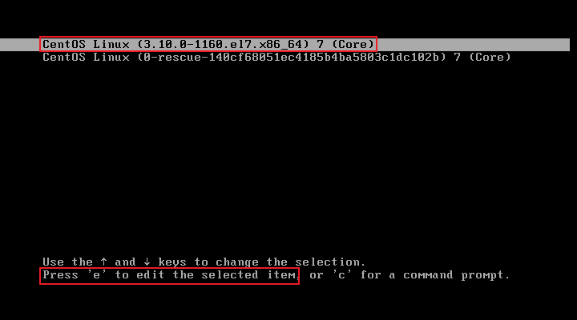
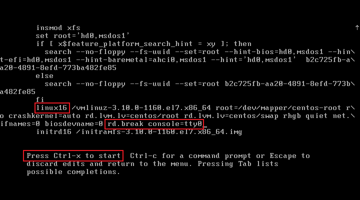
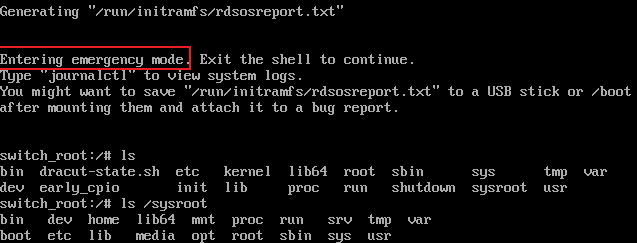

# SELinux与防火墙

## 一、SELinux

### 1.1 SELinux 概述

SELinux（Security-Enhanced Linux）是Linux内核的安全模块，是一套增强Linux系统安全的强制访问控制体系（MAC），集成在Linux内核（2.6及以上）中运行，RHEL 7基于SELinux体系针对用户、进程、目录、文件提供了预设的保护策略及管理工具。

SELinux具备三种运行模式：enforcing（强制）、permissive（宽松）、disabled（彻底禁用），SELinux临时切换运行模式时，只能在enforcing与permissive之间切换，只有通过配置文件才能将运行模式修改为disabled。permissive模式下，SELinux对大部分的操作会放开限制，但仍会记录执行的操作，只有非常危险的操作才会被permissive模式阻止。

### 1.2 三种运行模式

| 模式 | 说明 | 效果 |
| :--- | :--- | :--- |
| **Enforcing** | 强制执行 | 违反策略的行为被阻止并记录 |
| **Permissive** | 宽容模式 | 违反策略的行为只记录，不阻止 |
| **Disabled** | 禁用 | 完全关闭 SELinux |

### 1.3 切换模式

```bash
# 查看当前模式
getenforce
sestatus

# 临时切换（仅 Enforcing ↔ Permissive）
setenforce 0                # 切换到 Permissive
setenforce 1                # 切换到 Enforcing

# 永久修改
vim /etc/selinux/config
SELINUX=disabled            # enforcing | permissive | disabled
SELINUXTYPE=targeted        # targeted（推荐）| minimum | mls
```

SELinux使用`setenforce 1`修改为Enforcing/Permissive都是立即生效，但通过配置文件修改为disabled后必须重启系统生效。

### 1.4 SELinux上下文

安全上下文是SELinux的核心，可以将它视作附加在系统每个对象（文件、进程、端口等）上的一个“安全标签”，SELinux策略是通过比较进程和其要访问的客体（如文件）的“标签”，来决定访问是否被允许。

由此，我们可以进一步将安全上下文简单区分为“进程安全上下文”和“文件安全上下文”，只有两者安全上下文对应上了，进程才能访问文件。它们的对应关系由SELinux策略规则决定。文件安全上下文由文件创建的为止和创建文件的进程决定，而且系统有一套默认值，管理员可以修改默认值。

| 上下文分类 | 用户(User) | 角色(Role) | 类型(Type) | 级别(Level) |
| :-: | :-- | :-- | :-- | :-- |
| 进程安全上下文 | - 主要分2类。<br />- `system_u`是系统服务进程，受到管制。 <br />- `unconfined_u`是不管制进程，通常都是用户自己开启的，比如bash。 |  - 主要分2类。<br />- `system_r`是系统服务进程，受到管制。 <br />- `unconfined_r`是不管制进程，通常都是用户自己开启的，比如bash。 |  - 在`targeted`模式下唯一一个需要关注的字段。 <br />- 在`targeted`模式下，只有两者的类型对上了（不代表相同），进程才能访问文件。 | MLS安全级别。仅在MLS模式下才有意义。 |
| 文件安全上下文 | - 主要分2类。<br />- `system_u`是系统服务创建的文件。 <br />- `unconfined_u`是用户自己创建的文件。 | - 均为`object_r`，表示一个文件。 | - 在`targeted`模式下唯一一个需要关注的字段。 <br />- 在`targeted`模式下，只有两者的类型对上了（不代表相同），进程才能访问文件。 | MLS安全级别。仅在MLS模式下才有意义。 |

### 1.5 SELinux基本操作

#### 1.5.1 查看上下文

```bash
ls -Zd /usr/share/nginx/html/         # 查看文件或目录的安全上下文
system_u:object_r:httpd_sys_content_t:s0 /usr/share/nginx/html/

# 上下文格式
# system_u:object_r:httpd_sys_content_t:s0
# 用户:角色:类型:MLS范围

ps auxZ | grep nginx         # 查看进程的安全上下文
id -Z                        # 查看当前用户的上下文
```

常见的上下文类型

| 类型                | 解析         |
| :------------------ | ------------ |
| httpd_t             | HTTP服务进程 |
| httpd_sys_content_t | 网站文件     |
| var_t               | 变量数据目录 |
| tmp_t               | 临时目录     |

#### 1.5.2 修改上下文 — chcon / restorecon

不同的路径下有不同的安全上下文，在目录下新建文件时，文件会继承父目录的上下文。以nginx的网站家目录和root家目录为例，nginx的网站家目录天然就是为了对外提供服务而生，它的上下文类型采用`httpd_sys_content_t`；而root家目录，即便在操作系统内，默认也只有root账户能够访问，root家目录下的文件自然不会随意对外共享。

```bash
# 对比不同文件的上下文
touch test.html                  # 在root家目录下新建测试html文件
mv test.html  /usr/share/nginx/html/    # mv命令不会改变文件安全上下文
ls -lZ /usr/share/nginx/html/    # 对比测试各个文件的安全上下文
system_u:object_r:httpd_sys_content_t:s0        50x.html
system_u:object_r:httpd_sys_content_t:s0        index.html    # 由nginx服务的系统用户创建的文件
root root unconfined_u:object_r:admin_home_t:s0 test.html     # 在root家目录下新建的测试文件
curl http://192.168.0.243/test.html    # 访问测试文件，权限拒绝
```

chcon、semanage是2种比较常见的修改文件安全上下文的方式。chcon用于手动修改文件的上下文，这种方式一般会结合`--reference`选项使用；semanage用于修改默认的上下文，这种方式一般会结合restorecon命令使用，semanage在修改默认的上下文之后，通过restorecon刷新上下文使其生效。semanage是SELinux的策略管理工具，不只是单纯用于修改上下文。

```bash
# 手动修改文件上下文
chcon --reference=/usr/share/nginx/html/ /usr/share/nginx/html/test.html
    -u：修改上下文的用户字段
    -r：修改上下文的角色字段
    -t：修改上下文的类型字段
    -l：修改上下文的级别字段
    --reference：修改为与指定文件或目录相同的上下文
    -R：递归操作

# 修改目录默认值（/.autorelabel）
semanage fcontext --add --type httpd_sys_content_t "/usr/share/nginx/html(/.*)?"    # 为指定路径添加一条SELinux默认规则
semanage fcontext -l | grep httpd

# 恢复默认上下文
restorecon /usr/share/nginx/html/test.html    # 恢复默认上下文
restorecon -Rv /var/www/html/        # 递归恢复
```

修改测试文件上下文后重新访问测试文件成功。

> **chcon**
>
> 某些情况下，chcon也被称为“临时”修改文件上下文。SELinux有一套默认的规则，chcon能够手动修改文件的上下文，但SELinux策略不知道chcon的改动，所以在以下3种情况时，chcon的修改会按照SELinux策略对目录重制上下文标记。
>
> - 执行了`restorecon -R /path`命令
> - 系统重启触发全盘自动重新标记（touch /.autorelabel）
> - 重新挂载文件系统或软件包更新时触发重制
>
> 举个例子，在root家目录下新建的测试html文件，如果不使用mv移动到nginx的家目录下，而是直接执行chcon命令修改测试文件的上下文，chcon命令当然是可以立即生效的，但只要对root家目录执行`restorecon -R /path`，测试文件的上下文会按照SELinux默认策略重制。

### 1.6 SELinux 布尔值

SELinux布尔值（Boolean）和安全上下文（Context）是两种作用层面完全不同的机制。安全上下文是「身份标签」，它附加在进程（作为域）和文件等客体上，是SELinux进行访问控制的基础，类型（Type）是上下文的核心，决定了“谁”（进程域）能访问“什么”（文件类型）；布尔值是「策略微调开关」，它不改变任何对象的身份标签，而是在策略层面，决定基于这些标签的访问规则是否启用。

例如，一个Apache进程（域`httpd_t`）试图访问一个网页文件（类型`httpd_sys_content_t`），此时能否进程能否访问文件由Context决定；如果需要让Apache能够连接到网络，就需要打开`httpd_can_network_connect`布尔值。此时，布尔值开启的是一条全新的、允许`httpd_t`域进行网络通信的策略规则，而不会去修改`httpd_t`或任何文件的上下文标签。

```bash
# 查看所有布尔值
getsebool -a

# 查看httpd相关布尔值
getsebool -a | grep httpd

# 临时开启
setsebool httpd_can_network_connect on
# -P：永久生效

# 查看特定布尔值
semanage boolean -l | grep httpd_can_network
```

### 1.7 开放非默认端口

在SELinux的强制访问控制下，nginx进程（httpd_t）默认只被允许监听被标记为http_port_t类型的端口，当nginx需要监听一些非默认端口时，除了防火墙需要放行，还需要为该端口添加SELinux标签，否则在启动nginx服务时就会被SELinux权限拒绝。

```bash
vim /etc/nginx/conf.d/default.conf    # 修改nginx的配置文件
listen       8808;
nginx -t                              # 检查nginx配置文件语法无误
systemctl restart nginx               # 重启nginx服务权限拒绝

semanage port -l | grep http          # 查看http_port_t的默认端口
semanage port --add --type http_port_t --proto tcp 8808    # 为非默认端口添加SELinux标签
systemctl restart nginx               # 重启nginx服务成功
```

### 1.8 常见 SELinux 问题处理

```bash
# 网站无法访问 → 设置正确上下文
chcon -R -t httpd_sys_content_t /var/www/html/
restorecon -Rv /var/www/html/

# 服务无法访问网络 → 开启网络连接权限
setsebool -P httpd_can_network_connect 1
setsebool -P nfs_export_all_ro 1

# 端口被拒绝 → 添加端口上下文
semanage port -a -t http_port_t -p tcp 8080
semanage port -l | grep httpd

# 查看审计日志
tail /var/log/audit/audit.log | grep denied
sealert -a /var/log/audit/audit.log   # 分析日志（需安装 setroubleshoot）
```

---

## 二、防火墙

防火墙一般被用于数据隔离与策略管理，它可以严格过滤出、入站的所有流量，一般情况下主要是限制入站流量。防火墙又分为硬件防火墙和软件防火墙，两者在逻辑拓扑上应用的位置不相同，作用范围也不同，硬件防火墙一般用于整体网络的出口，或某个功能区域的出口，它被用于保护网络内的所有机器；软件防火墙一般用于某一台具体的主机上，它只会保护安装了软件的机器。

CentOS 7系统中集成了多款防火墙管理工具，默认启用firewalld动态防火墙管理器，firewalld支持CLI、GUI两种管理方式。在CentOS 8版本中又推出了nft工具用于替代firewalld，实际上在常见的软件中，早期的iptables仍然是最频繁使用的防火墙管理工具。

### 2.1 Firewalld

在CentOS 7发行版上，Firewalld服务的软件包默认就会被安装，且Firewalld服务的守护进程默认就是开机自启动，它用到的守护进程名称是firewalld，`firewall-cmd`、`firewall-config`都是Firewalld服务的管理工具，其中`firewall-config`是Firewalld的图形化管理工具，仅作了解即可。

Firewalld防火墙策略管理是CentOS系统中保障网络安全的关键机制，通过区域（Zone）划分不同信任级别的网络环境，并动态管理流量规则，Firewalld预设了多种安全区域，管理员可根据网络场景应用策略：

- public：默认仅允许SSH、DHCPv6等基础服务，严格限制入站流量。public是CentOS 7使用的默认区域，默认情况下系统中的所有网卡都处于此区域下
- trusted：允许所有流量（高危，仅限内网测试）
- home/work：放行Samba、mDNS等办公服务
- block/drop：拒绝/静默丢弃入站请求（生产环境常用drop节省资源）
- dmz/external：面向隔离区域或公网，仅放行指定服务

Fiewalld的规则生效模式分两种：Runtime（运行时）和Permanent（永久），运行时的规则立即生效，但也是临时生效，重新加载防火墙策略或重启系统后规则失效；永久规则需要添加`--permanent`选项，并且需要手动使其立即生效，否则只能等待系统重启后生效。

> **Firewalld判断规则**
>
> 1. 查看客户端请求中的**源IP**，匹配自身firewalld所有zone的规则，如果某个zone内存在匹配源IP的规则，则数据进入该zone
> 2. 所有zone都没有匹配源IP的规则时，进入默认zone（即public）
> 2. 根据默认zone种的规则决定如何处理该请求
>
> **源IP规则必须由管理员手动写入**，默认情况下所有zone都没有源IP规则，并且**防火墙的第一原则并不是优先匹配默认zone**，而是匹配源IP规则。一个源IP规则只能写入一个zone，同一个源IP的规则不能写入多个zone，Firewalld会报错。

#### 2.2.1 区域（Zone）

firewalld加入了区域zone的概念。简单描述就是firewalld预先准备了几套防火墙策略模板，管理员可以根据不同的场景选择不同的策略模板，从而实现防火墙策略之间的快速切换。

注：**一个网卡仅能绑定一个区域、一个区域可以绑定多个网卡**

```shell
# 1.禁用iptables防火墙服务
systemctl mask iptables           # 屏蔽iptables服务
systemctl mask ip6tables

# 2.启用firewalld服务
systemctl enable --now firewalld

# 3.查看区域
firewall-cmd --get-default-zone    # 获取当前默认区域
firewall-cmd --get-zones           # 获取所有区域信息
firewall-cmd --get-active-zones    # 获取活动区域


# 4.查看当前默认区域配置的所有规则
firewall-cmd --list-all --zone=public

# 5.拒绝所有主机ssh连接m01节点，仅允许宿主机访问
firewall-cmd --add-source=192.168.0.0/24 --zone=trusted
firewall-cmd --remove-service=ssh --zone=public

# 6.输出所有活动域
firewall-cmd --get-active-zone
```

上例并无实际意义，因为在这个示例中，trusted区域的默认规则就是放行所有请求，所以限制来源IP并无意义。但是这个配置仍然产生了作用，默认活动区域只有public，**根据来源地址在其它区域设置一个规则（此处表现是为trusted区域设置了一个add-source来源地址），即可实现同时使用多区域规则**，来源IP是192.168.0.0/24时匹配trusted区域规则，除此以外都匹配public区域规则。

#### 2.2.2 常用选项

| 参数                              | 作用                                                  |
| --------------------------------- | ----------------------------------------------------- |
| **zone区域相关指令**              |                                                       |
| --get-default-zone                | 查询默认区域                                          |
| --set-default-zone=<区域名称>     | 设置默认区域                                          |
| --get-active-zones                | 展示当前正在使用的区域与对应网卡                      |
| --get-zones                       | 展示所有区域                                          |
| --new-zone=<zone>                 | 新增区域                                              |
| **services服务相关指令**          |                                                       |
| --get-services                    | 展示默认定义的服务                                    |
| --add-service=<服务名>[,<服务名>] | 设置默认区域允许该服务的流量                          |
| --remove-service=<服务名>         | 设置默认区域不再允许该服务的流量                      |
| **Port端口相关指令**              |                                                       |
| --add-port=<端口号/协议>          | 设置默认区域允许该端口的流量                          |
| --remove-port=<端口号/协议>       | 设置默认区域不再允许该端口的流量                      |
| **Interface网卡相关指令**         |                                                       |
| --add-interface=<网卡名称>        | 将源自该网卡的所有流量都导向某个指定区域              |
| --change-interface=<网卡名称>     | 将该网卡与区域关联                                    |
| **其他指令**                      |                                                       |
| --list-all                        | 展示当前区域的详细信息                                |
| --reload                          | 使"--permanent"的配置规则立即生效，并覆盖当前配置规则 |

```bash
# 查看规则
firewall-cmd --list-all           # 查看默认区域的所有规则
firewall-cmd --list-ports         # 查看默认区域开放的端口
firewall-cmd --list-services      # 查看默认区域开放的服务
firewall-cmd --list-interfaces    # 查看默认区域开放的接口

# 批量开放端口
firewall-cmd --permanent --add-port=8000-9000/tcp
```

#### 2.2.3 自定义服务管理

```bash
# 1.查询firewalld包相关信息，可以查到默认的区域、服务的xml文件路径
rpm -ql firewalld

# 2.创建xml配置文件，配置文件本身的名字就是防火墙需要放行的服务名称
cp /usr/lib/firewalld/services/{http.xml,hebor.xml}
vim /usr/lib/firewalld/services/hebor.xml
<?xml version="1.0" encoding="utf-8"?>
<?xml version="1.0" encoding="utf-8"?>
<service>
  <short>Hebor</short>
  <description>This is test services</description>
  <port protocol="tcp" port="10086"/>   # 需调整协议与端口
</service>

# 3.使用规则
firewall-cmd --add-service=hebor --permanent
firewall-cmd --reload
```

#### 2.2.4 富规则（Rich Rule）

firewalld富规则表示更细致、更详细的防火墙策略配置，它能够针对系统服务、端口、源IP和目标IP等诸多信息进行更有针对性的策略配置，优先级在所有防火墙策略中也是最高的。

```bash
man firewalld.richlanguage
    rule    # rule本身也是一个选项
        [source]
        [destination]
        service|port|protocol|icmp-block|icmp-type|masquerade|forward-port|source-port
        [log|nflog]
        [audit]
        [accept|reject|drop|mark]

rule [family="ipv4|ipv6"]
source [not] address="address[/mask]"|mac="mac-address"|ipset="ipset"
destination [not] address="address[/mask]"|ipset="ipset"
service name="service name"
port port="port value" protocol="tcp|udp"
protocol value="protocol value"
forward-port port="port value" protocol="tcp|udp" to-port="port value" to-addr="address"
log [prefix="prefix text"] [level="log level"] [limit value="rate/duration"]
accept | reject [type="reject type"] | drop     # 代表匹配规则后会执行的动作
```

其中service、port、protocol、forward-port四个选项在一条富规则中，任选一条也可以成为一条富规则。reject与drop的区别在于：reject会比drop多返回一个ICMP错误信息包，drop收到匹配规则的请求后直接丢弃，且不会给用户返回任何信息。

```bash
# 1.允许10.0.0.254能访问http服务，允许172.16.1.0/24能够访问10050端口
firewall-cmd --add-rich-rule='rule family=ipv4 source address="10.0.0.254" service name="http" accept'
firewall-cmd --add-rich-rule='rule family=ipv4 source address="172.16.1.0/24" port port="10050" protocol="tcp" accept'

# 2.默认public区域对外开放所有人能够通过ssh服务连接，但拒绝172.16.1.0/24网段通过ssh连接服务器
firewall-cmd --add-rich-rule='rule family=ipv4 source address="172.16.1.0/24" service name="ssh" drop'

# 3.允许所有人能够访问http、https服务，但只有10.0.0.254主机可以访问ssh服务
firewall-cmd --add-service={http,https}   # 开放所有人可访问规则
firewall-cmd --add-rich-rule='rule family="ipv4" source address="10.0.0.254" service name="ssh" accept'   # 单独放行宿主机
firewall-cmd --remove-service=ssh     # 关闭所有人访问的权限

# 4.用户源IP是10.0.0.254的用户请求5555端口转发到后端web01节点的22端口
firewall-cmd --add-rich-rule='rule family="ipv4" source address="10.0.0.254" forward-port port="5555" protocol="tcp" to-port="22" to-addr="172.16.1.7"'
firewall-cmd --add-masquerade

# 5.查看所有富规则
firewall-cmd --list-rich-rules
```

> **firewalld配置文件**
>
> 所有通过--permanent参数永久保存的firewalld防火墙策略都会写到相应的区域配置文件中，以public区域为例，/etc/firewalld/zones/public.xml保存有public区域中所有的永久配置，该文件可直接编辑并备份

#### 2.2.5 NAT与端口转发

NAT针对内部主机访问互联网的场景、端口映射针对互联网访问内部主机的场景，两种场景都是基于防火墙的流量转发规则实现。

**端口映射，实现外网访问内网主机**

```shell
firewall-cmd --add-forward-port=port=8080:proto=tcp:toport=80:toaddr=172.16.1.7 --permanent   # 添加端口映射规则
firewall-cmd --add-masquerade --permanent     # 开启IP地址伪装
firewall-cmd --reload 
```

firewalld节点收到客户端的2222端口的ssh请求后，将ssh请求转发到内部节点，这个过程是没有问题的，但网络通信都是双向的，客户端通过`192.168.0.0/24`地址段访问内部节点，内部节点也应该向`192.168.0.0/24`地址段返回响应信息，但内部节点并没有去往`192.168.0.0/24`地址段的主机的路由，所以客户端的请求到达内部节点后默认会被丢弃，这也就造成了客户端无法正常ssh链接内部节点。

为了防止以上情况的出现，在firewalld上应该启用IP地址伪装（masquerade），firewalld接收到客户端的请求后，将源IP修改为自身的内网地址段再去请求内部节点，内部节点接收到请求后会将响应报文发送给firewalld，再由firewalld将响应报文转发给客户端，实现客户端与内部节点之间的通信；这个过程也可以通过在内部节点上指定一条路由，所有去往`192.168.0.0/24`地址段都指向firewalld节点.

**NAT**

```bash
firewall-cmd --add-masquerade --permanent    # 防火墙开启IP地址伪装，实现地址转换
firewall-cmd --reload
firewall-cmd --query-masquerade              # 查看NAT状态
firewall-cmd --remove-masquerade             # 移除NAT伪装

# firewalld节点启用IP地址伪装后，内网节点将网关地址指向firewalld、手动配置DNS即可
```

### 2.2 iptables

iptables基础
============

概述：ip包过滤系统，实际由netfilter和iptables组成 <br />
netfilter/iptables关系：
- netfilter是内核的一部分，由包过滤表组成，这些表包含内核用来控制包过滤处理的规则集
- iptables是用户空间的一种工具，简化插入、修改、删除包过滤表中的规则

```diff
iptables内置三表filter,nat,mangle五链postrouting,prerouting,input,output,forward，所有规则配置后立即生效
```

### 三表
- filter：负责过滤数据包，包扩input,output,forward三个规则链
- nat：负责网络地址转换，包括prerouting,postrouting,output三个规则链
- mangle：负责修改数据包内容，用于流量整形，给数据包打标，默认包括五链

```diff
+ iptables中还有一个raw表，用于处理异常，包括prerouting,output两个规则链，使用较少
```


### 五链
- input：匹配目标IP是本机的数据
- forward：匹配流经本机的数据
- prerouting：修改DIP，用于外网访问内网，做DNAT。路由判断之前的nat，地址转换后再匹配路由表，此表通常自动配合postrouting使用
- postrouting：修改SIP，用于内网访问外网，做SNAT。路由判断之后的nat，只有先匹配到目的路由之后才会做地址转换，做了SNAT后数据包回来时会自动做DNAT
- output:出口数据包

补充：在私有主机普及的情况下解决ipv4上网的方案只有两种:nat 和 proxy <br />

示例：查看nat表
```shell
# iptables -t nat -L
	-t：指定要查看的表
	-L：表示list
```

iptables过滤封包流程
-------------------
```shell
  --> PREROUTING --> [ROUTE] --> FORWARD --> POSTROUTING -->
        mangle          |        mangle   ↑     mangle
         nat            |        filter   |       nat
                        ↓                 |
                      INPUT             OUTPUT
                        |mangle           ↑
                        |filter           |mangle
                        |                 | nat
                        ↓----> local ---->|filter
```
整体数据包分两类：
1. 发送给防火墙本身的数据包
	此类数据包将经过**除了forward链**以外的四个链，可以通过在不同的位置调整不同的表中的规则对数据包设置规则
2. 经过防火墙的包
	经过防火墙的包不会经过input和output两个链

```diff
- 既然一个链可以在多个表中生效，那么四个表必然有优先顺序：
- raw > mangle > nat > filter
```

#### 链间的匹配顺序(根据过滤封包流程看)
- 入站数据：prerouting、input
- 出站数据：output、postrouting
- 转发数据：prerouting、forward、postrouting

#### 链内的匹配顺序
- 自上向下按顺序匹配规则，匹配到相应规则即停止
- 链内无相匹配的规则时，按照该链的默认策略处理（未修改情况下，默认策略为允许）

#### iptables命令语法格式
iptables [-t 表名] 管理选项 [链名] [条件匹配] [-j 目标动作或跳转]
	注：iptables命令区分大小写
```diff
- 不指定表名时，默认为filter表
- 不指定链名时，默认为该表内所有链
- 除非设置规则链的缺省策略，否则需要指定匹配条件
```

iptables操作命令
===============
将iptables操作分为几个类别

#### 查看规则
示例：查看详细规则
```shell
# iptables -t filter -nL
	-v：显示详细信息，包括每条规则的匹配包数量、匹配字节数和网卡接口
	-n：只显示IP地址和端口号，不显示域名和服务名称
	-x：在-v的基础上，禁止单位自动换算(K、M)
# service iptables save		保存对iptables做的操作
```

#### 添加规则
示例：拒绝所有人以任何协议访问
```shell
# iptables -t filter -A INPUT -j DROP
```

#### 删除规则
示例：删除filter表INPUT链中的第7条规则
```shell
# iptables -t filter -D INPUT 7
```
注意：
```diff
- 1. 若规则列表中有多条相同的规则时，按内容匹配则只删除序号最小的一条
- 2. 按号码匹配删除时，确保规则号码小于已有规则数
- 3. 按内容匹配删除时，确保规则存在
```
示例：按内容删除规则
```shell
# iptables -t filter -D INPUT -s 192.168.0.1 -j DROP
```

#### 设置规则链默认策略
示例：设置filter表的INPUT链默认策略为拒绝
```shell
# iptables -t filter -P INPUT DROP
```

#### 清空规则
示例：清空指定链的规则
```shell
# iptables -t filter -F INPUT
```
注：
```diff
- 1. 如果已经将INPUT链的默认策略改为非ACCEPT，那清空规则的操作就要小心。
- 2. 不指定链时，清空所有链的规则
- 3. -F仅清空链中规则，不影响默认规则
```

#### 匹配条件
匹配条件分4种： 
* 流入、流出接口：-i、-o 
* 源、目的地址：-s、-d 
* 协议类型：-p 
* 源、目的端口：--sport、--dport 

按网络接口匹配： <br />
-i [匹配数据进入的网卡]	#此参数主要用于nat表，做DNAT <br />
-o [匹配数据流出的网卡] <br /><br />

按源、目的地址匹配： <br />
-s [匹配源地址]	#可以是IP、NET(网段)、DOMAIN，也可空，空表示任意地址 <br />
-o [匹配目的地址]	 <br /><br />

按协议类型匹配：<br />
-p [匹配协议类型]		#可以是TCP、UDP、ICMP等，也可空<br /><br />

按源、目的端口匹配：<br />
--sport [匹配源端口]		#可以是个别端口、可以是端口范围<br />
    --sport 1000:3000
--dport [匹配目的端口]<br />
注：--sport 和 --dport 必须配置 -p 使用<br />

#### 动作（处理方式）
几种处理方式：
* ACCEPT 	允许
* DROP	 	丢弃，不给对端任何回应
* REJECT 	拒绝，给对端回应
* SNAT	 
* DNAT		端口映射
* MASQUERADE 伪装IP地址
* REDIRECT	端口重定向
* MARK		打标签

6种处理方式示例：
```shell
# iptables -t filter -A INPUT -j ACCEPT
	允许所有数据访问本机

# iptables -t filter -A FORWARD -s 192.168.80.39 -j DROP
	阻止源地址为192.168.80.39的流量经过本机

# iptables -t nat -A POSTROUTING -s 192.168.0.0/24 -j SNAT --to 1.1.1.1
# iptables -t nat -A POSTROUTING -s 192.168.0.0/24 -j SNAT --to 1.1.1.1-1.1.1.10
	SNAT仅支持nat表的postrouting链，SNAT支持转换为单IP，也支持转换到IP地址池

# iptables -t nat -A PREROUTING -i eth0 -p tcp --dport 80 -j DNAT --to 192.168.0.1
# iptables -t nat -A PREROUTING -i eth0 -p tcp --dport 81 -j DNAT --to 192.168.0.1:81
	DNAT仅支持nat表的prerouting链，DNAT支持内、外网主机间端口映射

# iptables -t nat -A POSTROUTING -s 192.168.0.0/24 -o eth0 -j MASQUERADE 
	将源地址为192.168.0.0/24网段的流量进行地址伪装，转换成eth0上的IP地址
```

### iptables扩展模块
4个附加模块：
* 包状态匹配：state
* 源mac匹配：mac
* 包速率匹配：limit
* 多端口匹配：multiport

按包状态匹配<br />
-m state --state 状态<br />
状态：NEW、RELATED、ESTABLISHED、INVALID<br />
	NEW：有别于tcp的syn。刚开始建立连接
	ESTABLISHED：连接态。连接完成或已经建立过连接
	RELATED：衍生态，与conntrack关联（FTP）。tcp衍生链接
	INVALID：不能被识别属于哪个连接或没有任何状态
示例：
```shell
# iptables -t filter -A INPUT -m state --state RELATED,ESTABLISHED -j ACCEPT
	允许衍生态或已经建立过连接的流量通过
```

按源mac匹配<br />
-m mac --mac-source MAC<br />
示例：
```shell
# iptables -t filter -A FORWARD -m mac --mac-source 28:6e:d4:89:1b:c5 -j DROP
	报文经过路由后，数据包中原有的mac信息会被替换，所以在POSTROUTING后的iptables中使用mac模块是无意义的
```

按包速率匹配<br />
-m limit --limit 匹配速率 [--burst 缓冲数量]<br />
示例：
```shell
# iptables -A FORWARD -d 192.168.0.1 -m limit --limit 50/s -j ACCEPT
# iptables -A FORWARD -d 192.168.0.1 -j DROP
	按照包速率限速流量，仅允许每秒发送50个数据包，做到限制需要两条规则
```

多端口匹配<br />
-m multiport [--sports|--dports|--ports] 端口1[,端口n...]<br />
一次性匹配多个端口，可区分源端口，目的端口或不指定端口<br />
示例：
```shell
# iptables -A INPUT -p tcp -m multiport --dports 21,22,25,80,110 -j ACCEPT
	允许所有客户端访问本机多个端口，必须与-p参数一起使用
```

### 综合示例
1. iptables防护web服务
	分析：
	1. 环回口lo处理
	2. 协议+端口处理
	3. 状态检测处理
```shell
# iptables -t filter -A INPUT -i lo -j ACCEPT
	允许换回口访问
# iptables -t filter -A INPUT -p tcp -m multiport --dport 22,80 -j ACCEPT
	放行ssh服务和http服务
# iptables -t filter -A INPUT -m state --state RELATED,ESTABLISHED -j ACCEPT
	允许 通过ssh服务或http服务衍生出的连接 和 已经建立过连接的流量 通过。状态防火墙能识别tcp或udp会话，非状态防火墙只能根据端口识别，不能识别会话
# iptables -t filter -P INPUT DROP
	更改默认策略为丢弃，拒绝所有。更改默认策略必须要添加按包状态匹配的规则，否则可能出现流量出去回不来的情况
```
注：一般iptables的OUTPUT出口都放行，允许本机主动访问外网 <br /><br />

测试：
```shell
$ ping 10.250.1.11		#ping测试无回包
$ ssh root@10.250.1.11	#ssh测试连接正常

$ nmap 10.250.1.11		#使用nmap扫描一下目标开放的端口
	PORT   STATE  SERVICE
	22/tcp open   ssh
	80/tcp closed http

$ telnet 10.250.1.11 80	#服务端打开http服务后，客户端使用telnet测试正常
Trying 10.250.1.11...
Connected to 10.250.1.11.
Escape character is '^]'.

# iptables -nL			#查看防火墙条目
```

2. iptables路由SNAT使内网PC上网
分析：网络拓扑
```shell
private <---------------> iptables <---------------> public
  pc      10.250.2.0/24    router    10.250.1.0/24   network
```
配置：为iptables主机添加两块网卡，一个放在内网，一个放在公网。启用内核路由转发功能
```shell
# echo "1" > /proc/sys/net/ipv4/ip_forward		#临时开启路由转发
# echo "net.ipv4.ip_forward = 1" >> /etc/sysctl.conf 	#永久开启路由转发
# sysctl -p 	#重新加载sysctl.conf文件

# iptables -t nat -A POSTROUTING -s 10.250.2.0/24 -j SNAT --to 10.250.1.11
	配置SNAT，将所有内网数据转到10.250.1.11这个IP上
```
注：以上操作都是在iptables主机上配置的，对于内网内的主机，需要更改一下IP和网关，将网关地址设置为iptables主机的内网网卡IP <br />
测试：使用内网主机ping百度正常

3. 拒绝访问服务器本身/拒绝通过服务器访问别的机器(网络拓扑还是采用示例2的)
分析：
	1. iptables每个链的作用
	2. filter表的过滤位置在哪个链
	3. 匹配条件和处理动作
示例：拒绝访问
```shell
# iptables -t filter -A INPUT -s 10.250.2.11 -j DROP
	拒绝内网主机访问iptables主机，此时SNAT规则没有删除，所以依然可以访问外网
# iptables -F

# iptables -A FORWARD -s 10.250.2.11 -j DROP
	拒绝内网主机的流量通过iptables主机，数据转发过程中，FORWARD链在POSTROUTING链前面，所以内网主机断网
```
示例：在不同的链上做操作达到相同的目的
```shell
# iptables -A INPUT -s 10.250.2.11 -j DROP
# iptables -A OUTPUT -d 10.250.2.11 -j DROP
	此两条规则的目的都是为了拒绝内网地址的访问
```
注：添加规则时需要尽量在最靠近数据流源的链上，减少设备不必要的资源开销

4. iptables路由DNAT将内网设备端口映射到外网
分析：网络拓扑采用示例2的
	1. 因为做了SNAT，所以内网主机能够访问外网
	2. 本身内网主机无法被外网设备访问
	3. 内网主机要监听映射出去的端口
示例：配置DNAT将内网主机的端口映射出去
```shell
# iptables -t nat -A PREROUTING -i eth0 -p tcp --dport 9000 -j DNAT --to 10.250.2.11:22
	将iptables主机上的9000端口与内网主机的22号端口做映射

ssh -p 9000 root@10.250.1.11	ssh连接测试
```
示例：配置ADSL
```shell
# iptables -t nat -A PREROUTING -i ppp0 -p tcp --dport 81 -j DNAT --to 10.250.2.11:80
```

小结：
	所有链名和动作必须大写，表名和匹配则用小写

---

## 三、systemd服务管理

通常，管理员对Linux系统上的服务程序进行管理时，可以通过运行服务主程序的方式启动服务，或通过一些服务管理工具启用服务。两者区别在于，主程序启用服务的方式需要通过绝对路径实现，且不便于实现开机自启设置，服务管理工具的使用则更加简单。systemd作为CentOS 7的服务管理工具，也是作为CentOS 7开机启动的第一个进程，管理员的所有操作都仅与systemd交互即可实现。例如，通过systemd设置httpd服务开机自启，那么系统重启拉起systemd进程后，systemd进程会自动拉起httpd进程。

### 3.1 init程序

在Linux系统中，init程序不是指具体的某一个程序代码，它指的是Linux内核引导后加载的第一个初始化进程（PID=1），这个初始化进程负责掌控整个Linux系统的运行、服务资源组合，在CentOS 7版本中，init程序指的就是systemd服务

传统的init程序特征：

- system v：顺序加载，RHEL 5系列采用
- upstart：事件触发，RHEL 6系列采用
- systemd：开机服务并行启动，各系统服务间精确依赖

systemd是一个高效的系统&服务管理器，并行启动服务的特征使系统开机速度更快，并行启动并非systemd独有的特征，只不过早期硬件性能限制无法使用并行启动。

### 3.2 systemd

systemd服务的配置目录是`/etc/systemd/system/`、服务目录是`/lib/systemd/system/`、管理命令是`systemctl`，需要重点关注的是服务目录，配置目录中的大部分文件都指向服务目录的软链接，服务目录下不仅保存了systemd自身的配置文件，在CentOS 7系统上安装的任意一个服务程序，都会在`/lib/systemd/system/`目录下产生一个相应的配置文件。

例如，安装httpd服务后，在`/lib/systemd/system/`目录下会产生一个`httpd.service`配置文件，这个配置文件又被称之为服务启动配置文件，服务启动配置文件中会详细写明主程序的启动路径、停止服务的方式等信息。管理员通过systemd来管理服务进程时，本质上与直接运行服务的主程序没有太大差别，systemd同样需要知晓服务进程的主程序存放路径，它也需要通过服务的主程序才能启用服务，服务启动配置文件中就标注了这些信息。

systemd服务管理与手动服务管理冲突，两种方式不兼容，如果已经先手动运行过服务主程序了，需要先手动停止服务主程序后，才能通过systemd管理服务。

```bash
# 查看服务状态
systemctl status httpd
systemctl is-active httpd
systemctl is-enabled httpd

# 启动/停止/重启/重载
systemctl start httpd
systemctl stop httpd
systemctl restart httpd
systemctl reload httpd

# 开机启动
systemctl enable httpd
systemctl disable httpd
systemctl enable --now httpd
```

**Centos6管理服务**

```bash
/etc/init.d/iptables stop    # 停止iptables服务
chkconfig iptables off       # 设置iptables服务开机自启
chkconfig iptables           # 查看iptables服务是否已停止开机自启
chkconfig --list             # 查看所有开机自启的服务
```

### 3.3 运行级别

**Centos 6的7种运行级别**

Centos 6可以通过修改`/etc/inittab`文件永久修改运行级别。

```shell
0	关机（init 0）
1	单用户模式（重置用户密码信息root，修复系统）    救援模式也可以解决root密码问题
2	多用户模式（无网络服务）    NFS网络存储服务无法使用
3	多用户模式（命令行模式）    有网络服务
4	未使用
5	图形化界面模式
6	重启
```

**Centos 7的运行模式**

在CentOS 7版本已经没有运行级别的概念了，将运行级别改为target，称之为运行模式，但实际上就是对CentOS 6的运行级别进行了简化，CentOS 7版本的运行模式主要重心放在CentOS 6上两个最常用的级别上，即字符模式（multi-user.target）与图形模式（graphical.target），在CentOS 7版本中仍能够通过`init`命令可直接实现字符界面与图形界面之间的切换。

```bash
systemctl isolate multi-user.target    # 当前切换到字符模式，等同于init 3
systemctl isolate graphical.target     # 当前切换到图形模式，等同于init 5
systemctl get-default                  # 获取每次开机默认的运行模式
systemctl set-default multi-user.target    # 设置永久策略，每次开机进入字符模式
```

`/usr/lib/systemd/system/`此目录下`runlevel*.target`所指向的源文件就是CentOS 7的7种运行级别名称

```shell
ls -l /usr/lib/systemd/system/runlevel*.target
lrwxrwxrwx 1 root root 15 Jan  8  2021 /usr/lib/systemd/system/runlevel0.target -> poweroff.target
lrwxrwxrwx 1 root root 13 Jan  8  2021 /usr/lib/systemd/system/runlevel1.target -> rescue.target
lrwxrwxrwx 1 root root 17 Jan  8  2021 /usr/lib/systemd/system/runlevel2.target -> multi-user.target
lrwxrwxrwx 1 root root 17 Jan  8  2021 /usr/lib/systemd/system/runlevel3.target -> multi-user.target
lrwxrwxrwx 1 root root 17 Jan  8  2021 /usr/lib/systemd/system/runlevel4.target -> multi-user.target
lrwxrwxrwx 1 root root 16 Jan  8  2021 /usr/lib/systemd/system/runlevel5.target -> graphical.target
lrwxrwxrwx 1 root root 13 Jan  8  2021 /usr/lib/systemd/system/runlevel6.target -> reboot.target
```

### 3.4 破解root密码

破解root密码是一种操作技巧，不需要对操作过程有什么理解，记忆即可。破解root密码的前提必须是服务器的管理员，它需要服务器直连显示器的情况下重启服务器。

1. 重启系统，选择系统内核后按e键，进入救援模式

    

2. 按↓箭头拉到最底下，找到linux16开头的行，在此行末尾添加两个参数`rd.break console=tty0`，按`Ctrl+x`启动系统。`Home`、`End`键可以一行的行头和行尾快速切换

    

3. 救援模式

    

   救援模式本身是Linux内核加载到内存中的一个微型的操作系统，救援模式下本身会具备一些数据专门用于救援系统。在救援模式下，它会将磁盘中的所有数据存放在`/sysroot/`目录下，这其中也包括操作系统的数据，因此出于安全性考虑，`sysroot`目录在救援模式下默认使用只读挂载。当管理员进入救援模式时，大多数场景下就意味着操作系统本身已经出现异常，因此需要通过救援模式对系统数据，即修改`/sysroot/`目录下的数据。

4. 破解root密码

   ```bash
   # 以读写方式重新挂载/sysroot/目录
   mount -o remount,rw /sysroot/
   
   # 切换到硬盘操作系统的环境
   chroot /sysroot/
   
   # 修改root账户密码
   echo "Admin@huawei.com" | passwd --stdin root
   
   # 当操作系统的SELinux是enforcing模式时，需要重置SELinux策略。如果SELinux不是enforcing模式，则不需要此操作
   cat /etc/selinux/config    # 在救援模式下查看SELinux的运行状态必须查看配置文件，getenforce的输出结果不可靠
   touch /.autorelabel
   
   # 重启系统完成操作
   reboot -f
   ```

   关于SELinux对破解root密码操作的影响，有2种处理方式：
   
   1. 直接修改`/etc/selinux/config`配置文件，将SELinux模式修改为disabled或permissive。
   2. 在SELinux模式是enforcing的情况下，创建/.autorelabel文件。该文件名可通过man selinux帮助手册辅助记忆。
   
   **2种处理方式只能选其一，不能两者同时执行。**
