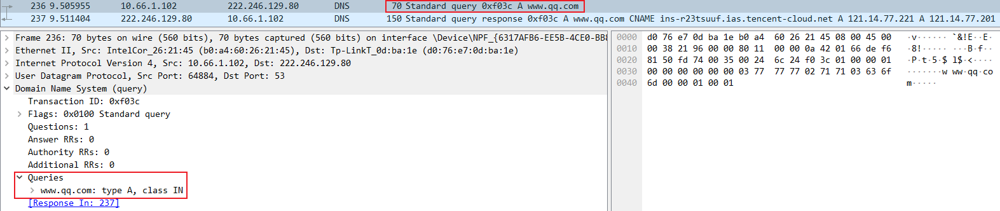
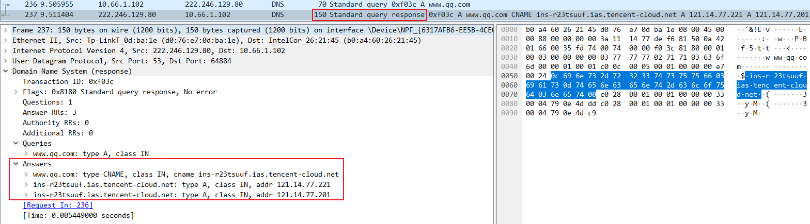
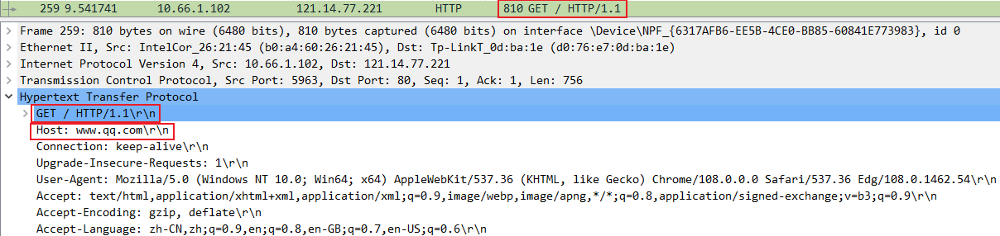
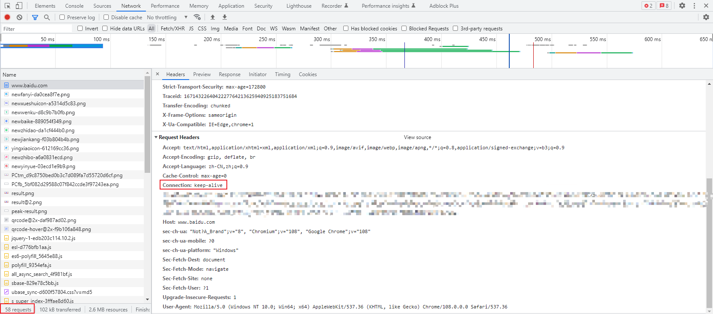

# Web 服务


## 一、基本概念

Web服务是一种基于互联网的标准化技术，允许不同平台、不同语言的应用程序通过网络协议相互通信和数据交换，是基于B/S架构的网页服务。生活中最常见的示例，使用浏览器访问百度的网站时，百度提供的就是一个Web服务。最常见的用于提供Web服务的软件包括httpd、Nginx、Tomcat等Web应用程序，HTTP（超文本传输协议）是Web服务最常用的底层传输协议。

互联网上会描述Linux是专门提供服务的操作系统，但实际提供服务的并不是Linux系统本身，而是运行在Linux系统上的各种应用程序，Linux只是一个出于通用目的而设计的资源管理平台。需要注意的是，httpd是Web应用程序，而HTTP是网络传输协议，两者名称相似，但完全不是同一个概念。

> **Web 服务**
>
> 本章节主要在于了解基础的Web 服务，所以只会对httpd服务做着重描述，Nginx、Tomcat会在后续的章节中写

## 二、HTTP 基础

### 1.1 http协议介绍

超文本传输协议（HTTP）是一个用于传输超媒体文档（例如 HTML）的应用层协议。HTTP遵循经典的C/S模型，客户端打开一个连接以发出请求，然后等待直到收到服务端端响应。HTTP是无状态协议，这意味着服务端不会在两个请求之间保留任何数据（状态）。尽管通常基于TCP/IP层，但它可以在任何可靠的传输层上使用，也就是说，该协议不会像UDP那样静默的丢失消息。

1. 超文本

   包含有超链接（Link）和各种多媒体元素标记（Markup）的文本，这些超文本之间彼此链接，形成Web，因此又被称为网页（Web Page），这些链接用URL表示。HTML是最常见的超文本标记语言。

2. URL

   HTTP 请求的内容通称为"资源"。"资源"这一概念非常宽泛，它可以是一份文档，一张图片，或所有其他你能够想到的格式。每个资源都由一个URI来进行标识。一般情况下，资源的名称和位置由同一个URL（统一资源定位符，它是 URI 的一种）来标识，URL由协议、主机、端口（默认为80）和文件路径四部分组成。

### 1.2 URL的语法（URL）

Uniform Resource Locator，统一资源定位符：

- **方案或协议**

  `http://`<span>w</span>ww.example.com:80/path/index.html?key1=value1&key2=value2#Document

  `http://`告诉浏览器使用何种协议。对于大部分Web资源，通常使用HTTP协议或其安全版本，HTTPS协议。另外，浏览器也知道如何处理其他协议。例如，mailto：协议指示浏览器打开邮件客户端；ftp：协议指示浏览器处理文件传输。

- **主机**

  http://`www.example.com`:80/path/index.html?key1=value1&key2=value2#Document

  `www.example.com`既是一个域名，也代表管理该域名的机构。它指示了需要向网络上的哪一台主机发起请求。当然，也可以直接向主机的IP address地址发起请求。

- **端口**

  http://<span>w</span>ww.example.com`:80`/path/index.html?key1=value1&key2=value2#Document

  `:80`是端口。它表示用于访问Web服务端上资源的技术“门”。如果访问的该Web服务端使用HTTP协议的标准端口（HTTP为80，HTTPS为443），则通常省略端口号。

- **路径**

  http://<span>w</span>ww.example.com:80`/path/index.html`?key1=value1&key2=value2#Document

  `path/index.html`是Web服务端上资源的路径。如果没有指定访问路径，那将会直接访问WEB服务端的根，此时服务端反馈到客户端的文件就是管理员指定的默认网页文件。

- **查询**

  http://<span>w</span>ww.example.com:80/path/index.html`?key1=value1&key2=value2`#Document

  `?key1=value1&key2=value2`是提供给Web服务端的额外参数。这些参数是用&符号分隔的键/值对列表。Web服务端可以在将资源返回给用户之前使用这些参数来执行额外的操作。每个Web服务端都有自己的参数规则，想知道特定Web服务端如何处理参数的唯一可靠方法是询问该Web服务端所有者。

- **片段**

  http://<span>w</span>ww.example.com:80/path/index.html?key1=value1&key2=value2`#Document`

  `#Document`是资源本身的某一部分的一个锚点。锚点代表资源内的一种“书签”，它给予浏览器显示位于该“加书签”点的内容的指示。例如，在HTML文档上，浏览器将滚动到定义锚点的那个点上；在视频或音频文档上，浏览器将转到锚点代表的那个时间。值得注意的是#号后面的部分，也称为片段标识符，永远不会与请求一起发送到服务端。

### 1.3 http工作原理

1. 用户输入域名 -> 浏览器跳转 -> 浏览器缓存 -> Hosts文件 -> DNS解析（递归查询|迭代查询）

   ```bash
   客户端向服务端发起查询->递归查询
   服务端向服务端发起查询->迭代查询
   ```

2. 浏览器向服务端发起TCP连接（三次握手）

   ```bash
   客户端 --> 请求包连接 syn=1 seq=x --> 服务端
   客户端 <-- 响应客户端 syn=1 ack=x+1 seq=y <-- 服务端
   客户端 --> 建立连接 ack=y+1 seq=x+1 --> 服务端
   ```

3. 客户端发起http请求

   ```bash
   1. 请求的方法：GET获取
   2. 请求的Host主机：www.baidu.com
   3. 请求的资源：/index.html
   4. 请求的端口：默认http是80、https是443
   5. 请求携带的参数：属性（请求的类型、压缩、认证、浏览器信息等）
   6. 请求最后的空行	
   ```

4. 服务端响应的内容

   ```bash
   1. 服务端使用的WEB服务软件版本
   2. 服务端响应请求文件的类型
   3. 服务端响应请求的文件是否进行压缩
   4. 服务端响应请求的主机是否进行长连接
   ```

5. 客户端向服务端发起TCP断开（四次挥手）

   ```bash
   客户端 -->断开请求 fin=1 seq=x          --> 服务端
   客户端 <--响应断开 fin=1 ack=x+1 seq=y  <-- 服务端
   客户端 <--断开连接 fin=1 ack=x+1 seq=z  <-- 服务端
   客户端 -->确认断开 fin=1 ack=z+1 seq=sj --> 服务端
   ```

### 1.4 访问网站分析

1. 浏览器分析超链接中的URL

2. DNS请求

   PC向DNS服务端发出DNS QUERY请求`www.qq.com`的A记录，DNS的A记录表示将域名绑定到IP

   

3. DNS回复

   DNS服务端回复DNS response，解析出`www.qq.com`域名对应的2条A记录

   

4. TCP三次握手

   PC获取到`www.qq.com`的IP地址后，向该IP发起TCP三次握手

   

5. HTTP GET请求

   在TCP三次握手的连接上，PC向`www.qq.com`服务端发起GET请求主页

   

6. 服务端响应

   `www.qq.com`服务端回应浏览器HTTP/1.1 200 OK，返回主页数据包

7. TCP四次挥手

   完成数据交互过程，TCP四次挥手断开连接

### 1.5 长连接与短连接

短连接：HTTP 1.0，一次TCP连接只能发起一次http请求。

长连接：HTTP 1.1，在一次TCP连接中，可以发起多次http请求。



打开百度的首页可以看到浏览器请求了58个资源，如果以短连接的方式发起58个requests，那需要发起58次TCP连接，而长连接仅需要在一次TCP连接里，发起58次http请求即可。

HTTP 1.1 一次请求对应一次响应，HTTP 2.0 从串行请求变成了并行请求，批量执行请求与响应。

### 1.6 http请求头示例

```bash
GET / HTTP/1.1
Host: www.baidu.com
User-Agent: Mozilla/5.0 (Windows NT 10.0; Win64; x64; rv:140.0) Gecko/20100101 Firefox/140.0
Accept: text/html,application/xhtml+xml,application/xml;q=0.9,*/*;q=0.8
Referer: https://mdsec.net/auth/488/Home.ashx
Accept-Language: zh-CN,zh;q=0.8,zh-TW;q=0.7,zh-HK;q=0.5,en-US;q=0.3,en;q=0.2
Accept-Encoding: gzip, deflate, br, zstd
Connection: keep-alive
Cookie: BAIDUID=56727D61545CCDB7BED1F2D2B31B6A4B:FG=1; BIDUPSID=56727D61545CCDB7790E200FC30...
Upgrade-Insecure-Requests: 1
Sec-Fetch-Dest: document
Sec-Fetch-Mode: navigate
Sec-Fetch-Site: none
Sec-Fetch-User: ?1
```

- GET：http的请求方法，用于从Web服务端获取一个URL资源。GET、POST是最常见的两种http方法，互联网上常用的http版本为1.1和2。
- Referer：用于标识发起请求的原始URL。例如，用户从百度首页点击贴吧，会从百度首页跳转到百度贴吧的站点，此时Referer字段的值理论上就应该是百度首页的URL。
- Host：访问的目标主机域名。
- Accept：声明客户端浏览器支持的MIME类型。不同MIME类型直接通过`,`相隔，部分MIME类型尾部携带有q参数，例如`application/xml;q=0.9`，q参数表示权重（优先级），权重取值范围在0~1之间，默认为1（最高），表示100%的权重。从示例的http请求头中查看，客户端浏览器期望Web服务端最优先返回的是`text/html`类型的数据。
- Accept-Encoding：声明客户端浏览器支持的压缩方式。
- Accept-Language：声明客户端浏览器期望Web服务端响应的语言
- Upgrade-Insecure-Requests：声明客户端浏览器可以处理https请求。该参数让浏览器自动升级请求从http到https。
- User-Agent：用户代理用于标识http请求的软件类型、操作系统、版本等信息。
- Cookie：客户端状态管理，Cookie是由服务端生成并发送到浏览器的一小块文本数据，浏览器会将其存储在本地，并在后续请求中自动附加该Cookie发送给同一域名下的服务端。Cookie可以用于记录用户登陆状态、用户偏好等信息，其生命周期也可以手动设置，简单一点理解，Cookie就像是服务端为客户端颁发的一个临时的身份证明。
- X_FORWARDED_FOR：客户端使用代理或负载均衡的方式链接到服务端时，此参数用于显示客户端最原始的IP地址。
- Fetch Metadata规范：于2019年由W3C发起的草案，被用于增强Web安全性并辅助服务端识别请求上下文，目前支持度还没有特别高，部分旧版本浏览器可能并不支持这些参数。
  - Sec-Fetch-Dest：声明请求的目标资源类型，即客户端期望获得何种类型的资源。document表示HTML页面。
  - Sec-Fetch-Mode：定义请求的网络模式，描述跨域策略。navigate表示页面导航、页面切换请求，并且给客户端的回复也应该是一个HTML的页面，navigate请求仅在浏览器切换页面时创建。
  - Sec-Fetch-Site：标识请求来源与目标域名之间的关系，简单理解就是当前页面与上一页面之间的关系。例如，由用户直接触发打开浏览器后在地址栏手动输入`www.baidu.com`，此时，与上一页面没有任何关联，Sec-Fetch-site的属性值是none（用户直接触发，地址栏输入、书签跳转）。
  - Sec-Fetch-User：标记导航请求是否由用户主动触发。此参数只有两个属性值，为?1时表示True，由用户主动触发，例如鼠标单击或键盘操作，值为?0是表示False，由浏览器自动跳转。

### 1.7 http响应头示例


```bash
HTTP/1.1 200 OK
Bdpagetype: 1
Bdqid: 0xbc17941700431e44
Connection: keep-alive
Referer Policy: strict-origin-when-cross-origin
Content-Encoding: gzip
Content-Type: text/html; charset=utf-8
Date: Sat, 19 Jul 2025 13:23:32 GMT
Server: BWS/1.1
Set-Cookie: H_PS_PSSID=60279_62327_631...; path=/; expires=Sun, ...; domain=.baidu.com
Set-Cookie: BDSVRTM=8; path=/
Set-Cookie: BD_HOME=1; path=/
Strict-Transport-Security: max-age=172800
Traceid: 1752931412283933594613553464430104354372
X-Ua-Compatible: IE=Edge,chrome=1
X-Xss-Protection: 1;mode=block
```

- Connection：keep-alive表示在完成http传输后仍保持TCP连接状态。此参数被用于提高http交互的效率，在完成http传输后是可以断开TCP连接的，在产生新的http连接时再重新建立TCP连接即可，但TCP连接的建立需要经过三次握手，这就会影响http交互的效率
- Referrer Policy：指定Referrer的策略，此参数由服务端进行配置，默认情况下不启用此参数。将参数值设置为`strict-origin-when-cross-origin`时，对于同源的请求会发送完整的URL作为引用地址，此功能可以用于防盗链。
- Content-Encoding：服务端内容的压缩格式。
- Content-Type：服务端内容MIME类型。
- Server：服务端Web的程序版本。
- Vary：用于指导代理服务端如何根据客户端的请求头信息缓存差异化内容。
- Set-Cookie：用于指示客户端存储指定的Cookie数据，并在后续请求中自动携带该数据发送回服务端。http协议本身无状态，无法区分连续请求是否来自同一用户，Set-Cookie通过在客户端存储标识信息（如Session ID），实现跨请求的状态跟踪。Set-Cookie的核心价值在于突破http无状态限制，通过客户端存储实现用户状态跟踪。
  - Expires：用于设置Cookie的有效时间。

  - Secure：此参数强制浏览器仅通过HTTPS加密连接传输Cookie，防止数据在HTTP明文传输中被窃取或篡改。在访问HTTP站点时，携带Secure属性的cookie不会被传递到服务端。

  - HttpOnly：此参数用于防止客户端脚本程序（如JS）访问Cookie，降低XSS攻击导致敏感信息泄露的风险。具备HttpOnly属性的cookie就只能由浏览器本身读取。
- Location：此字段用于重定向机制，其主要作用是指示客户端在接收到特定响应后自动跳转至新的URL地址。

### 1.8 http方法

以下描述的所有的http方法，都假定是由客户端主动向服务端发起请求

1. GET

   通常用于向服务端获取特定资源

2. POST

   POST方法起初是用于向服务端输入数据的，实际上通常会用它来支持HTML的表单，表单中填好的数据通常会被发送给服务端处理

3. HEAD

   与GET方法的行为非常类似，但服务端在响应中只返回首部。这允许客户端在未获取实际资源的情况下，对资源首部进行检查，遵循HTTP/1.1规范，服务端开发者必须确保HEAD返回的首部与GET请求所返回的首部完全相同。因此，这种方法可用于检查某一资源在向其提交GET请求前是否存在

4. PUT

   向服务端写入/更新数据。PUT方法试图使用包含在请求主体中的内容，向服务端创建一个由请求的URL命名的新资源，若URL已存在则执行替换操作。攻击者同样可以通过这个方法上传恶意脚本来攻击应用程序

5. TRACE

   主要用于诊断，即用于验证请求是否如愿穿过了请求/响应链。多数情况下TRACE方法实用性并不高，想使用TRACE方法时服务端也可能不支持

   TRACE客户端发起一个请求时，这个请求可能要穿过防火墙、代理、网关或其他一些设备或程序，每个中间节点都可能会修改原始的HTTP请求。对于TRACE方法的请求，服务端应该在响应主体中返回其收到的原始请求报文，这样客户端就可以査看在所有中间HTTP应用程序组成的请求/响应链上，原始报文是否、以及如何被毁坏或修改过

6. OPTIONS

   OPTIONS方法请求服务端提供对其资源有效的方法。例如，服务端通常支持什么方法、或者对某些特殊资源支持哪些方法，服务端通常返回一个包含Allow字段的响应，并在其中列出所有有效的方法

7. DELETE

   请求服务端删除URL所指定的资源

### 1.9 响应状态码

- 状态码分类

  | 整体范围  | 已定义范围 | 含义       |
  | --------- | ---------- | ---------- |
  | 100 ~ 199 | 100 ~ 101  | 信息提示   |
  | 200 ~ 299 | 200 ~ 206  | 成功       |
  | 300 ~ 399 | 300 ~ 305  | 重定向     |
  | 400 ~ 499 | 400 ~ 415  | 客户端错误 |
  | 500 ~ 599 | 500 ~ 505  | 服务端错误 |

- 常见状态码

  | 状态码                    | 含义                                                         |
  | ------------------------- | ------------------------------------------------------------ |
  | 100 Continue              | HTTP/1.1协议中的一种临时性信息响应，主要用于客户端与服务器在大数据量传输场景下的协同控制。当客户端需发送大型请求体时（如文件上传），可先发送请求头并附加`Expect: 100-continue`字段，服务端收到请求后如果愿意接受请求体，则返回`100 Continue`状态码，通知客户端发送剩余数据，若拒绝则返回`417 Expectation Failed`。此状态码的目的在于避免客户端在服务器拒绝请求时仍发送大量无效数据，节省带宽和计算资源 |
  | 200 OK                    | 访问成功                                                     |
  | 201 Created               | PUT请求的响应报文返回201状态码，表示请求已经成功提交         |
  | 301 Moved Permanently     | 永久跳转                                                     |
  | 302 Found                 | 临时跳转                                                     |
  | 304 Not Modified          | 本地缓存。指示浏览器使用缓存中保存的所请求资源的副本         |
  | 307 Temporary Redirect    | 临时跳转。与302的区别在于307明确要求客户端在重定向时不得修改原始的请求方法。例如，若原始请求使用POST方法，重定向后也必须使用POST方法发起请求 |
  | 400 Bad Request           | 客户端错误。表示服务端因请求中存在语法或结构问题而无法处理   |
  | 401 Unauthorized          | 认证错误。客户端尝试访问受保护的资源时未提供有效的身份凭证   |
  | 403 Forbidden             | 权限不足。与401的未认证或认证失败不同，403表示已认证但权限不足 |
  | 404 Not Found             | 请求的资源不存在                                             |
  | 405 Method Not Allowed    | 请求方法异常。客户端使用的请求方法对目标资源无效             |
  | 500 Internal Server Error | 服务端错误                                                   |
  | 502 Bad Gateway           | 找不到后端主机。502表示网关或代理服务器尝试将请求转发给上游服务器（源站）时，未能获取有效响应 |
  | 503 Service Unavailable   | 服务端过载。此响应码通常表示服务器运行正常，但Web程序无法响应合法请求，问题可能是暂时的，而非永久性故障 |
  | 504 Gateway Timeout       | 请求超时。504表示网关或代理服务器在等待上游服务器（源站）响应时超时，导致客户端请求失败 |

- **http相关术语**

  pv：页面浏览量；一次浏览产生了多少个http请求就代表产生了多少个pv

  uv：独立设备；uv指同一时间网站被多少个硬件设备访问

  ip：独立ip；ip指同一时间访问网站的公网ip数量

## 三、Apache（httpd）

### 3.1 安装与启动

```bash
yum install -y httpd
systemctl enable --now httpd

# 配置防火墙
firewall-cmd --add-service=http --permanent
firewall-cmd --add-service=https --permanent
firewall-cmd --reload

# 验证
curl http://localhost
```

### 3.2 核心配置

```bash
# 主配置文件
/etc/httpd/conf/httpd.conf

# 虚拟主机配置目录
/etc/httpd/conf.d/

# 默认网站根目录
/var/www/html/

# 日志目录
/var/log/httpd/

# 主配置参数
vim /etc/httpd/conf/httpd.conf
Listen 80                        # 监听端口
ServerName www.example.com:80     # 服务器名
DocumentRoot "/var/www/html"      # 文档根目录
DirectoryIndex index.html        # 目录索引文件
```

### 3.3 访问控制

```bash
# 配置示例 /etc/httpd/conf.d/vhost.conf

<VirtualHost *:80>
    ServerName www.example.com
    DocumentRoot /var/www/example
</VirtualHost>

# 目录权限
<Directory "/var/www">
    Options Indexes FollowSymLinks   # Indexes允许目录浏览
    AllowOverride None
    Require all granted
</Directory>

# 禁止特定IP访问
<Directory "/var/www/private">
    Require ip 192.168.1.0/24
    Require all denied
</Directory>

# 密码认证
<Directory "/var/www/admin">
    AuthType Basic
    AuthName "Restricted"
    AuthUserFile /etc/httpd/.htpasswd
    Require valid-user
</Directory>

# 创建密码文件
htpasswd -c /etc/httpd/.htpasswd admin
htpasswd /etc/httpd/.htpasswd user2
```

### 3.4 虚拟主机

#### 基于域名

```bash
# /etc/httpd/conf.d/vhost1.conf
<VirtualHost *:80>
    ServerName www.site1.com
    DocumentRoot /var/www/site1
</VirtualHost>

# /etc/httpd/conf.d/vhost2.conf
<VirtualHost *:80>
    ServerName www.site2.com
    DocumentRoot /var/www/site2
</VirtualHost>

# 重启
systemctl reload httpd
```

#### 基于端口

```bash
# 修改 /etc/httpd/conf/httpd.conf
Listen 80
Listen 8080

# 创建虚拟主机
<VirtualHost *:8080>
    ServerName www.example.com
    DocumentRoot /var/www/portal
</VirtualHost>
```

---

### 3.4 Nginx vs Apache

| 特性 | Nginx | Apache |
| :--- | :--- | :--- |
| 架构 | 事件驱动（epoll） | 进程/线程模型 |
| 并发 | 高（万级） | 一般（千级） |
| 内存占用 | 低 | 较高 |
| 静态资源 | 强 | 一般 |
| 动态资源 | 需配合后端 | 支持（mod_php等） |
| 配置复杂度 | 简单 | 复杂 |

---

## 四、FTP 服务（vsftpd）

### 4.1 FTP 原理

```
FTP 主动模式（PORT）：
客户端随机端口 → 服务器21 → 服务器20 → 客户端

FTP 被动模式（PASV）：
客户端随机端口 → 服务器21 → 服务器随机端口 → 客户端
```

### 4.2 部署

```bash
yum install -y vsftpd
systemctl enable --now vsftpd

# 防火墙
firewall-cmd --add-service=ftp --permanent
firewall-cmd --reload

# SELinux
setsebool -P ftp_home_dir on
setsebool -P allow_ftpd_full_access on
```

### 4.3 配置

```bash
vim /etc/vsftpd/vsftpd.conf

# 匿名访问
anonymous_enable=NO

# 本地用户
local_enable=YES
write_enable=YES
local_umask=022

# 限制用户访问目录
chroot_local_user=YES
allow_writeable_chroot=YES

# 用户列表
userlist_enable=YES
userlist_deny=NO
userlist_file=/etc/vsftpd/user_list

# 被动模式
pasv_enable=YES
pasv_min_port=6000
pasv_max_port=6010
pasv_address=公网IP
```
