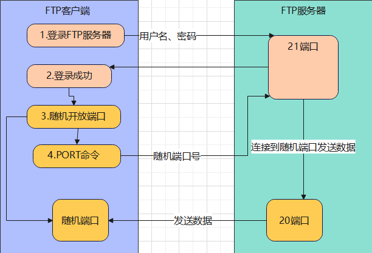
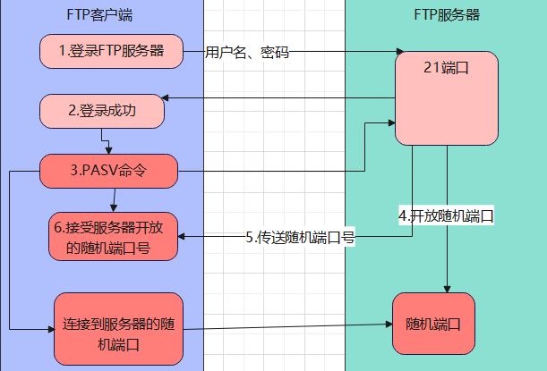
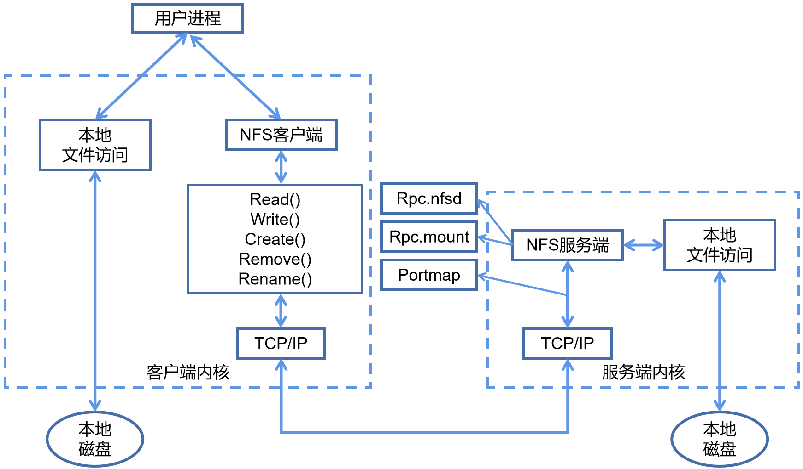

# FTP服务

File Transfer Protocol，文件传输协议。FTP服务是一种基于C/S架构的网络协议，专为高效传输文件而设计，CentOS发行版上最常见的用于实现FTP服务功能的软件是vsftpd，默认的共享数据的主目录是`/var/ftp/`

## 一、FTP工作原理

FTP服务比较常见的会用到20、21端口，其中21端口用于控制连接传输控制信号，一般被用于传输FTP命令和执行信息等；20端口用于数据连接，一般用于上传、下载数据。FTP的数据传输模式分为**主动传输**和**被动传输**，主动传输方式由服务端主动发起连接，使用20、21端口；被动传输方式由客户端主动发起，使用21端口和一个由服务器产生的随机高端口。因此，根据FTP的两个端口的不同作用判断，21端口属于常驻端口，而20端口不一定会用上，也可以是任意一个随机端口提供数据传输功能。

### 1.1 主动模式

Active模式，客户端通过FTP服务端的身份验证之后，自身会产生一个默认高于1024的随机端口，并通过PORT命令将自身产生的随机端口号通知给FTP服务端，FTP服务端再通过自身20端口与客户端的随机端口建立连接传输数据。在这个过程中需要注意的是，客户端自身只是产生了一个随机端口，并没有实际建立一个到FTP服务端20端口的连接，而FTP服务端收到客户端的随机端口后，才通过20端口向客户端发起连接，对于客户端的防火墙来说，这是从外部要建立到内部的连接，通常会被阻塞。



### 1.2 被动模式

Passive模式，客户端通过FTP服务端的身份验证之后，会向FTP服务端发起PASV命令，FTP服务端收到客户端的PASV命令后会产生一个随机端口，并将产生的随机端口号转发给客户端，再由客户端向FTP服务端的随机端口发起连接，这个随机端口将会被用于数据传输。FTP服务端的随机端口的范围是可以手动设置的。



## 二、部署

```bash
# 1、安装软件包
yum install -y vsftpd
rpm -qi vsftpd

# 2、启动服务
systemctl enable --now vsftpd    # 通过systemd管理vsftpd服务，或 /usr/sbin/vsftpd 以主程序的方式启用服务

# 3、防火墙
firewall-cmd --add-service=ftp --permanent
firewall-cmd --reload

# 4、SELinux
semanage boolean --modify allow_ftpd_full_access --on    # 允许FTP服务完整访问文件系统

# 5、准备测试文件
echo "ftp test" > /home/hebor/test.txt

# 6、PC2客户端测试访问FTP服务
yum install -y ftp    # 安装ftp客户端工具
ftp 192.168.0.243     # 连接ftp服务端
ls                    # 查看ftp共享目录
get test.txt          # 下载文件
```

FTP服务默认不需要准备测试文件，默认共享数据的主目录`/var/ftp/`下已存在一个共享目录`/var/ftp/pub/`，准备测试文件更便于识别。默认情况下vsftpd禁止匿名用户登录，但允许本地系统用户登录，无论系统本地用户或匿名用户，都需要调整SELinux允许FTP服务完整访问文件系统。在CentOS 7版本，可能还会涉及调整`ftp_home_dir`值，以实现本地系统用户登录。

## 三、配置

```bash
vim /etc/vsftpd/vsftpd.conf

anonymous_enable=NO                    # 默认禁用，匿名用户访问

local_enable=YES                       # 默认启用，允许在服务器上有系统账号的“本地用户”登录FTP
write_enable=YES                       # 默认启用，全局性写操作开关，允许用户上传、修改或删除文件
local_umask=022                        # 为本地用户新建的文件和目录设置权限掩码

chroot_local_user=YES                  # 默认禁用，限制本地用户只能访问自己的家目录
allow_writeable_chroot=YES             # 默认禁用，允许chroot目录本身可写

userlist_enable=YES                    # 默认禁用，启用用户列表访问控制功能的总开关
userlist_deny=NO                       # 默认禁用，值为NO意味着白名单模式，只有在文件中的用户才被允许登录
userlist_file=/etc/vsftpd/user_list    # 默认禁用，用户列表文件

pasv_enable=YES                        # 默认禁用，启用FTP被动模式
pasv_min_port=6000                     # 默认禁用，用于设置FTP被动模式下建立数据连接的端口范围
pasv_max_port=6010                     # 默认禁用，用于设置FTP被动模式下建立数据连接的端口范围
pasv_address=公网IP                     # 默认禁用，像客户端通告哪个IP用于建立数据连接
```

`allow_writeable_chroot=YES`，这是一个出于兼容性问题而存在的“补丁”选项，出于安全考虑，vsftpd的chroot目录默认必须不可写，否则会因安全漏洞风险而拒绝用户登录。开启此项后，vsftpd会绕过这一限制，允许chroot目录本身可写。这个选项仅在一种情况下需要：启用了`chroot_local_user=YES`，并且用户的家目录本身需要作为上传目标（即家目录可写）。

`userlist_enable`、`userlist_deny`、`userlist_file`这三个选项需要联合使用，`userlist_deny`的值决定采用黑名单模式还是白名单模式。

---


# NFS服务

Network File System，网络文件系统，用于在集群中用于保存静态资源数据。NFS主要功能是通过*局域网络*在不同主机间共享文件，用于企业集群架构中，如果是大型网站，会用到更复杂的分布式文件系统FastDFS（4K~500M的小文件，音频、小说、视频），Glusterfs（大文件，iso镜像），HDFS。

**NFS主要用于解决web静态资源的一致性和资源共享问题**，避免web服务器的磁盘空间浪费，但它不能解决网站访问的延时问题，甚至会扩展大这个问题。

## 一、NFS写入原理



NFS服务端本地写入，当用户执行mkdir命令，该命令会调用shell解释器翻译给内核，内核解析完成后驱动对应的硬件设备。

NFS远程写入实现过程：

1. 用户进程访问NFS客户端，使用不同的函数封装不同的操作命令
2. NFS客户端通过TCP/IP协议传输数据到NFS服务端
3. NFS服务端接收请求后，会先调用portmap进程进行端口映射
4. nfsd进程用于判断NFS客户端是否拥有权限连接NFS服务端
5. Rpc.mount进程判断客户端是否有具备文件的操作权限
6. idmap进程实现用户的映射和压缩（与NFS配置文件参数有关）
7. 最后NFS服务端会将对应请求的函数解封装转换为本地能识别的命令，传递至内核，由内核驱动硬件

从NFS的远程写入过程中，无论客户端操作系统是什么操作系统平台并不重要，客户端的命令首先都需要交给函数进行封装，函数传输到服务端后再进行识别；nfs服务发起的远程过程调用基于RPC协议，所以使用nfs必须启动rpc服务。

- Rpc.nfsd：基本的NFS守护进程，主要功能是管理客户端是否能够登录服务器
- Rpc.mount：主要功能是管理NFS的文件系统。当客户端顺利通过nfsd登录NFS服务器后，在使用NFS服务所提供的文件前，还必须通过文件使用权限的验证。它会读取NFS的配置文件/etc/exports来对比客户端权限
- Portmap：主要功能是进行端口映射工作，其本身默认监听111端口

## 二、部署

```bash
# 1.安装软件包
yum install -y nfs-utils    # rpc包会被作为nfs的依赖包一起安装
rpm -q nfs-utils

# 2.修改配置文件
mkdir /mnt/public           # 创建共享目录
echo "nfs test" > /mnt/public/test.txt    # 创建测试文件
man exports                 # 查看配置帮助手册，手册中有写配置示例用于参考
vim /etc/exports            # 修改NFS服务配置文件
/mnt/public *(ro)           # 允许任意客户端只读访问共享目录

# 3.启动NFS服务
systemctl start rpcbind
systemctl start nfs-server
firewall-cmd --zone=public --add-service=nfs
firewall-cmd --zone=public --add-service=rpc-bind
firewall-cmd --zone=public --add-service=mountd

# 4.客户端挂载
yum install -y nfs-utils    # NFS通过RPC协议进行交互，所以客户端也必须具备rpcbind服务
showmount -e 192.168.0.80	  # 检查是否存在共享内容；nfs-utils包中包含一些客户端要使用到的命令，例如showmount等
mkdir /mnt/nfs              # 客户端创建挂载点
mount -t nfs 192.168.0.80:/public /mnt/nfs    # 客户端挂载
df -h                       # 查看挂载
```

rpcbind服务与nfs-server服务的启动具备依赖关系，nfs-server依赖rpcbind服务，因此需要先启动rpcbind服务，才能启用nfs-server服务。NFS服务默认监听2049端口，默认情况下NFS服务端只提供只读权限。

## 三、配置

### 1.2 进阶配置

1. 修改NFS服务端配置文件

   NFS主配置文件`/etc/exports`，NFS配置文件语法格式：`共享目录 NFS客户端地址(客户端权限)`，通过`man exports`也可以查看NFS配置示例

   ```bash
   mkdir /data
   vim /etc/exports
   /data 192.168.0.0/24(rw,sync,all_squash)
   ```

   nfs服务端将`/data`目录共享给`192.168.0.0/24`网段的所有主机，并对客户端开放如下权限：

   1. rw：所有客户端主机都具备读写权限
   2. sync：将数据写入NFS服务器的硬盘中后才会结束操作，最大限度保证数据不丢失
   3. all_squash：将所有用户映射为本地的匿名用户（nfsnobody）

2. 重启NFS服务

   ```bash
   systemctl restart nfs-server
   firewall-cmd --zone=public --add-service=nfs --permanent
   firewall-cmd --zone=public --add-service=rpc-bind --permanent
   firewall-cmd --zone=public --add-service=mountd --permanent
   ```

3. 服务端校验

   NFS服务启动后，`/var/lib/nfs/etab`内会记录NFS的共享配置信息，如果此文件为空，则配置文件可能有误，查看此文件时能看到大量权限参数，除了手动配置的参数以外，其他的参数都是NFS默认添加的

   ```bash
   [root@pc80 ~]# cat /var/lib/nfs/etab
   [root@pc80 ~]# ss -lntp | column -t    # 查看端口
   ```

4. 客户端挂载

   ```bash
   [root@pc81 ~]# showmount -e 192.168.0.80	# 检查是否存在共享内容
   [root@pc81 ~]# mkdir /mnt/nfs
   [root@pc81 ~]# mount -t nfs 192.168.0.80:/public /mnt/nfs
   [root@pc81 ~]# df -h    # 查看挂载
   ```

NFS客户端连接挂载完毕后，往服务端共享目录里写入数据时会提示权限错误，客户端连接服务端的时候会经过两层验证，nfsd会检测客户端是否能够连接成功，mount会检测客户端对共享目录的权限。在上例中，mount的权限是rw，这两个检测都没有问题，因此，提示权限错误是由于主配置文件中，客户端的另一个权限参数all_squash导致。

all_squash参数表示将所有客户端的用户压缩成一个匿名用户，这个匿名用户的uid和gid都是65534（nfsnobody)。所以，任何一个客户端的指令到达服务端后，都会被NFS服务交给这个匿名用户进行接封装再执行，但由于服务端的共享目录是由root创建，所以匿名用户没有权限操作共享目录，重新更改共享目录的授权即可。关于匿名用户的信息，在`/var/lib/nfs/etab`文件中也有记录。

上例挂载属于临时操作，永久挂载需要写入`/etc/fstab`，但NFS的挂载可能导致设备重启时系统启动失败，这个问题可能会由两个原因导致：一是写入`/etc/fstab`文件的配置有误、二是客户端启动时NFS服务端异常。前者通过`mount -a`命令可以测试配置文件是否有误，后者需要在编写`/etc/fstab`文件时在挂载选项列添加`_netdev`参数，此参数用于声明该文件系统是一个网络设备，必须等网络就位后才能挂载。

## 三、NFS服务端参数

在一般工作场景下，通常NFS服务端共享只是普通的静态数据，不需要执行`suid、exec`等权限，挂载的这个文件系统只能作为存取数据用，无法执行程序，对于服务端或客户端而言也增加了安全性

```shell
# 通过mount -o选项指定挂载参数，增加安全性能
mount -t nfs -o nosuid,noexec,nodev 172.16.1.31:/data /opt

# 禁止更新目录及文件时间戳挂载，一定程度上提升性能
mount -t nfs -o noatime,nodiratime 172.16.1.31:/data /opt
```

这两个选项对于现在的服务器架构而言，基本不需要添加这两个配置，硬盘读写纪录时间戳一定程度上会影响磁盘I/O，CDN能够解决这个问题

### 1.1 NFS配置详解

| nfs共享参数    | 参数作用                                                     |
| -------------- | ------------------------------------------------------------ |
| rw             | 读写权限                                                     |
| ro             | 只读权限                                                     |
| root_squash    | 当NFS客户端以root账户访问时，映射为NFS服务端的匿名用户（不常用） |
| no_root_squash | 当NFS客户端以root账户访问时，映射为NFS服务端的root用户（不常用） |
| all_squash     | 当NFS客户端以任意账户访问时，映射为NFS服务端的匿名用户（不常用） |
| no_all_squash  | 当NFS客户端以任意账户访问时，都不进行压缩                    |
| sync           | 同时将数据写入内存和磁盘中，保证不丢失数据                   |
| async          | 优先将数据写入内存，再写入硬盘；效率更高，可能丢失数据       |
| anonuid        | 配合all_squash使用，指定NFS的用户UID，服务端必须存在该用户   |
| anongid        | 配合all_squash使用，指定NFS的用户GID，服务端必须存在该用户   |

示例：验证all_squash、anonuid、anongid权限

```shell
[root@nfs ~]# more /etc/exports
/data/   172.16.1.0/24(rw,sync,all_squash,anonuid=666,anongid=666)

[root@nfs ~]# groupadd -g 666 www
[root@nfs ~]# useradd -u 666 -g 666 www
[root@nfs ~]# chown -R www.www /data
[root@nfs ~]# systemctl restart nfs-server.service

[root@web01 ~]# touch file
[root@web01 ~]# echo "hello" > file
[root@web01 ~]# ll /opt
-rw-r--r--. 1 666 666         6 Nov 30 11:43 file
```

NFS的远程写入，请求到达服务端后会切换成UID为666的用户执行写入操作，所以服务端的www用户一定要有能够操作共享目录的权限，而客户端系统没有UID为666的用户，所以客户端在查看共享目录属性信息的时候，所属组和所属用户都是直接显示数字，而不是显示用户名

### 1.2 NFS优缺点

NFS存储优点

1. NFS文件系统简单易用、方便部署
2. NFS存放的数据都在文件系统之上，所有数据直观可见

NFS存储局限

1. 存在单点故障，如果构建高可用，维护又比较麻烦 web -> nfs(sersync) -> backup
2. NFS数据明文，不对数据做任何校验
3. 客户端挂载NFS没有密码验证，一般只在内网使用

### 1.3 NFS故障

1. 客户端使用showmount查看服务端共享目录，提示RPC故障

   ```bash
   错误信息：clnt_create: RPC: Unknown host
   
   解决办法：关闭nfs服务，重启rpcbind服务后再启动nfs服务
   ```

---

# 自动挂载

又叫做按需挂载，通过Linux系统的autofs（automount file system）程序实现，其核心功能是动态管理文件系统挂载点。当用户访问指定目录时自动挂载对应设备或远程共享，闲置超过时限（默认5分钟）后自动卸载，以节省系统资源。从某种角度而言，自动挂载的稳定性不如开机挂载，此服务仅作了解

## 一、部署

### 1.1 基本实现

1. 安装软件包

   ```bash
   yum install -y autofs
   ```

2. 启用服务

   ```bash
   systemctl start autofs
   ```

   启用autofs服务时，autofs服务默认会创建`/misc/`目录

3. 校验

   ```bash
   ls -A /misc
   ls /misc/cd
   ```

   默认情况下autofs服务创建的`/misc/`目录是空目录，当用户访问挂载点`/misc/cd`时，autofs会自动挂载镜像设备到此挂载点下。当主机上存在`/dev/cdrom`设备时，autofs服务默认情况下会将`/dev/cdrom`挂载到`/misc/cd`下

### 1.2 进阶配置

autofs服务的配置框架分为两个层级：

- 主配置文件：`/etc/auto.master`

  此为固定配置文件不可变更，主配置文件中主要定义了**监控目录、子配置文件路径、超时时间**，在Linux系统上不是所有的目录都可以实现自动挂载功能，只有在autofs服务的监控目录下才能够实现自动挂载功能

  ```bash
  /misc    /etc/auto.misc    --timeout=300
  ```

- 子配置文件：`/etc/auto.misc`

  子配置文件可自定义存放路径和文件名，只需要在主配置文件中写明子配置文件的信息即可，子配置文件被用于定义具体的挂载规则，编写格式为`挂载点 挂载选项 :挂载设备`

  ```bash
  cd    -fstype=iso9660,ro,nosuid,nodev    :/dev/cdrom
  ```

1. 修改主配置文件

   ```bash
   vim /etc/auto.master
   /myauto    /opt/hebor.auto
   ```

2. 新建子配置文件

   ```bash
   vim /opt/hebor.auto
   nsd    -fstype=iso9660    :/dev/cdrom
   mynfs    -fstype=nfs    192.168.0.80:/public
   ```

3. 重启autofs服务

   ```bash
   systemctl restart auto
   ```

   重启autofs服务会自动创建挂载点目录

