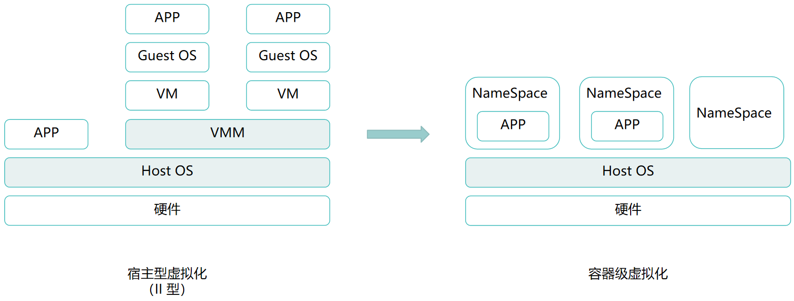
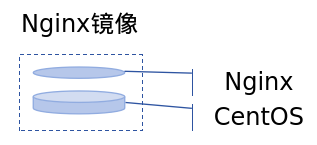
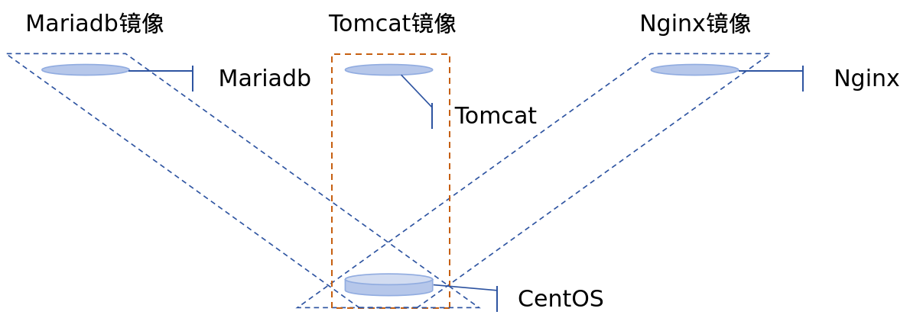
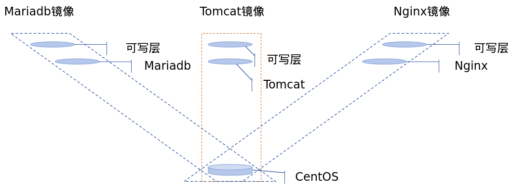
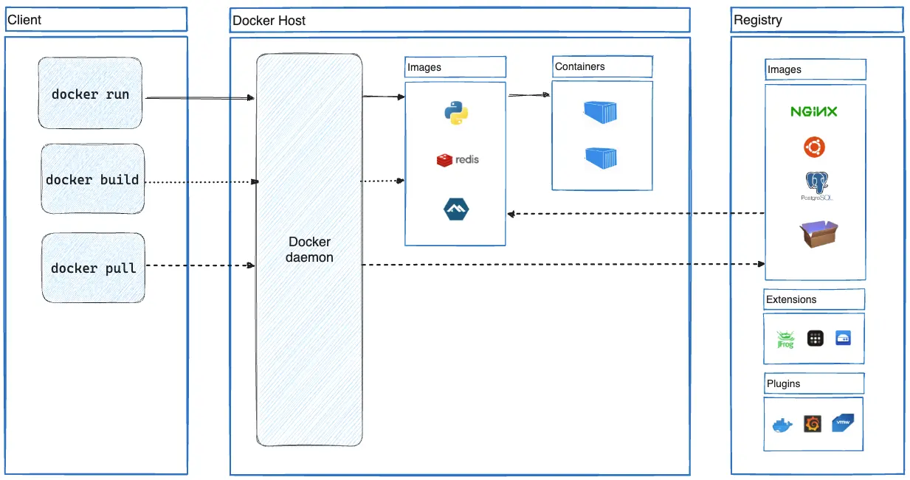

# Docker 容器

## 第一章、概述

Docker是一个开源的**容器化平台**，核心思想是：把应用及其依赖打包成标准化镜像，让它在任何支持Docker的环境中运行，实现“一次构建，到处运行”。Docker也不等于容器，Docker只是使用容器的一种工具。

### 1.1 虚拟化

在了解Docker之前，先简单了解一下虚拟化技术。目前主流的虚拟化的实现形式分两种：主机级虚拟化、容器级虚拟化，主机级虚拟化需要提供完整的虚拟硬件平台。

#### 1.1.1 主机级虚拟化

主机级虚拟化又分为两种：裸金属虚拟化、宿主机虚拟化。裸金属虚拟化指的是直接在硬件上安装一个虚拟化OS（hypervisor层），在虚拟化OS上再安装虚拟机，典型代表是ESXi；宿主机虚拟化指的是在硬件上安装常规操作系统（Windows、Linux），然后在操作系统上安装虚拟化软件（hypervisor层），在虚拟化软件上再安装虚拟机，典型代表是VMware Workstation。

两种类型的主机级虚拟化技术，底层的实现机制是类似的：统一由hypervisor提供虚拟化硬件，用户需要先在虚拟化硬件上部署操作系统。安装虚拟机操作系统的过程，等同于安装系统内核的过程，由安装好的内核提供用户空间，应用程序则运行在用户空间内。但实际上，运行内核不是主要目的，内核的核心作用在于资源分配和管理，真正能够产生价值的是在用户空间中运行的应用程序。然而，系统内核仍需要作为业务中不可或缺的一部分，因为应用程序基本上都需要依赖系统内核提供的运行环境才能正常运行。

虽然主机级虚拟化的确实现了更大程度的物理资源利用率，但其带来的性能损耗也是不容忽视的，当需要部署的服务很少，甚至只有1个或2个服务时，虚拟机就显得无比臃肿。

#### 1.1.2 容器级虚拟化

既然只启用少量服务时虚拟机显得臃肿，那么减少中间层就是显著的提升效率的方式，例如，将虚拟机中的GuestOS层剥离。但如此一来又会产生一个问题，使用虚拟机的最终目的是为了实现资源隔离，每个虚拟机的异常都不会影响到其他虚拟机，将中间层剥离后需考虑原本运行在各个虚拟机上的各个应用程序之间的隔离问题。那么现在所需要的系统环境就产生了变化，首先需要一组硬件平台，其次在硬件平台上需要一组“虚拟的隔离环境管理器”，最后创建多个“隔离环境”，将各个应用进程运行在“隔离环境”内。



众所周知，应用程序需要运行在用户空间中，因此这个所谓的“隔离环境”实际上就是隔离的用户空间。一般情况下，一个系统内核上对应只有一个用户空间，但在现在的应用场景下，我们希望可以拥有多组用户空间，多组用户空间之间互不干扰，一组用户空间中只运行一个或部分应用进程。但，无论用户空间之间怎么隔离，一般都会有一个用户空间，甚至是第一个用户空间，一定是有特权的，这个特权用户空间一般用于管理其他用户空间。

在拥有多组用户空间之后，随后使应用进程运行在各个隔离的用户空间中。多个用户空间共享底层同一个系统内核，并被其统一管理，每个用户空间中的应用进程在运行时所能感知到的边界是其所属的用户空间的边界，以此实现应用程序之间的隔离。每个用户空间都为应用进程提供了运行环境，并且保护其内部的应用进程不受其他应用进程的干扰，所以每个用户空间都可以视作一个容器。

一个独立的用户空间，其主要目标是为了实现资源隔离，任何应用程序运行在该用户空间当中，它就认为自己是唯一运行在当前内核之上用户空间中的进程，且自己能看到的其他进程也都是这个系统内核之上的所有进程，因此一个用户空间中至少应该能够具备以下6种资源：

* UTS：独立的主机名域名

* Mount：独立的挂载树（文件系统树）；每个用户空间都需要具备独立的根文件系统

* IPC：进程间通信的专用通道，信息量、消息队列和共享存储

  一般情况下，用户空间中的不同应用进程都是在同一个物理内存中运行，系统内核希望不同进程间通过IPC实现进程间通信。但在容器级虚拟化场景下，如果不同用户空间内的应用进程可以通过IPC实现进程间通信，那么隔离将毫无意义，因此需要确保每个用户空间的IPC资源都是独立的。同一容器下的不同应用进程之间可以通过IPC实现通信，不同容器间的应用进程不可通过IPC实现通信

* PID：独立的进程树

  正常情况下，一个操作系统的运行无非就是“两棵树”，文件系统树和进程树，用户空间中的每一个进程都应该从属于某个父进程，如果一个进程没有父进程，它就应该是用户空间中的init进程。在Linux系统上的进程管理，子进程由父进程创建，也由父进程终止并回收，如果init进程终止了，那么在init终止之前会将所有子进程终止，也就是关机，这是Linux系统的基本逻辑

  在容器级虚拟化场景下，既然每个用户空间都认为自己就是系统内核上唯一的用户空间，那么每个用户空间就需要具备自己独立的init进程，否则这个用户空间中的应用进程将无法被管理，但对于init进程而言，事实上每个文件系统上只能有一个init进程，因此对于每个用户空间的处理方式分为两种：

  - 如果用户空间内存在多个应用进程，那么该用户空间必须产生一个假的init进程，通过init进程对多个应用进程进行管理
  - 如果一个用户空间内只运行一个应用进程，该应用进程就可以直接就被视作init进程，只要该应用进程结束，用户空间就被回收

  在系统内核上进程号为1的init进程只能有1个，在容器级虚拟化场景下，又不得不为每一个用户空间伪造init进程，因此需要将每个用户空间的进程树进行隔离

* User：独立的用户和用户组

  每一个系统内核上都只能有一个root ID，如果每一个用户空间都具备root ID，那么是否存在某个用户空间的root账户能够跨边界管理其他用户空间的进程，这又失去了隔离的意义。因此，应该是为每个用户空间伪装出一个root账户，这个伪装的root账户在真正的系统内核上只是一个普通账户，但对于用户空间而言，该账户具备最高权限

* Net：独立的网络设备、TCP/IP栈、套接字接口Socket

> **jail、vserver**
>
> 容器并不是一个新概念，最早出现在FreeBSD系统上，早期被称为jail（监狱），最初的目的是为了运行一个应用进程不受其他干扰。最初出于程序的安全运行考虑，为应用程序提供一个沙箱环境，即便应用程序产生异常行为，也不至于影响到沙箱以外的其他应用进程。后来有人将jail这种技术复刻到Linux系统上，其产品称为vserver，早期vserver主要使用chroot工具来实现类似jail的功能

#### 1.2.3 Namespace

对于系统内核而言，这6种资源都是独立的、唯一的一组资源，因为系统内核在设计之初就只是为了支撑单个用户空间运行。但为了支撑容器机制的实现，Linux系统在内核级已经通过Namesapce（名称空间）的机制，原生支持这6种资源的切分、隔离。每一种资源只要能够在内核级可以切分为互相隔离的环境，这种隔离的环境就被称为Namespace。

例如，正常情况下，一个系统内核就应该只有一个UTS，在Linux内核原生支持Namespace之后，UTS能够以Namespace为单位进行隔离，在一个Linux内核之上可以创建多个Namespace，每个Namespace都可以拥有独立的UTS，并且由Linux内核原生支持Namespace的隔离，各个Namespace之间的UTS资源互不影响。

```bash
┌─────────────────────────────────────┐
│            用户空间 Userspace        │
│                                     │
│  bash   nginx   python   ls   ps    │
│    │       │       │                │
│    └───────┴───────┴──────┐         │
│                           │         │
├──────────── 系统调用 ──────┤         │
│                           ▼         │
│             Linux Kernel            │
│                                     │
│  Process  Namespace  Cgroup  FS ... │
│                                     │
└─────────────────────────────────────┘
```

不要混淆用户空间的隔离和Namespace的隔离。一个操作系统可以视作由用户空间和内核空间组成，应用程序运行在用户空间，所以应用程序的隔离需要通过用户空间实现。但应用程序的运行需要调用内核的资源，所以应用程序会通过系统调用请求Kernel，既然用户空间需要隔离，那么内核的资源同样需要“隔离”。实际上，内核资源没有被隔离，真正被隔离的是应用程序“能够看到的内核资源”，**Namespace的本质是Linux Kernel用来隔离进程所能看到、能使用的内核资源视图的机制**。

虽然6种资源都已经通过Linux内核的Namespace技术原生支持，但最晚支持的User资源的隔离在Linux内核版本3.8之后才被支持，所以如果想要更好的使用容器技术，内核版本应该保持在3.8以上，CentOS 6天然就被排除在外，没有User的Namespace机制的情况下，CentOS 6也能够使用容器技术，只不过在某些地方有功能缺失。

#### 1.2.4 CGroups

主机物理硬件资源分为两种：可压缩型资源和不可压缩型资源。例如，CPU属于可压缩型资源、内存属于不可压缩型资源。当一个用户空间中的进程占用大量CPU资源，导致其他用户空间的进程无法调用到足够的CPU资源时，其他用户空间的进程会进行排队，等待CPU资源释放；当一个空户空间中的进程占用大量内存资源时，一旦其他用户空间的进程申请内存资源失败，会导致程序崩溃或异常终止，甚至可能导致系统崩溃，这就是内存溢出（Out of Memory，OOM）。

也就是说，可压缩型资源被超量使用的情况下可能导致系统卡顿或进程卡顿，在某些特殊场景下是可以允许被超量使用的，但不可压缩型资源需要严格控制资源用量。在主机级虚拟化场景下，天然的通过分配虚拟化硬件资源，即可限制每个VM能够使用到的资源上限；但在容器级虚拟化场景下，Namespace只能限制进程能看到的资源视图，当用户空间内的进程出现OOM时，它仍可以吃掉宿主机的内存，进而导致宿主机崩溃。

因此，Linux内核级还需要一个功能来限制每一个用户空间可调用的资源量，例如，对每个用户空间设置各自的资源用量百分比，例如对三个用户空间设置`1:2:1`的资源用量，这种方式的优势在于，当某些用户空间的资源用量很少时，其他用户空间可以超量占用资源，最大限度的提升资源利用率；或对每个用户空间严格限制其资源上限，这种方式的优势在于用户空间需要调用资源时内核可以立刻进行反馈。

这种资源限制功能在内核级依靠CGroups（Control Groups）机制实现，每个用户空间的进程通常都归属于某个CGroup，内核在资源分配的关键路径上插入了检查逻辑，分配资源时会按照进程的CGroup来限制资源。实际上，不只是Docker，运行在用户空间的所有进程都会受到CGroups控制，只不过默认情况下的CGroups对进程限制是`max`，也就是不限制。CGroups是树形结构，父CGroup会限制所有子CGroup，父组总配额限制所有子组的总使用。

CGroups所划分的系统资源类型包括：

- blkio：块设备IO
- cpu：CPU
- cpuacct：CPU资源使用报告
- cpuset：CPU核心的分配；如上述两种资源分配方式
- devices：设备访问
- freezer：挂起或恢复任务
- memory：内存用量及报告
- perf_event：对cgroup中的任务进行统一性能测试
- net_cls：cgroup中的任务创建的数据报文的类别标识符

> **CGroups的核心组成**
>
> 操作CGroups本质上是通过/sys/fs/cgroup/下的目录或文件实现。例如，限制appA的资源用量时，会创建/sys/fs/cgroup/appA/目录，在该目录下写入cpu.max、memory.max来限制进程可用的最大CPU、内存资源，再将appA的进程号写入groups.procs，appA就会受到CGroups规则约束。
>
> 但Docker管理的CGroups与常规进程的CGroups管理不同，Docker的CGroups管理会根据cgroup版本Docker自己的cgroup的驱动产生变化，以下记录的是cgroup v2+systemd驱动下的配置：
>
> ```bash
> # 1、检查cgroup版本和Docker的cgroup驱动
> ls /sys/fs/cgroup/cgroup.controllers    # 此文件存在则说明使用的是cgroup v2，否则v1
> docker info | grep -i cgroup            # Cgroup Driver: systemd表示使用的systemd驱动
> 
> # 2、运行容器，限制容器资源
> docker run --cpus=1.5 --memory=512m --pids-limit=100 nginx
> docker ps --no-trunc                    # 查看容器的CGroups配置，需要获取容器的长ID
> 
> # 3、检查CGroups配置
> cd /sys/fs/cgroup/system.slice/docker-<你的容器长ID>.scope/
> cat cpu.max                             # 查看CPU限制
> cat memory.max                          # 查看内存限制
> ```

#### 1.2.5 小结

相比较虚拟机，容器则属于轻量级的虚拟化技术，使用容器时不再需先安装操作系统，因为容器共享了底层的系统内核，只需要系统内核划分出一个Namespace，应用进程可见的资源会由Namespace隔离。但同时，容器的隔离性明显不如虚拟机，因为每个虚拟机都具备独立的GuestOS，每个虚拟机上的进程本身就具备独立的操作系统内核，而容器却共享底层的操作系统内核，只不过在内核级强行设置了边界。相比较虚拟机的安装和启动，一个容器的启动是秒级响应，更快的启动速度和轻量化。

在容器技术下，Namespace决定了容器能够看到的资源边界、CGroups决定了容器能够使用的资源上限。

### 1.2 LXC

容器技术最初是由jail技术启发，后来在Linux系统上产生了vserver，早期使用容器时需要手写代码通过内核的系统调用函数实现，对于用户而言使用门槛非常高。而为了使容器技术更加易用，将容器技术需要使用到的系统调用函数集中的写入到一组工具中，简化用户使用容器技术的复杂度，于是就产生了这样一组解决方案LXC（LinuX Container）。

除了vserver以外，LXC是最早一批真正把完整的容器技术，用一组简易使用的工具和模板来极大的简化了容器技术使用的一个方案。通过LXC的工具可以快速创建一个容器，通常将这个容器称其为一个用户空间，在这个用户空间中至少需要具备最基本的目录结构（例如/bin、/sbin）和应用程序（例如ls），当用户空间中需要的运行环境与宿主机操作系统的运行环境一致时，可以直接从宿主机上复制运行环境到容器中，但当用户空间需要ubuntu的运行环境，而宿主机使用的是CentOS操作系统时，就需要用到LXC的模板。

通过LXC的工具创建一个用户空间后，需要根据LXC的模板创建用户空间中的运行环境，一个模板实际上就是一组脚本，创建用户空间后LXC首先会准备一个脚本执行环境，执行脚本会自动的实现安装过程，安装过程实际上就是指向了用户空间需要创建的那一类Namespace的系统发行版所属的仓库，从仓库中下载各个应用程序包并安装，生成这个新的名称空间，然后这个namespace就可以像虚拟机一样被使用。这个是一个复杂过程，因此需要借助LXC模板实现，再访问到这个模板中所定义的Linux发行版的仓库，利用仓库中的程序包下载至本地来完成安装过程。

虽然LXC简化了容器的使用，但相比较使用主机级虚拟化的经验，LXC本身的复杂程度是没有多少降低的，并且容器本身的隔离性就弱于虚拟机，当然，容器的优势在于每一个用户空间直接使用宿主机内核，中间没有额外的资源开销。LXC创建的每一个用户空间都是安装生成的，用户空间在不断的使用过程中会生成新的数据文件，用户空间的数据迁移和批量创建在LXC上都没有很好的解决方案，于是就出现了Docker。

### 1.3 Docker

站在LXC的视角来看，Docker其实就是LXC的增强版，Docker本身并不是容器，它只是使用容器技术的工具，容器是Linux内核中的技术，Docker只是简化了容器技术的使用。Docker基于LXC的两个痛点寻找突破口，并成功解决了数据迁移和批量创建的问题，实际上，Docker的早期版本其核心就是LXC，是LXC的二次封装发行版。在功能实现上，Docker使用LXC做容器管理引擎，但在创建容器（或称用户空间）时不再使用模板安装生成容器。

Docker事先使用一种镜像技术，将一个操作系统用户空间所需要用到的组件，事先准备编排好后整体打包成一个文件，这个文件就称为镜像文件。镜像技术在虚拟化技术中也被频繁的使用，例如在KVM中，通过将一个操作系统打包成一个镜像，KVM可以通过该镜像创建虚拟机，基于镜像启动虚拟机。

镜像文件存放在一个集中统一的仓库中，这个仓库中可以用于存放自己创建的、或其他人创建的各种应用程序的、或操作系统的镜像，例如在仓库可以存放一个打包好的纯净的、最小化的CentOS镜像或Ubuntu镜像。当通过Docker创建一个容器时，Docker使用LXC做容器管理创建一个用户空间，在此基础之上，Docker不会再激活模板安装生成容器，而是自动连接到仓库服务器上，下载一个匹配创建容器需要的镜像，把镜像拖到本地，并基于镜像启动容器。

通过这种方式，Docker极大的简化了容器的使用，通过Docker启动一个容器，只需要`docker run`即可启动一个容器，在底层Docker会自动连接到互联网上的Docker仓库下载镜像，在镜像仓库上所有的东西都是提前准备好的，大多数通用的应用程序、操作系统环境都在Docker仓库上已存在现成的镜像文件。在此前小节中有提到，在一个用户空间中可以运行一组应用进程或一个应用进程，我们最终的目的是为了运行具备生产功能的应用程序，Docker为了使容器更加易于管理，采用了一种更精巧的机制：**在一个容器内只运行一个进程**。例如在宿主机上需要同时安装nginx和tomcat，那么两者可以各自运行在各自独立的容器中。

Docker与LXC相比较，LXC是把一个容器当作一个虚拟机一样使用，一个容器内运行N个进程，这就使得将来在管理容器时极为不便；Docker的理念使一个容器内只运行一个进程，其优势在于安全性和应用程序分发效率上的显著提升，其劣势则在于需要更多的存储空间和对于运维人员而言更高的运维难度。

> **runC**
>
> Docker的早期版本基于LXC构建，在Docker本身技术略微成熟后放弃了LXC，转而采用自主研发的libcontainer（后演变为runC和containerd），是技术演进与生态战略双重驱动的结果

#### 1.3.1 Docker的优势

对比传统系统架构与Docker容器架构上的差异，在传统系统架构下，所有进程都运行在操作系统内核上的同一个用户空间中，当某个进程被恶意劫持后，黑客有可能通过该进程影响到用户空间中的其他进程；在Docker架构下，每个应用进程都单独的运行在一个独立的用户空间中，各用户空间内的进程彼此不可见，并且由于一个容器只为运行一个进程，因此容器内部的所有环境都是最小化的，只为了运行这一个应用进程而准备的，这个应用进程需要用到`/bin`目录则准备`/bin`目录、需要用到`/etc`目录则准备`/etc`目录，用不到`/usr`目录就不会有`/usr`目录。从这个角度来看，即便某一个进程被恶意劫持，黑客也更难影响到系统上的其他应用进程。

Docker技术真正实现了开发的一次编写、到处运行，现在的系统环境都是异构的，CentOS的不同版本并行、Ubuntu、Windows等，为了解决软件开发的兼容性问题，需要对每一种平台做兼容性调试，而基于Docker，只需要准备一组环境并打包为镜像即可，Docker基于镜像运行的容器与宿主机原本的用户空间没有关系，容器具备自己独立的用户空间。因此Docker技术的出现也使得开发应用程序时，减小了需要在程序兼容性上的资源投入，同时简化了应用程序的分发问题。

#### 1.3.2 Docker的劣势

在传统系统架构下，所有的应用进程运行在一个用户空间时，不同进程的共享文件只需要存在一份即可，但在Docker架构下，每个用户空间相互隔离，一份同样的文件需要复制多份存放在各自的用户空间中，这使得Docker会占用更多的存储空间。但反过来讲，删除某一个用户空间，并不会影响到其他用户空间中的文件副本。

同样的，在传统系统架构下，当应用进程出现异常时，通常管理员可以使用一组跟踪工具来排查该进程的故障原因，但在Docker架构下，每个进程运行在自己的用户空间中，那么调试工具也需要是该用户空间自带的工具，因此每个用户空间的调试工具也是独立存在的，同样会占用更多的存储空间。

基于Docker的理念，调试进程的运行会违反Docker的理念，但不运行调试程序则无法对异常进程进行调试，因此，容器内运行第二个进程是必然的，只不过一般来讲，调试进程并不是主要目的，需要用到时才会启动调试进程，平时启动的只是那个容器内的唯一进程，也称为主进程（Main process 或 Core process）。容器内的主进程并不指代其单一进程，也包含该主进程创建的子进程，例如nginx的master和worker进程都会运行在同一个用户空间中，当一个容器中的主进程终止时，容器也随之终止。

因此Docker架构带来的另外一个问题在于，要调试一个应用进程时，用户空间内可能并不具备调试工具，其次，要想调试应用进程时，首先还需要先突破用户空间的边界，进入用户空间后才能对应用进程进行调试，因此容器技术更加便于开发人员的分发，不便于运维人员的调试。

#### 1.3.3 Docker镜像

刚刚提到过，Docker运行容器时是通过从仓库中下载镜像的方式实现的，当Docker需要批量创建容器时，只需要从仓库中下载一次镜像到本地即可，这与Docker镜像的构建方式有关，Docker镜像的构建底层是通过**分层构建、联合挂载**的机制实现的。



Docker制作镜像时，首先会先制作一个最底层的纯净的centos系统镜像，随后如果要在容器中运行nginx进程，管理员不必从头创建一个完整的包含系统运行环境和nginx进程的镜像，而是基于centos镜像的上层，添加一个nginx镜像即可，整体上对外而言这就是一个完整的nginx镜像，但对镜像构成而言，centos镜像与nginx镜像叠加对外提供完成的nginx服务，且nginx镜像只包含nginx本身。一个功能在一层镜像上实现，这就是分层构建，随后将多个镜像叠加到一起，形成一个统一视图，就相当于在一个centos上安装了一个nginx进程，这就是联合挂载。



这种机制使得Docker镜像的分发得以复用，减小存储空间的占用。Docker的镜像并不是传统的iso镜像，Docker的每一个完整镜像都分成了许多层细分镜像，每一层细分镜像都是只读层，使用完整镜像时就是将这些细分镜像层联合挂载到一起，从外面看起来就像是一个完整镜像，每个底层都是高层镜像的父镜像。例如，假设要在宿主机上要运行nginx、tomcat、mariadb三个容器，这三个应用程序的底层都是基于centos构建，那么运行三个容器时其最底层的父镜像都复用centos镜像，应用程序本身则使用各自独立的镜像层，最终联合挂载启用为容器。



一个完整镜像的所有细分镜像层都是只读层，但随着容器的运行必定会产生新的数据，所以在创建容器时，只读层全部挂载完毕后还会在最顶层额外挂载一个读写层，这个读写层是每个容器独有的，随着容器的消亡而消亡。例如，当宿主机上想要运行两个nginx容器时，实际上centos镜像与nginx镜像都是复用的，只不过两个容器的读写层相互独立。

容器的所有数据修改都是在读写层完成的，包括配置文件的修改、删除。要删除nginx镜像中自带的配置文件时，对于nginx镜像层而言这个操作是不可实现的，因此“删除只读层”数据的操作，实际上就是在读写层上将该配置文件标记为不可见；而要修改nginx的配置文件时，则是通过写时复制机制，将nginx镜像层的配置文件复制到读写层，再在读写层上对配置文件进行修改。

第二章、Docker的基本用法
---------------

### 一、OCI

Open Container Initiative（开放容器计划），由Linux基金会主导于2015年成立，旨在围绕容器格式和运行时指定一个开放的工业化标准，确保容器跨平台的兼容性。OCI标准由两部分组成：

- Image Specification（镜像标准）：定义容器的分层结构、配置和分发格式
- Runtime Specification（运行时标准）：定义容器的创建、启动、隔离和生命周期管理

runC基于libcontainer构建，是一个根据OCI标准启动和运行容器的CLI工具，容器作为runC的子进程启动，可以嵌入到各种其他系统中，而无需运行守护进程。现如今，runC就是较新版本的Docker中使用的容器引擎

对于Docker而言，它专门提供了一个存放容器镜像的站点，称之为dockerhub。在dockerhub上可以找到大多数的容器镜像。从dockerhub下载到本地的镜像占用的存储可能会比dockerhub上显示的要小一些，因为dockerhub上显示的存储大小是经过压缩过的，这样从dockerhub下载到本地时产生的流量会小一些。因为docker的镜像以分层的形式存在，那不同的完整镜像使用到相同的细分镜像层时，再从dockerhub下载镜像，docker就不会再下载这些本地已有的细分镜像层

<<<<<<< HEAD
> **dockerhub访问异常**

截至2025年6月27日为止，dockerhub站点因不可抗力因素无法直接从国内访问，大部分的第三方的镜像加速服务也已经失效

### 二、Docker架构
=======
## 二、Docker架构
>>>>>>> 3970e89f86d85074bca4a9aca0d2e5a1d74f852b



整个Docker架构由三部分组成：Client、Server、Registry，Docker的Server端又称为DOCKER_HOST，所以整个Docker可以理解为是一个C/S架构的应用程序。实际上无论是Client端或Server端，都是由Docker这一个程序提供，Docker这个程序有很多子程序，其中一个子程序就是Docker daemon守护进程，当一台主机上运行Docker daemon时，这台主机就成为了一台守护进程服务器，他可以监听在Socket套接字上，套接字出于安全性考虑，默认只提供本机的unix socket文件的套接字

Docker作为C/S架构的应用程序，它支持三种套接字：IPv4套接字、IPv6套接字、unix socket套接字，也就是说默认情况下Docker daemon只允许本地Client访问。DOCKER_HOST的特征在于Containers与images，此前提到过，Docker基于镜像运行容器，这里的镜像指的就是DOCKER_HOST本地的images，然而DOCKER_HOST本身默认是没有image的，因此在第一次运行某一个容器时，Docker daemon需要从Registry下载相应的image，这个Registry默认是指的Docker Hub。从Registry下载镜像到DOCKER_HOST本地后，Docker daemon通过镜像的联合挂载机制，在所有镜像的最顶层挂载一个可写层，这就是一个容器，即Containers

**Registry**

Registry用于集中存放Docker的image，因此Registry也被简称为“仓库”。由于image本身就会占用更多的磁盘空间，并且Docker Host上未来会通过哪些image启动容器也是未知的，因此Docker Host本地不便于存放过多的image，但同时为了便于Docker Host的镜像管理，需要一个角色来提供集中的镜像存储、镜像分发的服务，这就是Registry。一般公共的Registry允许用户免费上传、下载公开的镜像，Docker配置文件中默认使用的Registry就是Docker官方提供的Docker Hub，现在也可以使用第三方提供的镜像仓库服务或自建私有Registry，例如阿里云容器镜像服务

Docker基于镜像启动一个容器时，首先会从Docker Host本地搜索镜像，如果本地没有镜像，就会从Registry拉取对应版本的镜像到本地后再启动容器。从Docker Host向Registry下载镜像时可使用两种协议：https或http，默认都是仅使用https协议，只有手动指定http时才会使用http协议下载镜像。同样的Client与Docker Host之间的通信也可以使用https或http，只不过在使用本地unix socket时无需考虑复杂场景

镜像是静态的，它就像是存放在磁盘上的程序文件；容器是动态的、具备生命周期的，它就像是通过程序启动成为进程，因此容器的启动必须依赖Docker Host本地镜像。容器运行在属于自己的独立的namespace中，可以拥有自己的根文件系统、网络配置、进程空间，就像在使用虚拟机一样

**tag**

总所周知，一个处于长期维护状态下的软件，本身就在不断的迭代更新，这意味着软件本身也是存在版本差异的。公共的Registry允许用户上传自制的镜像，那么Docker在使用Registry提供的集中的镜像存储服务时，Registry自身应该如何区分不同的应用程序、应用程序自身的不同版本、以及不同用户的自制镜像？

此处就需要引出一个新的“仓库”的概念，即repository。一个Registry下存放的是众多的repository，在不考虑用户自制镜像的情况下，一个repository下一般只存放一个应用程序的镜像，在repository下通过tag来区分应用程序自身的不同版本的镜像。repository本身又分为两种，一种是repository的名称直接与应用程序的名称相同，这种repository又被称为顶级repository，一般是由Docker Hub官方发布的镜像仓库；另一种则是由用户自建的repository，用户自建的repository与顶级repository在名称上会产生较大差异

在常规场景下提起nignx，一般指的是nginx应用程序，在Docker应用场景下提起nginx，一般指的是nginx的顶级repository。通过`docker search nginx`搜索nginx镜像时会检索到顶级repository和用户repository，例如`nginx`与`hebor/nginx`，前者repository名与应用程序名相同，一般是顶级仓库，后者则是由`用户名/镜像名`组成，一般是用户自制镜像repository。在使用`docker search`检索镜像时只会显示repository，如果要查看镜像的tag，需要通过浏览器访问Resigtry检索repository进行查看

无论是顶级repository或用户repository，镜像的不同版本在repository下都需要通过tag进行标记。以一个完整的nginx镜像名`nginx:1.15`为例，nginx表示镜像的repository、`1.15`则表示镜像的tag，因此通过`repository:tag`的组合才能唯一标识一个镜像，如果在拉取镜像时仅提供了repository名称而没有提供tag，则拉取该repository的默认镜像，repository的默认镜像一般都是latest最新版本的镜像，一个镜像可以同时具备多个tag

一个Registry至少需要具备两种功能：镜像存储的仓库、用户身份的认证，一般情况下，它还会通过其他插件提供Registry上所有可用镜像的索引

## 三、Docker部署

### 3.1 YUM安装

1. 卸载旧版本docker

   在安装Docker Engine之前需要卸载任何冲突的软件包

   ```bash
   [root@docker ~]# yum remove docker \
   docker-client \
   docker-client-latest \
   docker-common \
   docker-latest \
   docker-latest-logrotate \
   docker-logrotate \
   docker-engine
   ```

2. 配置YUM源

   CentOS 7于2024年结束生命周期，Docker官网已经不再提供CentOS 7的官方安装指南，因此需要使用第三方YUM源安装Docker

   ```bash
   [root@docker ~]# \rm /etc/yum.repos.d/*    # 删除系统自带的YUM配置
   [root@docker ~]# curl -o /etc/yum.repos.d/CentOS-Base.repo https://mirrors.aliyun.com/repo/Centos-7.repo
   [root@docker ~]# yum install -y yum-utils    # 安装YUM工具
   [root@docker ~]# yum-config-manager --add-repo https://mirrors.aliyun.com/docker-ce/linux/centos/docker-ce.repo    # 添加Docker的软件YUM仓库
   ```

3. 安装软件包

   ```bash
   [root@docker ~]# yum install docker-ce docker-ce-cli containerd.io docker-buildx-plugin docker-compose-plugin
   ```

4. 启用服务

   ```bash
   [root@docker ~]# systemctl enable --now docker
   ```

5. 配置镜像加速服务

   实际上大部分的第三方的镜像加速服务已经失效，此步骤可省略

   ```bash
   [root@docker ~]# vim /etc/docker/daemon.json    # 路径不存在时手动创建
   {
     "registry-mirrors": ["https://xxxxxxxx.mirror.aliyuncs.com"]
   }
   [root@docker ~]# systemctl daemon-reload 
   [root@docker ~]# systemctl restart docker
   ```

[docker官网的安装手册入口](https://docs.docker.com/get-docker/)
[CentOS安装手册](https://docs.docker.com/engine/install/centos/)

## 四、Docker管理

### 4.1 基本信息

1. 查看Client端与Server端的版本信息

   ```bash
   [root@docker ~]# docker version
   ```

2. 查看docker详细信息

   ```bash
   [root@docker ~]# docker info
   ...
   Server:
    Containers: 0    # 当前容器数量
     Running: 0      # 处于运行状态的容器数量
     Paused: 0       # 处于暂停状态的容器数量
     Stopped: 0      # 处于停止状态的容器数量
    Images: 0        # 镜像数量
    ...
    Storage Driver: overlay2    # 存储驱动后端，Docker镜像的分层构建、联合挂载功能必须使用特殊的文件系统才能实现
    ...
    Registry Mirrors:           # 仓库镜像
     https://v8znzt9x.mirror.aliyuncs.com/    # 此处可确认镜像加速器是否配置成功
   ```

### 4.2 常用操作

#### 4.2.1 镜像管理

```bash
[root@docker ~]# docker search nginx               # 搜索镜像
[root@docker ~]# docker image pull nginx:alpine    # 拉取最新版nginx镜像到本地
[root@docker ~]# docker image rm busybox:latest    # 删除本地镜像
[root@docker ~]# docker image ls --no-trunc        # 查看本地镜像
    --no-trunc：输出完整的镜像ID
```

常见的，nginx可以基于CentOS、Ubuntu等Linux发行版进行安装，同样的也可以基于一些小体量的Linux发行版进行安装，alpine就是基于微型Linux发行版构建出的nginx镜像，alpine版的磁盘空间占用、带宽压力都会小很多，测试环境下可以使用alpine版

无论是基于CentOS或微型Linux发行版的nginx镜像，即便是官方提供的镜像也不过是基于最小化的安装，实际上镜像里都缺少调试工具，在生产环境中更推荐自制镜像，根据实际需求可以将所需要的调试工具封装到镜像中

docker镜像文件格式是：`{registry name}:{port}/{namespaces}/{repository name}:{tag name}`，默认不指定registry的情况下会使用dockerhub，也就是docker.io，`{namespaces}`一般指账户名，默认使用docker官方的library账户

#### 4.2.2 容器管理

1. 运行容器

   容器的运行选项非常多，可以通过man手册或[Docker官网的命令手册](https://docs.docker.com/engine/reference/run/)查看运行选项解析

   ```bash
   [root@docker ~]# docker container run --name box -i -t --rm busybox:latest    #使用busybox镜像运行一个容器
       --name：为容器设置别名
       -i：保持STDIN打开
       -t：分配一个伪TTY
       --rm：退出容器时立马删除此容器
       -d,--detach：使容器运行在后台
   
   / # ps    # 查看容器中的进程
   PID   USER     TIME  COMMAND
       1 root      0:00 sh    # PID为1代表此进程是整个用户空间的总管进程，它的终止意味着整个用户空间的终止，用户空间的终止意味着整个容器的终止
       9 root      0:00 ps
   / # exit    # 由于--rm参数，推出容器时意味着这个容器将被删除
   
   [root@docker ~]# docker container run --name box -id busybox:latest    # 后台启用一个容器
   [root@docker ~]# docker container stop box    # 停止容器运行
   [root@docker ~]# docker container start -a -i box    # 启动并进入容器
   [root@docker ~]# docker container kill box    # 强制终止容器
   [root@docker ~]# docker container exec -it box /bin/sh    # 绕过容器的边界进入已启动的容器内运行命令，exec命令会再创建一个进程覆盖掉容器内的主进程
   [root@docker ~]# docker container attach box    # 进入容器，与exec的区别是，exec是进入容器后开启一个新的终端，attach则是进入容器正在执行的终端
   [root@docker ~]# docker container cp box:/index.html ./    # 从容器中拷贝文件到宿主机
   [root@docker ~]# docker container stats box    # 查看容器占用资源状态
   ```

   Docker的理念是在一个容器内只运行一个进程，基于一个镜像启动一个容器时，管理员可以手动指定容器要运行的程序，当管理员没有指定要运行的程序时，每个镜像自身都有它自定义的默认要运行的程序，容器会运行镜像自定义的默认程序

   在容器中运行的程序，包括守护进程或镜像自定义的默认程序，都不能运行在后台，如果容器中的主进程运行在后台，会被Docker判断为主程序已经终止，从而终止整个容器。以默认的nginx镜像为例，启用nginx镜像时可以看到nginx镜像的默认程序是将nginx的守护进程运行在前台

   当运行`Docker run`启用一个容器时，如果Docker Host本地没有镜像，它会自动从Registry下载镜像到本地后，再通过镜像启动容器，这个过程由Docker自动实现

2. 查看容器

   ```bash
   [root@docker ~]# docker container ls    # 查看当前正在运行的容器
       -a：查看所有容器，包括不活跃状态的容器
   [root@docker ~]# docker inspect box     # 查看容器的详细信息
   [root@docker ~]# docker logs web        # 查看容器日志
   ```

3. 删除容器

   ```bash
   [root@docker ~]# docker container rm box    # 删除容器，正常删除容器需要先停止运行容器
   ```

#### 4.2.3  网络管理

```bash
[root@docker ~]# docker network ls
NETWORK ID     NAME      DRIVER    SCOPE
c083dc41a4de   bridge    bridge    local    # 创建容器默认会使用bridge网络
a989ecf04600   host      host      local
a2b56ed2fa77   none      null      local
```

### 4.3 Docker状态变更流程


docker镜像管理基础
=================

Docker镜像含有容器所需要的文件系统及其内容，且采用分层构建机制，最底层为bootfs，其次为rootfs

- bootfs：用于系统引导的文件系统，包括bootloader和kernel，容器启动完成后会被卸载以节约内存资源
- rootfs：位于bootfs之上，表现为docker容器的根文件系统
  * 传统模式中，系统启动时，内核挂载rootfs时首先将其挂载为"只读"模式，完整性自检完成后重新挂载为读写模式
  * docker中，rootfs由内核挂载为"只读"模式，而后通过"联合挂载"技术额外挂载一个"可写"层
    位于下层的镜像称为父镜像，最底层的称为基础镜像(base image)

#### Docker Registry分类

- Sponsor Registry：第三方的registry，供客户与Dockers社区使用
- Mirror Registry：第三方的registry，只让用户可用
- Vendor Registry：由发布Dokcer镜像的供应商提供的registry
- Private Registry：通过设有防火墙和额外的安全层的私有实体提供的registry

#### repository

Repository

- 由特定的docker镜像的所有迭代版本组成的镜像仓库
- 一个registry中可存在多个repository
  - repository可分为"顶层仓库"和"用户仓库"
  - 用户仓库名称格式为"用户名/仓库名"
- 每个仓库可以包含多个tag，每个tag对应一个镜像

### 制作镜像

制作镜像的三种方式：

* Dockerfile
* 基于容器制作
* Docker Hub automated builds

示例：基于容器制作镜像

```shell
# docker container run --name box -it busybox:latest /bin/sh    #运行一个容器

#在容器中做出修改
/ # mkdir -p /data/html
/ # echo 'Busybox Server.' > /data/html/index.html

# docker container commit -a "hebo1248@163.com" -p box    #以容器box为模板制作镜像，a参数表示指定作者，p参数表示制作镜像时短暂暂停容器的运行
# docker image tag 0b7a893fa4f5 hbdbenben/student:box1    #为镜像打标签
# docker rmi 0b7a893fa4f5    #删除标签
```

```diff
- 基于容器制作镜像时并不是制作了一个完整的镜像，而是将容器的读写层的修改内容单独制作成了一个镜像
```

注：
	1. 制作镜像时不指定仓库和标签，则此镜像仓库和tag都为空，这种镜像也被称为虚悬镜像
	2. tag选项也可以添加标签，可以为一个镜像打上多个标签，类似硬链接，删除标签时不会删除镜像

新镜像制作成功了，但是使用镜像启动容器时的默认命令却没有更改，使用以下命令查看默认启动的命令：

```shell
# docker inspect f0b02e9d092d    #查看Cmd
```

commit选项自带了一个参数用于更改默认启动命令

```shell
# docker container commit -a "hebo1248@163.com" -c 'CMD ["/bin/httpd","-f","-h","/data/html"]' -p box hbdbenben/student:test
```

注：参数顺序不可错

### 上传镜像

上传镜像时需要指定registry地址，如果没有指定，则默认使用dockerhub，也就是docker.io，上传镜像的前提是打标签时要注意用户名和仓库名必须与dockerhub上的相对应，比如hbdbenben/student:test，hbdbenben表示用户名，每个人的用户名不一样，student表示仓库名，dockerhub上用户名是固定的，则必须要创建一个student仓库，本地镜像才能上传成功 <br />
示例：上传镜像

```shell
# docker push hbdbenben/student:test
```

这里使用了默认的dockerhub，所以完整的标签名应该是docker.io/hbdbenben/student:test，上传的完整路径也应该是

```shell
# docker push docker.io/hbdbenben/student:test
```

如果使用registry不是dockerhub，那在打标签和上传镜像时就应该明确指出使用的registry地址，比如使用阿里云的registry

```shell
# docker push {阿里云的registry地址}/hbdbenben/student
```

上传镜像时如何不指定tag，那将会上传整个repository的镜像

### 镜像的导入和导出

示例：镜像打包

```shell
# docker image save -o images.gz 02bdbb9f44a 8a2fb25a19f    #将多个镜像打包到一起
```

注：使用image id打包，解包后时不带有仓库名和标签的，也就是说打开后是一个虚悬镜像。
也可以仅指定单个镜像打包，打包完成后使用scp或其他命令到其他主机上解包即可 <br />
示例：镜像解包

```shell
# docker image load -i images.gz    #镜像解包
```

```diff
- 注：使用save打包镜像时仅打包了容器的读写层镜像，所以导入镜像之前，主机上需要下载好对应的base image，否则直接运行解包的镜像时还是会先pull基础镜像
```


虚拟化网络
========

在实现容器技术需要隔离的六种资源中提到过，网络名称空间(NET)主要实现网络设备/协议栈的隔离，如果为一个namespaces单独分配一个物理网卡设备，那么其他namespaces就看不见这个物理网卡了，这个namespaces内部与外界的通信也是没有问题的，可以为每一个namespaces单独分配一个物理网卡设备以解决namespaces的网络通信问题，但如果namespaces的数量大于物理网卡设备的数量时如何解决，每一个namespaces内部的网络进程也需要通过网络进行通信又如何解决

虚拟网卡
-------

用纯软件的方式模拟网卡设备来使用，Linux内核支持二层/三层网络设备的模拟

### 虚拟二层网络通信

对于二层网络通信的模拟，利用Linux内核对二层虚拟设备的支持创建虚拟网卡接口，每一个虚拟网卡接口都是成对出现的，可以模拟为一根网线的两头，一头可以模拟插在主机上，另一头可以模拟插在交换机上，相当于将一个主机连接到交换机上。而Linux原生支持模拟二层虚拟网桥设备，那么将虚拟网卡设备的一头分配到namespaces，另一头分配到虚拟网桥，则相当于namespaces连接到网桥上，如果将多个namespaces连接到网桥，且配置为同一网段，那么不同的namespaces之间也能够相互通信了

### 虚拟三层网络通信

二层网络之间的通信通过虚拟网桥和虚拟网卡可以实现，不同网段之间的通信则需要通过三层路由来实现，而Linux内核本身则可以实现路由转发功能(通过iptables或打开内核的路由转发功能)，将内核的路由转发放置在一个单独的namespaces内模拟路由器，并使用虚拟网卡连接路由器和网桥(一个单臂路由模型)即可实现不同网段之间的namespaces通信 <br /> <br />

docker的网络通信中，每创建一个容器，都会创建一个虚拟网卡，一头放在容器内，另一头接在docker0网桥上

```shell
# brctl show    #查看网桥上关联的端口
```

docker0桥默认是一个NAT桥，每创建并启动一个容器时，会自动创建一个iptables规则。删除容器时也会自动将iptables规则删除

### ip命令操作网络名称空间

示例：创建网络名称空间

```shell
# ip netns add r1		创建两个netns
# ip netns add r2
# ip netns list			查看创建的netns
# ip netns exec r1 ip add	在netns里执行ip命令
```

注：使用ip命令模拟的网络名称空间，**除了网络名称空间是隔离的，其他的都是共享的**

示例：配置虚拟网卡接口

```shell
# ip link add name veth1.1 type veth peer name veth1.2			创建虚拟网卡接口，指定veth1.1的对端接口名称为veth1.2
# ip link show												查看虚拟网卡接口
# ip link set dev veth1.1 netns r1							将虚拟网卡的veth1.1端放至netns r1中
# ip netns exec r1 ip link set dev veth1.1 name eth0		将netns中的虚拟网卡接口改名为eth0
# ifconfig veth1.2 10.250.1.5/24 up							为物理设备上的veth1.2配置临时地址
# ip netns exec r1 ifconfig eth0 10.250.1.6/24 up			为netns内的veth1.1配置临时地址
# ping 10.250.1.6											测试物理设备与netns通信是否正常
```

补充：将物理机上的虚拟网卡的另一半放至netns r2中则变成r1与r2通信。将虚拟网卡接口移到netns中默认是不激活的。如果失误将虚拟网卡的两个接口都放至一个netns中了，则使用以下命令将接口移出

```shell
# ip netns exec r1 ip link set dev veth1.1 netns r2
```

### docker容器端口映射{#index1}

默认情况下容器对外的网络通信是没有问题的，但如果想要由外向内访问容器，则需要将容器暴露出去。将容器端口与主机端口做映射，就相当于做DNAT，端口映射的方式有5种：

```shell
-p <containerPort>    #将指定的容器端口映射至主机所有地址的一个动态端口
-p <hostPort>:<containerPort>    #将容器端口映射至指定的主机端口
-p <ip>::<containerPort>    #将指定的容器端口映射至主机的某一个IP的动态端口
-p <ip>:<hostPort>:<containerPort>    #将容器端口映射至主机的某个IP的指定端口
	"动态端口"指随机端口，具体的映射使用docker port命令查看
-P 映射所有端口。这里的所有端口是指，构建镜像时要开放的所有端口。基于镜像启动容器时默认不会暴露端口。
```

查看端口映射[示例](#index2)


### docker的四种网络模型

示例：查看bridge网络详细信息

```shell
# docker network inspect bridge 
```

#### 1.closed container

封闭式容器，不为此容器的网络名称空间创建任何的网络设备，只有一个lo环回接口 <br />
示例：

```shell
# docker container run --name t1 --network none -it --rm -h t1.example.com busybox
	创建一个封闭式容器，并为此容器指定主机名，此容器创建完成后仅有一个lo口
```

#### 2.bridge container{#index2}

桥接式容器，通过nat的方式将容器和docker0网桥连接。为容器创建虚拟网卡，一半在容器中，一半接在docker0桥上
示例：包括[端口映射](#index1)

```shell
# docker container run --name t2 -it --rm --network bridge --dns 114.114.114.114 --dns-search example.com busybox
	创建一个桥接容器，指定dns服务器和域名
	--add-host centos.example.com:10.250.1.11    添加hosts文件解析条目

# docker container run --name t3 -d --network bridge -p 80  nginx
	将nginx服务的80端口映射到主机所有地址的随机高端口

# docker container run --name t4 -p 10.250.1.11::80 --rm nginx
	将nginx服务的80端口映射到主机指定地址的随机高端口
# docker port t4	查看端口映射
80/tcp -> 10.250.1.11:32769

# docker container run --name t5 -d -p 10.250.1.11:6000:80 --rm nginx
	指定地址和端口映射容器
```

#### 3.joined container

联盟式容器，将一部分namespaces隔离(User,Mounted,Pid)，UTS、IPC、NET则共享
示例：创建两个联盟容器

```shell
# docker container run --name t6 -it --rm busybox
	先创建一个桥接容器
# docker container run --name t7 -it --rm --network container:t6 busybox
	创建容器指定网络是t6的容器网络。查看t6和t7的ip，此两个容器的ip共享
```

#### 4.open container

开放网络，直接共享物理机的namespaces
示例：共享主机网络

```shell
# docker container run --name t8 -it --rm --network host busybox
	共享主机网络启动容器。ifconfig查看网络与主机网络一致，启动http服务可直接通过主机地址访问
```

### 自定义docker网桥

更改docker0桥的网段，和其他的网络属性信息。创建新的docker桥，比如docker1

#### 更改docker0桥的属性

更改docker0桥的属性文件路径：/etc/docker/daemon.json

```shell
{
        "bip": "192.168.42.1/24",
        "mtu": 1500
        "dns": ["114.114.114.114","8.8.8.8"]
}
```

bip为核心选项，bridge ip，用于指定docker0桥本身的地址，其他选项可通过此地址计算得出

#### 容器的远程连接

docker0守护进程的C/S，默认仅监听Unix Socket格式的地址：/var/run/docker.sock。而Unix Socket文件只支持本地通信，如果想从docker0监听docker1的容器，默认是不可以的。docker客户端命令通信连接服务器时会用到**-H**选项，指定要连接的docker服务器，如果不指，默认指向/var/run/docker.sock文件。 <br />
如果想要docker服务器允许外部的连接，那就需要监听一个正常的tcp端口，在这里有很多教程会选择在/etc/docker/daemon.json文件中添加一行配置：

```shell
"hosts": ["tcp://0.0.0.0:2375","unix:///var/run/docker.sock"]
```

注：

```diff
- /etc/docker/daemon.json会被docker.service的配置文件覆盖，直接添加daemon.json不起作用，还可能导致docker服务起不来
```

此处应该编辑docker服务的配置文件：/lib/systemd/system/docker.servcie

```shell
ExecStart=/usr/bin/dockerd -H tcp://0.0.0.0:2375 -H unix://var/run/docker.sock
	更改此选项，为了防止出错，应注释原有选项后重新编辑
```

重启docker服务后，从其他安装了docker的主机可以访问本机的docker服务
示例：查看远程主机上的镜像

```shell
# docker -H 10.250.1.11:2375 images
```

#### 创建新的docker桥

docker支持的网络插件可以通过docker info命令查看Network项，目前docker Network项包括了6种：bridge、host、ipvlan、macvlan、null、overlay
示例：创建一个bridge网桥

```shell
# docker network create -d bridge --subnet "172.26.0.0/16" --gateway "172.26.0.1" mybr0
	-d：指定驱动类型
	--subnet：指定ipv4子网
	--gateway：网关
	mybr0：网桥名称

# docker network ls    查看网桥信息

# docker container run --name t9 -it --rm --network mybr0 busybox
	创建容器连接到自定义的网桥
```

ifconfig也能够看到mybr0的网桥，只不过名字是随机的，可以通过ip命令更改名称


docker 存储卷
============

docker镜像由多个只读层联合构成，启动一个容器，docker会加载只读镜像，且在镜像的最上层添加一个读写层，用于保存对容器的读写操作。而对只读镜像的操作则需要通过**写时复制**机制实现

```diff
+ 写时复制(COW)：如果运行中的容器修改了一个已存在的文件，那该文件将会从只读层复制到读写层，该文件的只读版本仍然存在，但会隐藏起来，转而只显示修改后的文件
```

且不论容器读写层数据持久化问题，写时复制的I/O机制在效率上就比较低下，如果遇到对I/O要求较高的服务，则需要使用存储卷的方式实现I/O读写

存储卷
-----

存储卷的实现则是宿主机为容器提供一个目录，容器将宿主机的目录挂载在自己的文件系统上，在容器中对此目录的读写会绕过容器文件系统的限制，直接对宿主机目录进行读写，宿主机上也可以通过此目录为容器提供共享数据。 <br />
通过存储卷的特性，还可以在容器间共享存储数据，并且在删除容器时，保存在存储卷中的数据默认是不会删除的，再次创建容器时引用此存储卷，可以较大程度上还原原本的容器。如果此存储卷所在的后端存储是一个共享存储，那任意一台连接此后端存储的主机都能够再次调度此容器。

volume types
------------

### bind mount volume

绑定挂载卷需要在容器和宿主机上都要手动指定一个目录，使两个已知路径建立关联关系 <br />
示例：

```shell
# docker container run --name b2 --rm -it -v /mnt/docker/valumes:/data busybox
	将宿主机的/mnt/docker/valumes路径绑定到容器的/data，指定的宿主机路径如果不存在，此路径会自动创建
```

### docker-managed volume

docker管理卷，只需要在容器上指定一个目录，而宿主机上则会由docker引擎新建一个随机目录或使用一个已存在的目录与容器的存储卷路径建立关联关系。使用docker管理卷时需要注意，如果删除了容器，那么下一次想引用此存储卷时，则需要用绑定挂载卷的方式引用，否则docker引擎会创建一个新的目录作为存储卷路径 <br />
示例：

```shell
# docker container run --name b1 -it -v /data busybox
	容器上指定/data目录为存储卷路径
# docker inspect b1
	查看容器详细信息，查看宿主机上的存储卷路径：Mounts.Source，容器上的存储卷路径则是：Config.Volumes
```

补充
----

* GO语言模板过滤
* 容器共享存储卷

### 使用GO语言模板过滤详细信息

示例：查看挂载信息

```shell
# docker inspect -f {{.Mounts}} b2
	-f：使用GO模板语言格式
	.Mounts：.表示从根目录开始，.Mounts表示根目录下的Mounts项

# docker inspect -f {{.NetworkSettings.IPAddress}} b2
	过滤容器的IP地址
```

### 容器共享存储卷

创建容器时可以将宿主机上的存储卷路径给多个容器使用，也就可以做到多容器共享数据，创建容器时可以直接连接到其他容器在宿主机上的存储卷 <br />
示例：

```shell
# docker run --name init -it --rm -v /mnt/docker/valumes:/data/init/volume busybox
	启动一个底层容器，并指定挂载卷
# docker container run --name web --network container:init --volumes-from init -it --rm busybox
	此容器共享init容器的网络和存储卷
```


前提：容器配置文件的修改
----------------------

从dockerhub上下载的镜像基本上是不符合环境需求的，启动容器后还需要对配置文件进行修改，修改配置后重启容器，这个过程就显得过于繁琐。当然，也可以使用自制镜像或存储卷的方式修改或替换配置文件，但无法用于批量操作

```diff
- docker在配置文件上的解决方案是，构建镜像时，以变量的方式修改配置文件，启动容器时，docker会使用一个其他程序先替换容器的主进程，这个程序会将用户的传参替换到配置文件中的变量，传参完后，这个程序会通过exec命令再次启动容器的主进程
- 如果用户没有传参，则使用镜像配置文件的默认参数
```

以nginx镜像为例，构建nginx镜像时将nginx的配置文件以变量的方式保存为只读层：

```shell
/etc/nginx/conf.d/server.conf
{
	server_name $NGX_SERVER_NAME;
	listen $NGX_IP:$NGINX_PORT;
	root $DOC_ROOT;
}
```

通过nginx镜像启动容器时，docker会使用一个其他程序读取用户为nginx的配置文件传入的参数，然后保存为新的配置文件，并通过此配置文件启动容器

Dockerfile
==========

Dockerfile用户构建镜像，是一个包含构建指令的文本文件，"#"号开头表示注释，在整个Dockerfile文件中第一个非注释行必须以"FROM"开头，"FROM"将指定一个基础镜像，后续构建的镜像将基于这个基础镜像实现 <br />
注：

- 制作Dockerfile时必须在一个特定的工作目录下进行，且建议Dockerfile文件名首字母大写
- Dockerfile文件中可以引用同级目录或子目录下的文件，但不能引用父目录的文件
- 在工作目录下可以创建一个.dockeringore，写在此隐藏文件中的路径可以作为Dockerfile的黑名单，不被Dockefile引用
- 在Dockerfile中也可以执行shell命令，但这些shell命令必须是引用的底层镜像所包含的

构建指令集
---------

#### FROM

* FROM指令是最重要的一个且必须为Dockerfile文件第一个非注释行，用于为镜像文件构建过程中指定基础镜像，后续的指令行基于此镜像提供的运行环境。默认情况下，docker build会在docker主机上查找指定的基础镜像文件，主机上不存在时会从dockerhub下载基础镜像 
* 语法格式：

```shell
FROM <repository>:[:<tag>] 或
FROM <repository>@<digest>
	digest：镜像的hash码
	repository：默认使用dockerhub的镜像，也可以指定了别的registry
```

#### MAINTAINER（已废弃，被兼容）

* 用于让Dockerfile制作者提供本人信息，Dockerfile不限制MAINTAINER出现的位置，但推荐将其放在FROM指令之后 
* 语法格式：

```shell
MAINTAINER "hebor <hebo1248@163.com>"
```

#### LABEL

* LABEL为镜像指定元数据，LABEL使用键值对的表现形式，MAINTAINER可以通过LABEL实现
* 语法格式：

```shell
LABEL <key>=<value> <key>=<value> ...
LABEL maintainer="hebo1248@163.com"
```

#### COPY

* 用于从Docker主机复制文件到构建的新镜像文件中
* 文件复制准则
  被复制的文件必须与Dockerfile处于同级或下级目录，不能是父目录中的文件
  如果被复制的是目录，则此目录下的所有文件及目录都会被复制，但此目录本身不会被复制
  如果指定了多个源文件或目录，或者在其中使用的通配符，那目标路径必须是一个目录，且必须以"/"结尾
  如果目标路径事先不存在，他将会被自动创建，包括父目录路径
* 语法格式

```shell
COPY <src> ... <dest> 或
COPY ["<src>",... "<dest>"]    #通常源文件路径中存在空白字符时使用第二种格式
```

补充：快速测试容器命令

```shell
# docker build -t test:v0.1 /srv/dockerfile/    
	给镜像打标签，构建镜像时必须指定工作目录

# docker run --rm test:v0.1 cat /data/www/html/index.html
	启动容器，仅执行cat命令，退出删除容器
```

#### ADD

* ADD指令类似COPY指令，ADD支持使用tar文件和url路径，此指令似乎不支持使用"&&"语法
* 操作准则：
  COPY的文件复制准则在ADD中一样适用
  如果源为url且目标路径不是目录，则源指定的url将被下载并直接重命名为目标文件；如果目标路径是目录，则源指定的url文件将会被下载到目标目录下
  如果源是一个压缩文件，它将会被展开为解压后的目录；通过url获取到的压缩文件则不会自动展开
  有多个源目标或使用通配符时，目标路径必须是个目录，如果目标路径不以"/"结尾，则所有源文件的内容都会被直接写入目标文件
* 语法格式：

```shell
ADD <src> ... <dest> 或
ADD ["<src>",... "<dest>"]
```

#### WORKDIR

* 为Dockerfile中所有的RUN、CMD、ENTRYPOINT、COPY和ADD指定工作目录。在Dockerfile中，WORKDIR指令可出现多次，其路径也可以为相对路径，不过相对路径是作用在此前一个WORKDIR指令指定的路径之上的
* 语法格式

```shell
WORKDIR $PATH
WORKDIR /var/log
```

#### VOLUME

* 用于在镜像中创建一个挂载卷，但在Dockerfile中只能使用docker-managed volume
* 语法格式

```shell
VOLUME <mountpoint> 或
VOLUME ["<mountpoint>"]
```

#### EXPOSE

* 用于为容器打开指定要监听的端口，EXPOSE只能指定容器要开放的端口，使用随机高端口的方式映射到宿主机，不能直接指定映射到宿主机的端口。默认启动容器时指定的端口不会暴露，需要通过-P选项手动暴露端口
* 语法格式

```shell
EXPOSE <port>[/<protocol>] [<port>[/<protocol>] ...]
EXPOSE 11211/udp 11211/tcp
```

#### ENV

* 用于为镜像定义所需要的环境变量，可被Dockerfile文件后续的其他指令调用，调用格式为$variable_name或${variable_name}
* 语法格式

```shell
ENV <key> <value> 或    #此格式中，<key>之后的所有内容都被视为<value>的组成，所以一次只能设置一个变量
ENV "<key>=<value>"    #此格式可一次设置多个变量，每个变量通过键值对的方式表现为"<key>=<value>"，如果<value>中包含空格，可以用\转义或对其加引号进行标识，反斜线也可用于换行
```

补充：docker run和docker build的区别
镜像构建和启动容器是两个不同的过程，如果在Dockerfile文件中设置ENV环境变量，在docker run时能否执行变量替换

```shell
Dockerfile  docker build构建镜像             docker run启动容器
文件       ----------------------> 镜像文件 --------------------> 容器
```

解析：Dockerfile中定义的所有环境变量是容器启动以后可以直接在容器中引用的变量，docker build的过程中已经将Dockerfile中的传参做成了只读镜像，启动容器时可以向容器内传参以修改环境变量，但docker run传参只是显示环境变量已修改，并不会修改docker build的值 <br />
docker build的过程中已经将环境变量的值做成了只读镜像，docker run只是在容器的读写层修改了环境变量，并覆盖了只读镜像的环境变量

#### RUN

* 用于指定**docker build过程中**运行的程序，可以是任何命令，但使用的命令在基础镜像中必须存在，RUN命令也可以运行多次，建议使用换行符一行执行多条命令
* 语法格式

```shell
RUN <command> 或
RUN ["<executable>","<param1>","<param2>"]
```

* 第一种格式中，<command>通常是一个shell命令，以"/bin/sh -c"来运行一个进程，这意味着此进程在容器中PID不为1，不能接收Unix信号，因此，当使用docker stop <container>命令停止容器时，此进程接收不到SIGTERM信号
* 第二种语法格式的参数是一个json数组，<executable>是要运行的命令，<paramN>作为传递给命令的选项或参数；这种格式的命令不会以"/bin/sh -c"来发起，因此常见的shell操作如变量替换以及通配符替换将不会运行

补充：在Linux系统下运行一个服务或程序时，其父进程一定会是shell，所有进程在被终止时一定会将其下的所有子进程一并终止，shell也是如此。而想要不被终止则只能绕过shell，直接通过内核启动程序(nohub command)，直接通过内核启动的程序不会自动释放内存，也不会随着shell的终止而自动终止，但通过内核直接启动程序却不能使用通配符、管道、重定向等功能，因为这些功能是由shell提供的特性 <br />
回到容器，docker的核心理念是一个容器只运行一个进程。而这个进程是直接通过内核启动还是通过shell托管就非常关键，通过容器启动一个进程时，这个进程在整个namespaces中进程号为1，也就是说这个进程由内核启动，所以在命令上就不能使用shell特性，Dockerfile中的RUN命令中的两种语法格式就代表两种启动程序的方式 <br />
启动容器时，如果既想以shell的方式启动进程，又不想shell作为pid号为1的进程，那就需要使用exec启动新的进程来覆盖掉shell进程。使用exec进入已启动的容器后再使用ps命令查看进程时，shell进程的pid依旧为1，这是为了确保容器能够自动接收UNIX信号，但从使用exec命令进入容器的那一刻起，就说明exec命令确实已经替换掉了容器中的主进程

#### CMD

* 用于指定**docker run过程中**运行的命令，即启动容器时默认要运行的程序，容器默认只运行一个程序，所以虽然CMD可以出现多次，但只有最后一个生效。CMD指定的命令可以被docker run的命令行覆盖
* 语法格式

```shell
CMD <command> 或
CMD ["<executable>","<param1>","<param2>"] 或	#前两种语法格式要求与CMD相同
CMD ["<param1>","<param2>"]		#此语法则用于为ENTRYPOINT指令提供默认参数
```

#### ENTRYPOINT

* 类似CMD指令的功能，为容器指定默认运行程序，但ENTRYPOINT启动的程序不会被docker run命令行指定的参数覆盖，但这些**命令行参数**会覆盖CMD指令的内容，并会附加到ENTRYPOINT指定的应用程序后作为其**参数**使用。不过docker run命令的--entrypoint选项可覆盖ENTRYPOINT指令指定的程序
* 语法格式

```shell
ENTRYPOINT <command>
ENTRYPOINT ["<executable>","<param1>","<param2>"]
```

#### USER

* 用于指定运行镜像时或运行Dockerfile中任何RUN、CMD或ENTRYPOINT指令指定的程序时的用户名或UID。默认容器运行身份为root
* 语法格式

```shell
USER <UID>|<UserName>	#UID必须是/etc/passwd中已存在的用户
```

#### HEALTHCHECK

* docker判断容器正常与否并不是判断容器内进程是否正常提供服务，而是仅判断容器进程是否运行。这种判定机制并不能真正的判断容器是否正常，此时需要用一些工具去测试服务是否正常，比如curl、wget。HEALTHCHECK指令用于指定一条CMD命令，这条命令用于检查主进程服务状态
* 语法格式

```shell
HEALTHCHECK [OPTIONS] CMD command	#CMD是关键词，不可少
HEALTHCHECK NONE	#不使用健康检查，会关闭默认的健康检查
```

HEALTHCHECK属于周期性任务，所以会有OPTIONS：

```shell
--interval=DURATION(default:30s)	#检测间隔时间
--timeout=DURATION(default:30s)		#服务未响应超时时间
--start-period=DURATION(default:0s)	#第一次检测延时时间
--retries=N(default:3)				#检测次数
```

#### SHELL

* 用于指定运行程序使用的shell，Linux默认shell为["/bin/sh","-c"]，Windows默认shell为["cmd","\S","\C"]

#### STOPSIGNAL

* 容器内PID为1的进程可以接收Linux的信号，默认信号是15，也就是终止程序。此信号可修改，比如修改为9，修改后docker stop容器进程收到的信号就是强制终止
* 语法格式

```shell
STOPSIGNAL signal	#修改容器主进程可以接收的信号
```

#### ARG

* 定义只在build的过程中使用的变量，且能在执行docker build命令时，通过选项--build-arg <varname>=<value>向biuld过程中传参
* 语法格式

```shell
ARG <name>[=<default value>]	#此处可以不定义默认值，docker build时传参即可
```

#### ONBUILD

* 在Dockerfile中定义一个触发器，自己在docker build基于此Dockerfile制作的镜像时没有问题，但制作的镜像如果被他人FROM引用做基础镜像时，在他人docker build的过程中会执行此触发器
* 语法格式

```shell
ONBUILD <INSTRUCTION>	#INSTRUCTION可以是RUN、CMD或ADD等
ONBUILD ADD http://mirrors.aliyun.com/repo/Centos-7.repo
```

* 几乎任何指令都可以成为触发器指令，但ONBUILD不能自我嵌套，且不会出发FROM和MAINTAINER指令，使用包含ONBUILD指令的Dockerfile构建的镜像应该使用特殊的标签进行声明。在ONBUILD指令中使用ADD或COPY指令时应注意，新构建过程的上下文在缺少指定的源文件时会失败

```diff
- 构建Dockerfile文件时应尽量减少文件行数，因为构建镜像时每一行就是一层镜像，过多的行数会导致镜像臃肿
```

### 向容器中传参

示例：Dockerfile文件内容

```shell
FROM nginx:1.14-alpine
LABEL maintainer="hebor hebo1248@163.com"
ENV NGX_DOC_ROOT="/data/web/html/"			#指定nginx的网页文件目录
EXPOSE 80									#开放80端口
ADD index.html ${NGX_DOC_ROOT}
ADD entrypoint.sh /bin/						#添加nginx的配置文件脚本
CMD ["/usr/sbin/nginx","-g","daemon off;"]	#设置nginx前台运行
ENTRYPOINT ["/bin/entrypoint.sh"]			#执行nginx配置文件脚本
```

示例：entrypoint.sh脚本内容

```shell
#!/bin/sh
cat > /etc/nginx/conf.d/www.conf << EOF
server {
	server_name $HOSTNAME;
	listen ${IP:-0.0.0.0}:${PORT:-80};		#指定默认IP和端口
	root ${NGX_DOC_ROOT:-/usr/share/nginx/html};
}
EOF				#以上都是nginx配置

exec "$@"		#将CMD的参数作为命令，用exec运行，如果docker run的过程中指定了其他参数，则exec会运行docker run命令行参数
```


# Private Registry

Docker容器应用的开发和运行离不开可靠的镜像管理，虽然Docker官方以及第三方厂商都提供了公共的镜像仓库，但是从安全和效率等方面考虑，部署企业私有环境内的Registry是必要的

## 一、harbor

Harbor是由VMware公司开源的企业级的Docker Registry管理项目，它包括权限管理（RBAC）、LDAP、日志审核、管理界面、自我注册、镜像复制和中文支持等功能

### 1.1 harbor部署

1. 签发证书

   Docker Host访问Registry时默认使用HTTPS协议，HTTPS提供更加安全的外网访问，但同样HTTPS也需要证书文件，实验环境中使用自签发证书方式进行HTTPS环境部署，实现最终测试环境访问

   ```bash
   # 1.创建保存证书的目录
   [root@docker ~]# mkdir -p /data/ssl/ && cd /data/ssl/
   
   # 2.生成CA私钥文件
   [root@docker ssl]# openssl genrsa -out ca.key 3072
       genrsa：openssl的子命令，专用于生成RSA私钥。不生成公钥，公钥需从私钥提取
       -out：指定输出文件路径
       3072：RSA密钥长度，单位为bit。默认为2048，3072长度更高，安全性更强
   
   # 3.生成CA数字证书
   [root@docker ssl]# openssl req -new -x509 -days 3650 -key ca.key -out ca.pem
   Country Name (2 letter code) [XX]:CN
   State or Province Name (full name) []:BJ
   Locality Name (eg, city) [Default City]:BJ
   Organization Name (eg, company) [Default Company Ltd]:
   Organizational Unit Name (eg, section) []:
   Common Name (eg, your name or your server's hostname) []:
   Email Address []:
       req：证书请求操作，用于处理证书请求（CSR）或直接生成自签名证书
       -new：创建新的证书请求结构
       -x509：生成的证书格式标准，直接输出X.509格式的自签证书
       -days：证书有效时间
       -key：指定私钥文件
       -out：输出证书文件，包含公钥和签名信息
   
   # 4.生成私钥文件
   [root@docker ssl]# openssl genrsa -out harbor.key 3072
   
   # 5.生成证书请求文件（CSR)
   [root@docker ssl]# openssl req -new -key harbor.key -out harbor.csr
   Country Name (2 letter code) [XX]:CN
   State or Province Name (full name) []:BJ
   Locality Name (eg, city) [Default City]:BJ
   Organization Name (eg, company) [Default Company Ltd]:
   Organizational Unit Name (eg, section) []:
   Common Name (eg, your name or your server's hostname) []:harbor
   Email Address []:
   
   Please enter the following 'extra' attributes
   to be sent with your certificate request
   A challenge password []:
   An optional company name []:
   
   # 使用CA证书签署证书签名请求（CSR），生成最终可用的X.509格式服务器证书（harbor.pem）
   [root@docker ssl]# openssl x509 -req -in harbor.csr -CA ca.pem -CAkey ca.key -CAcreateserial -out harbor.pem -days 3650
       openssl x509：这是一个组合命令，用于证书生成、查看、转换等操作
       -req：指定输入的文件类型是CSR文件，声明输入文件是证书请求，而非已生成的证书
       -in：指定CSR文件
       -CA：指定CA证书文件
       -CAkey：指定CA私钥文件
       -CAcreateserial：自动创建序列号文件，生成唯一的.srl序列号文件，避免重复
   ```

    不同密钥长度的安全性与性能对比

   | 密钥长度 | 安全性 | 性能影响 | 典型应用场景              |
   | -------- | ------ | -------- | ------------------------- |
   | 2048 位  | ★★★☆☆  | 低       | 普通 Web 服务器、内部系统 |
   | 3072 位  | ★★★★☆  | 中       | CA 根证书、金融系统       |
   | 4096 位  | ★★★★★  | 高       | 军事、政府等高安全场景    |

2. 安装软件包

   ```bash
   [root@docker ssl]# cd
   [root@docker ~]# wget https://github.com/goharbor/harbor/releases/download/v2.13.1/harbor-offline-installer-v2.13.1.tgz
   [root@docker ~]# tar -xzf harbor-offline-installer-v2.13.1.tgz
   ```

3. 修改harbor配置文件

   ```bash
   [root@docker ~]# cp /root/harbor/harbor.yml.tmpl /root/harbor/harbor.yml
   [root@docker ~]# vim /root/harbor/harbor.yml
   hostname: docker.hebor.cc
   https:
     certificate: /data/ssl/harbor.pem
     private_key: /data/ssl/harbor.key
   ```

4. 安装docker-compose

   docker-compose项目是Docker官方的开源项目，负责实现对Docker容器集群的快速编排，其工程配置文件默认为`docker-compose.yml`，运行目录下必须存在一个`docker-compose.yml`文件。harbor官方文档中有声明，安装harbor的先决条件必须要先安装docker-compose，harbor 2.13版本要求docker-compose版本不低于2.3

   ```bash
   [root@docker ~]# wget https://github.com/docker/compose/releases/download/v2.38.2/docker-compose-linux-x86_64
   [root@docker ~]# mv docker-compose-linux-x86_64 /usr/local/bin/docker-compose
   [root@docker ~]# chmo +x /usr/local/bin/docker-compose
   [root@docker ~]# docker-compose --version
   ```

5. 安装harbor

   ```bash
   [root@docker ~]# cd harbor/
   [root@docker harbor]# docker load -i harbor.v2.13.1.tar.gz    # 导入镜像
   [root@docker harbor]# ./install.sh    # 执行安装脚本
   ```

   执行harbor的安装脚本后，harbor会在其根目录下生成一个`docker-compose.yml`配置文件，因此harbor可以通过docker-compose进行启停

6. 访问harbor

   浏览器输入harbor主机的IP，缺省账户密码是admin/Harbor12345

### 1.2 harbor管理

1. [系统管理] -> [用户管理] -> [创建用户]；新建用户，并切换为新用户等路harbor

   

2. [项目] -> [新建项目]；通过普通用户新建一个公开项目public、一个私有项目private

   

3. 切换另一台Docker机器，修改Docker Host配置连接Harbor

   ```bash
   [root@node1 ~]# vim /etc/docker/daemon.json
   {
     "registry-mirrors": ["https://v8znzt9x.mirror.aliyuncs.com"],
     "insecure-registries": ["192.168.0.13","docker.hebor.cc"]    # 指定使用http协议的Registry
   }
   [root@node1 ~]# systemctl daemon-reload 
   [root@node1 ~]# systemctl restart docker
   ```

4. 远端Docker Host登录Harbor

   远端Docker Host的登录操作与Harbor本身的项目权限有关，虽然在Harbor上创建的公开的public项目，但public在Harbor中默认是公开拉取而非公开推送，因此用户如果要向public推送镜像时，则需要同时具备项目访问权和推送权限

   ```bash
   [root@node1 ~]# echo "192.168.0.13    docker.hebor.cc" >> /etc/hosts
   [root@node1 ~]# docker login docker.hebor.cc
   Username: hebor
   Password: *****
   ```

5. 远端Docker Host向Harbor推送镜像

   推送镜像的命名格式也很关键，必须包含完整的项目名路径

   ```bash
   # 为镜像设置标签
   [root@node1 ~]# docker tag centos:latest docker.hebor.cc/public/centos:v1
   [root@node1 ~]# docker tag web:latest docker.hebor.cc/private/web:v1
   
   [root@node1 ~]# docker push docker.hebor.cc/public/centos:v1    # 向public项目推送镜像
   [root@node1 ~]# docker push docker.hebor.cc/private/web    # 向private项目推送镜像
   ```

6. 从Harbor拉取镜像

   ```bash
   [root@node1 ~]# docker image rm centos    # 删除本地镜像
   [root@node1 ~]# docker pull docker.hebor.cc/public/centos:v1
   
   # 拉取镜像的另一种方式，从Harbor上获取镜像的pull链接，这种方式拉取的镜像tag是none
   [root@node1 ~]# docker pull docker.hebor.cc/public/centos@sha256:a1801b843b1bfaf77c501e7a6d3f709401a1e0c83863037fa3aab063a7fdb9dc
   ```

   

private registry
----------------

docker默认拒绝使用http访问registry，为了快速创建私有registry，docker专门提供的一个程序包：docker-distribution，且在dockerhub上也有registry的容器仓库，运行registry容器必须为其定义一个存储卷，且此存储卷应该时共享存储。

```shell
# yum install  docker-registry -y	#实际安装过程安装的还是docker-distribution包
# rpm -ql docker-distribution		#查看配置文件路径、镜像存储路径、服务名称
# vim /etc/docker-distribution/registry/config.yml	#修改镜像存储路径
# systemctl start docker-distribution.service	#启动服务，默认使用5000端口
```

直接使用本地地址是可以上传镜像的，但如果非本地地址，又不是https协议，则需要修改/etc/docker/daemon.json文件

```shell
"insecure-registries": ["10.250.1.11:5000"]	#添加此行，IP地址可以更改为域名
```

重启docker服务后，修改镜像仓库名称，上传镜像即可

harbor
------

harbor的项目代码托管在github上，在安装harbor之前需要确认主机上已经安装了docker和docker-compose，确切的版本要求github上面也明确[要求](https://github.com/goharbor/harbor)了
[harbor配置文件信息](https://goharbor.io/docs/2.0.0/install-config/configure-yml-file/)<br />
配置文件中分为必要配置和可选配置，必要配置至少要修改主机名，可以选择性修改harbor的管理员密码和数据库密码，如果没有为https配置证书，那https的内容需要注释，否则会报错<br />
[harbor脚本安装](https://goharbor.io/docs/2.0.0/install-config/run-installer-script/)<br />
直接运行安装脚本即可，安装完成后查看端口是否开放

```diff
- harbor.yml文件中开放的端口号必须要与/etc/docker/daemon.json文件中的端口号相同，否则即便安装完成也无法登录web
```


## 一、docker 概述

Docker 是 Linux 容器的增强版，基于 Linux 内核的 namespace 和 cgroups 机制实现资源隔离和限制。

### 1.1 Docker vs 传统虚拟化

| 特性 | Docker 容器 | 虚拟机 |
| :--- | :--- | :--- |
| 启动时间 | 秒级 | 分钟级 |
| 性能 | 接近原生 | 有虚拟化损耗 |
| 资源占用 | 小（MB级） | 大（GB级） |
| 隔离性 | 进程级隔离 | 完整硬件隔离 |
| 迁移性 | 一次构建，到处运行 | 需要完整镜像迁移 |
| Guest OS | 不需要 | 需要独立 Guest OS |

### 1.2 核心概念

- **镜像（Image）**：只读模板，包含应用程序和依赖
- **容器（Container）**：镜像的运行实例
- **仓库（Registry）**：存储和分发镜像（Docker Hub、Harbor）
- **Dockerfile**：构建镜像的配置文件

---

## 二、namespace 资源隔离

Linux namespace 提供 6 种资源隔离：

| namespace | 作用 |
| :--- | :--- |
| UTS | 独立主机名和域名 |
| Mount | 独立挂载树视图 |
| IPC | 进程间通信隔离 |
| PID | 独立进程树（容器内PID从1开始） |
| User | 独立用户/用户组映射 |
| Network | 独立网络栈（IP、端口、路由等） |

---

## 三、Docker 安装

### 3.1 CentOS 7+

```bash
# 安装依赖
yum install -y yum-utils device-mapper-persistent-data lvm2

# 添加 Docker 仓库
yum-config-manager --add-repo https://mirrors.aliyun.com/docker-ce/linux/centos/docker-ce.repo

# 安装
yum install -y docker-ce docker-ce-cli containerd.io

# 启动
systemctl enable --now docker

# 验证
docker version
docker run hello-world
```

### 3.2 Docker 镜像加速

```bash
# 创建配置文件
mkdir -p /etc/docker
vim /etc/docker/daemon.json
{
  "registry-mirrors": [
    "https://docker.mirrors.ustc.edu.cn",
    "https://hub-mirror.c.163.com"
  ],
  "log-driver": "json-file",
  "log-opts": {
    "max-size": "100m"
  }
}

# 重启 Docker
systemctl restart docker
```

---

## 四、镜像管理

### 4.1 基础命令

```bash
# 搜索镜像
docker search nginx

# 拉取镜像
docker pull nginx:latest
docker pull nginx:1.20-alpine

# 查看本地镜像
docker images
docker image ls

# 删除镜像
docker rmi nginx:latest

# 构建镜像（Dockerfile）
docker build -t myapp:v1 .

# 镜像标签
docker tag myapp:v1 myrepo.com/myapp:v1

# 推送镜像
docker push myrepo.com/myapp:v1
```

### 4.2 Dockerfile 示例

```dockerfile
FROM centos:7
LABEL maintainer="admin@example.com"

# 设置环境变量
ENV APP_HOME=/app
WORKDIR $APP_HOME

# 复制文件
COPY ./dist/ $APP_HOME/

# 安装依赖
RUN yum install -y nginx && \
    yum clean all

# 暴露端口
EXPOSE 80 443

# 健康检查
HEALTHCHECK --interval=30s --timeout=3s CMD curl -f http://localhost/ || exit 1

# 启动命令
CMD ["nginx", "-g", "daemon off;"]
```

### 4.3 Dockerfile 常用指令

| 指令 | 说明 |
| :--- | :--- |
| FROM | 基础镜像 |
| LABEL | 元数据 |
| ENV | 环境变量 |
| WORKDIR | 工作目录 |
| COPY | 复制文件 |
| ADD | 复制+解压缩/URL |
| RUN | 执行命令 |
| EXPOSE | 声明端口 |
| CMD | 启动命令（可被覆盖） |
| ENTRYPOINT | 启动命令（不可被覆盖） |
| HEALTHCHECK | 健康检查 |
| ARG | 构建参数 |

---

## 五、容器管理

### 5.1 创建与启动

```bash
# 交互式创建并运行
docker run -it --name mycontainer centos:7 /bin/bash

# 后台运行
docker run -d --name myweb -p 8080:80 nginx

# 常用选项
# -i: 交互式 -t: 分配终端
# -d: 后台运行 --rm: 停止后删除
# -p host:container: 端口映射
# -v host:container: 目录挂载
# -e VAR=value: 环境变量
# --name: 容器名称
# --network: 网络模式
```

### 5.2 容器操作

```bash
# 查看容器
docker ps                   # 运行中的
docker ps -a               # 所有
docker ps -l               # 最近创建的

# 启动/停止/重启
docker start mycontainer
docker stop mycontainer
docker restart mycontainer

# 进入容器
docker exec -it mycontainer /bin/bash

# 查看日志
docker logs -f mycontainer          # 实时跟踪
docker logs --tail 100 mycontainer   # 最近100行

# 查看容器信息
docker inspect mycontainer

# 查看资源使用
docker stats mycontainer

# 复制文件
docker cp host_file mycontainer:/path/
docker cp mycontainer:/path/file .

# 提交为镜像
docker commit mycontainer myimage:v1
```

### 5.3 容器网络

```bash
# 查看网络
docker network ls

# 创建网络
docker network create --driver bridge mynet

# 容器连接到网络
docker run -d --network mynet --name app myapp

# 连接已存在的容器
docker network connect mynet mycontainer
docker network disconnect mynet mycontainer

# 网络模式
# bridge: 默认桥接网络
# host: 共享宿主机网络栈
# none: 无网络
# overlay: 跨主机Docker Swarm网络
```

### 5.4 数据持久化（数据卷）

```bash
# 创建数据卷
docker volume create mydata

# 查看数据卷
docker volume ls
docker volume inspect mydata

# 挂载数据卷
docker run -d -v mydata:/data --name web nginx
docker run -d -v /host/data:/container/data --name web nginx

# 备份数据卷
docker run --rm -v mydata:/data -v $(pwd):/backup alpine tar cvf /backup/backup.tar /data

# 删除未使用的数据卷
docker volume prune
```

---

## 六、Docker Compose

### 6.1 docker-compose.yml 示例

```yaml
version: '3.8'

services:
  web:
    image: nginx:alpine
    ports:
      - "80:80"
    volumes:
      - ./html:/usr/share/nginx/html
    networks:
      - frontend
    depends_on:
      - api
    restart: unless-stopped

  api:
    build: ./api
    environment:
      - DB_HOST=db
      - REDIS_HOST=redis
    networks:
      - backend
    depends_on:
      - db
      - redis

  db:
    image: mysql:5.7
    environment:
      MYSQL_ROOT_PASSWORD: secret
      MYSQL_DATABASE: app
    volumes:
      - dbdata:/var/lib/mysql
    networks:
      - backend
    restart: unless-stopped

  redis:
    image: redis:alpine
    networks:
      - backend
    restart: unless-stopped

networks:
  frontend:
  backend:

volumes:
  dbdata:
```

### 6.2 常用命令

```bash
# 启动
docker-compose up -d

# 停止
docker-compose down

# 查看日志
docker-compose logs -f

# 扩展服务
docker-compose up -d --scale web=3

# 重新构建
docker-compose up -d --build

# 查看状态
docker-compose ps
```

---

## 七、私有仓库

### 7.1 部署 Registry

```bash
# 运行 Registry
docker run -d --name registry -p 5000:5000 --restart=always \
  -v /data/registry:/var/lib/registry \
  registry:2

# 推送镜像到私有仓库
docker tag nginx:latest localhost:5000/mynginx:v1
docker push localhost:5000/mynginx:v1

# 从私有仓库拉取
docker pull localhost:5000/mynginx:v1

# 允许 HTTP（非生产环境）
vim /etc/docker/daemon.json
{
  "insecure-registries": ["192.168.1.100:5000"]
}
systemctl restart docker
```

---

## 八、存储驱动

| 驱动 | 说明 | 适用场景 |
| :--- | :--- | :--- |
| overlay2 | 性能好，稳定（推荐） | 生产环境 |
| devicemapper | CentOS 7默认 | CentOS 7 |
| aufs | Docker早期使用 | Ubuntu |
| btrfs | 文件系统为btrfs | btrfs用户 |
