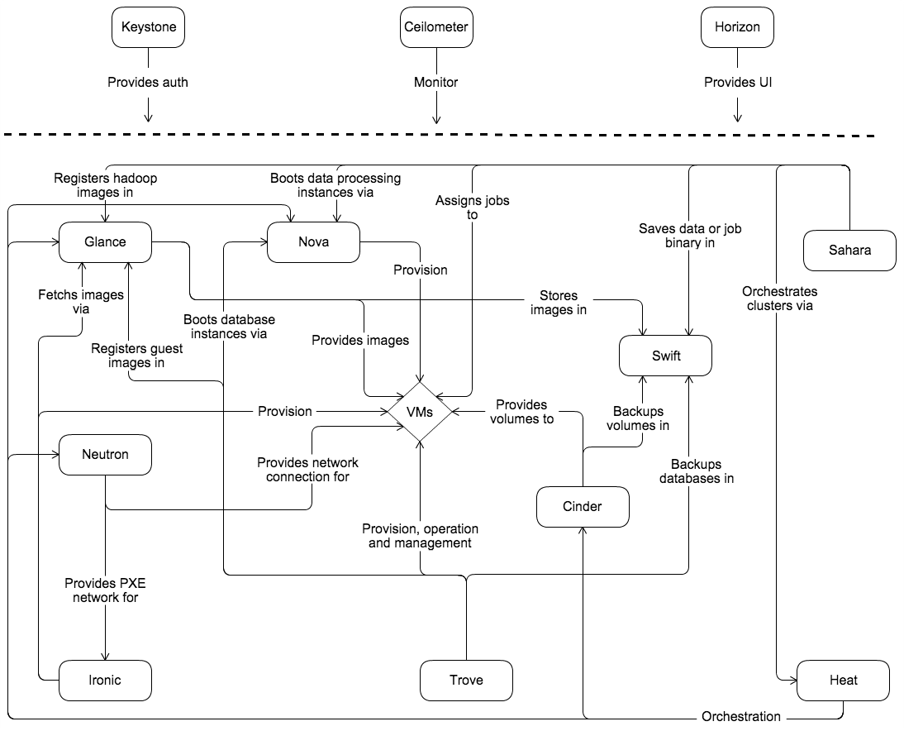
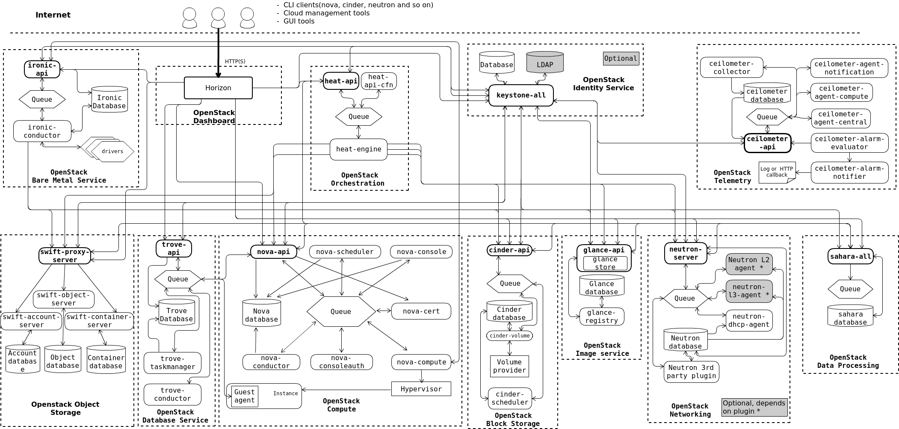
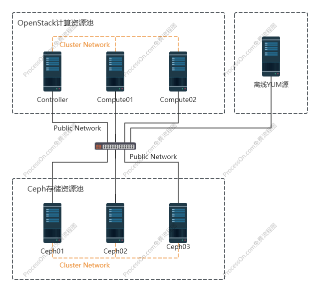

# OpenStack

OpenStack，一个开源的云计算管理平台，又称为云操作系统。属于IaaS（基础设施即服务）层，旨在为公有云或私有云提供可扩展的、弹性伸缩的计算、存储、网络资源，其中，计算资源通过虚拟机的方式提供，在OpenStack平台中，虚拟机又被称为实例

## 一、OpenStack架构

架构可以帮助我们站在高处看清事物的整体结果，避免过早的进入细节而迷失方向



从OpenStack架构图中基本上就能看到OpenStack中的所有重要模块（OpenStack官方称其为服务，下文统一使用服务这个术语）。OpenStack最终要对用户提供计算资源，而计算资源又是以虚拟机实例的形式提供，因此在架构图中可以看到所有的服务最终都是围绕VMs的。

1. Keystone：身份认证服务，提供用户权限管理和API访问控制；

   任何一个用户（包含租户用户或服务用户）要访问OpenStack时，都需要先通过Keystone的身份认证和授权，认证通过才能登录、授权通过才能使用资源。

2. Glance：镜像服务，提供虚拟机镜像文件的管理功能；

   虚拟机镜像文件（image）又称为虚拟机模板，管理功能则是指的image的上传、下载、搜索等功能，image实际上就是一个包含了操作系统的磁盘文件，被称为模板。

   Glance服务本身并不提供镜像文件的存储，因此Glance服务需要对接存储资源，例如Ceph、GlusterFS、本地目录等，从架构图中可以看到Glance服务有一个箭头指向Swift服务，Swift服务用于提供分布式对象存储。

3. Nova：计算服务，管理实例的生命周期；

   管理实例的生命周期则意味着虚拟机的创建、调度、迁移等操作都是由Nova服务完成的，从架构图中可以看到Nova有一个箭头直接指向了VMs。

   显而易见的，如果Nova服务需要完成对实例的生命周期的管理，那么它就必须对接虚拟化技术。Nova服务提供如CPU、内存资源等计算资源，因此它也被称为计算节点，而实际上这些计算资源都是由Nova所对接的虚拟化技术提供的。OpenStack是一个异构的平台，它可以通过不同的插件（或称为驱动）可以接入不同的虚拟化技术，例如KVM、VMware、FusionCompute等虚拟化技术。

   虚拟化技术的接入都由Nova服务实现，Nova可以通过不同虚拟化技术厂家提供的插件来接入不同的虚拟化技术，Nova本身可以接入的虚拟化技术有很多种，KVM是Nova接入的最多的虚拟化技术。当然，各个云厂商也有自己的云OS，例如华为自己的云OS架构下的Nova就有一个专门的驱动用于接入自己的FusionCompute虚拟化技术

   至此，Nova服务的功能分2大块，**对下需要通过不同的插件接入各种虚拟化技术、对上需要提供实例的生命周期管理**。

4. Cinder：块存储服务，为虚拟机提供持久化存储卷（volume），对于实例而言，volume就类似虚拟硬盘；

   与Glance服务类似，Cinder服务实现的是对持久化块存储资源的管理，也就是说Cinder服务本身并不提供存储资源，他需要与实际的存储设备或服务对接，然后将后端存储空间调度给实例，提供持久化块存储。

   与Nova服务类似，Cinder服务也需要通过不同的插件或驱动对接不同类型的后端存储，例如，通过Cinder对接Ceph、LVM、FC SAN、FusionStorage。相对而言对接FusionStrorage比较困难，需要拿到FusionStrorage的驱动

5. Neutron：网络服务，负责虚拟网络的构建与管理，支持子网划分、负载均衡和防火墙策略；

6. Horizon：Web 控制台，提供可视化界面管理云资源；

7. Ironic：裸金属服务器全生命周期管理服务，提供裸机即服务（BMaaS）；

   通过自动化技术和标准API实现物理机的电源控制、操作系统部署、硬件配置等操作，将物理机资源纳入云平台统一管理，使其成为云资源池的一部分

   Ironic服务依赖几个核心技术：IPMI/BMC、PXE、DHCP/TFTP。通过IPMI/BMC实现服务器远程电源控制和KVM访问、通过PXE实现网络引导部署系统、通过DHCP/TFTP分配临时IP并传输引导文件。通过Ironic服务可以实现直接向裸金属服务器安装系统，并将物理服务器视作OpenStack的一个实例进行管理

   OpenStack的自动化安装工具TripleO在实现上云部署的过程中，就利用到了Ironci的裸金属的功能，当然，TripleO不仅仅使用到了Ironic提供的裸金属功能，还用到了Heat的提供的编排功能

8. Heat：基础设施编排服务，通过模板化方式实现云资源的自动化部署、配置和管理；

9. Swift：分布式对象存储服务；

   分布式对象存储服务适用于大规模非结构化数据的存储场景，例如虚拟机镜像、图片、视频、日志等。与Cinder服务不同的是，Swift本身就是存储服务，从架构图中可以看到Glance、Cinder服务都有箭头直接指向Swift服务，Glance服务可以通过Swift服务存储镜像、Cinder服务可以通过Swift服务提供持久化存储

在整个OpenStack架构中，真正必不可少的核心服务只有前5个，Horizon服务提供友好的Web控制台页面，但通过命令行同样可以实现OpenStack的管理

## 二、OpenStack逻辑结构

现在，OpenStack的核心服务明确了，接下来将视角放低，看看核心服务的内部组成结构。实际上OpenStack有一个更加复杂的逻辑结构，当你需要去了解和设计OpenStack系统架构时，就必须清楚OpenStack的逻辑结构。



在逻辑结构中可以看到每个服务又由若干组件构成，以Glance服务为例，Glance服务中就包含`glance-api`、`galnce-registry`、`glance-database`三个组件。作为初学者而言，在OpenStack的逻辑结构中只需要关注两点

1. 消息队列

   OpenStack由多个服务组合而成，而每个服务内部又包含了多个组件，几乎所有的服务内的各个组件之间都需要通过消息队列进行通信。例如Nova服务，在OpenStack逻辑结构中，Nova服务内部包含`nova-scheduler`、`nova-console`、`nova-cert`等组件，但这些组件之间大多并不直接通信，而是通过消息队列`Queue`实现通信

   消息队列的优势在于解耦和分布式，例如将一个服务的多个组件部署在不同的节点上，通常情况下各个服务的API组件会部署在Controller节点上

2. API

   除了Neutron服务以外，OpenStack的每个服务都有自己的API组件，Neutron服务同样需要一个API组件，只不过Neuturn的API组件被集成到了`neutron-server`组件中。服务内部的多个组件之间需要通过消息队列通信，而不同的服务之间则需要通过各个服务的API组件进行通信

   服务的API组件会对外监听，API接口收到请求后会对请求的资源做解析，解析请求参数正常后API组件会将请求消息写入`Queue`，这个服务内的其他组件如果和请求的资源相关联，那么该组件自然会从`Queue`中订阅、消费消息，从而做下一步处理，最终的处理结果仍由API接口返回

OpenStack本身就是一个分布式系统，不但各个服务可以分布部署，服务中的组件也可以分布部署。这种分布式特性让OpenStack具备极大的灵活性、伸缩性和高可用性。当然从另一个角度讲，这也使得OpenStack比一般系统复杂，学习难度也更大。

## 三、OpenStack部署

一个OpenStack平台的部署，首要的事情就是集群规划

### 3.1 实验环境说明

- OpenStack版本：Train
- Ceph版本：14.2.22（Nautilus）
- 虚拟机操作系统：Rocky linux 10

### 3.2 实验规划

#### 3.2.1 组网规划



OpenStack节点与Ceph节点之间使用Cluster Network通信，Public Network作为Compute节点的外网和管理网络，VXLAN网络没有体现在组网规划中

#### 3.2.2 VMware虚拟机规划

<table>
  <tr>
    <th>节点类型</th>
    <th>CPU</th>
    <th>磁盘</th>
    <th>内存</th>
    <th>Provider IP（公共网络）</th>
    <th>vxlan隧道IP（租户网络）</th>
    <th>集群网络</th>
  </tr>
  <tr>
    <td>虚拟机模板</td>
    <td>4</td>
    <td>sda/300G</td>
    <td>8G</td>
    <td>192.168.0.237/24</td>
    <td></td>
    <td></td>
  </tr>
  <tr>
    <td>本地YUM源仓库</td>
    <td>2</td>
    <td>sda/300G</td>
    <td>4G</td>
    <td>192.168.0.236/24</td>
    <td></td>
    <td>192.168.1.236/24</td>
  </tr>
  <tr>
    <td>Controller</td>
    <td>8</td>
    <td>sda/300G</td>
    <td>8G</td>
    <td>192.168.0.235/24</td>
    <td>172.16.0.235/24</td>
    <td>192.168.1.235/24</td>
  </tr>
  <tr>
    <td>Compute01</td>
    <td>8</td>
    <td>sda/300G、sdb/50G</td>
    <td>8G</td>
    <td>192.168.0.234/24</td>
    <td>172.16.0.234/24</td>
    <td>192.168.1.234/24</td>
  </tr>
  <tr>
    <td>Compute02</td>
    <td>8</td>
    <td>sda/300G、sdb/50G</td>
    <td>8G</td>
    <td>192.168.0.233/24</td>
    <td>172.16.0.233/24</td>
    <td>192.168.1.233/24</td>
  </tr>
  <tr>
    <td>Ceph01</td>
    <td>4</td>
    <td>sda/300G、sdb/100G、sdc/100G、sdd/100G</td>
    <td>8G</td>
    <td>192.168.0.232/24</td>
    <td></td>
    <td>192.168.1.232/24</td>
  </tr>
  <tr>
    <td>Ceph02</td>
    <td>4</td>
    <td>sda/300G、sdb/100G、sdc/100G、sdd/100G</td>
    <td>8G</td>
    <td>192.168.0.231/24</td>
    <td></td>
    <td>192.168.1.231/24</td>
  </tr>
  <tr>
    <td>Ceph03</td>
    <td>4</td>
    <td>sda/300G、sdb/100G、sdc/100G、sdd/100G</td>
    <td>8G</td>
    <td>192.168.0.230/24</td>
    <td></td>
    <td>192.168.1.230/24</td>
  </tr>
</table>


在宿主机配置不够的情况下，Compute节点与Ceph节点的内存配置可以适当降低，并在VMware虚拟机上启用与内存容量一致的Swap分区，避免VMware虚拟机OOM。生产环境下只建议在Compute节点上分配Swap，且不宜过大，避免影响实例性能。某些场景下不建议分配Swap分区，使用到Swap分区时会影响到应用程序的性能，且由Swap分区引起的性能问题比较难通过应用程序的日志排查出来

虚拟机模板在完成系统安装以及相关参数设置以后就可以关闭，此虚拟机仅作模板克隆用，使用模板的目的是保证所有主机软件包及参数一致。生产环境一般使用cobbler或kickstart无人值守来完成系统安装及参数设置

#### 3.2.3 节点职责

**Controller**

控制器节点运行 Identity service（身份服务）、Image service（镜像服务）、Placement service（放置服务）、Compute的管理服务、Neutron的管理服务、Horizon服务。它还包括其他支撑服务，如SQL数据库、消息队列和NTP。Compute的管理服务、Neutron的管理服务，基本上都是API组件，OpenStack每个服务内部的组件通信需要用到消息队列

**Compute**

计算节点运行操作实例的虚拟机管理程序部分。默认情况下，Compute使用KVM虚拟机管理程序。计算节点还运行网络服务代理，该代理将实例连接到虚拟网络，并通过安全组为实例提供防火墙服务。

**Block Storage**

可选的块存储节点包含块存储和共享文件系统服务为实例调配的磁盘。为简单起见，计算节点和该节点之间的服务流量使用管理网络。生产环境应该实施单独的存储网络，以提高性能和安全性。可以部署多个数据块存储节点。

#### 3.2.4 网络类型

- Provider networks

  Provider networks，以最简单的方式部署OpenStack网络服务，主要采用第2层（桥接/交换）服务和VLAN网络分段。本质上，它将虚拟网络连接到物理网络，并依赖物理网络基础设施提供第3层（路由）服务。此外，DHCP服务向实例提供IP地址信息。OpenStack用户需要更多关于底层网络基础设施的信息，以创建与基础设施完全匹配的虚拟网络。

- Self-service networks

  Self-service networks，通过第3层（路由）服务增强了提供商网络选项，支持使用覆盖分段方法（如VXLAN）的自助服务网络。本质上，它使用NAT将虚拟网络路由到物理网络。此外，该选项为LBaaS和FWaaS等高级服务提供了基础。OpenStack用户可以在不了解数据网络底层基础设施的情况下创建虚拟网络。如果相应地配置了第2层插件，这也可以包括VLAN网络。

### 3.3 基本环境准备

#### 3.3.1 虚拟机模板准备

1. 根据主机规划创建虚拟机，并安装操作系统

2. 设置主机名及hosts

   ```bash
   [root@localhost ~]# hostnamectl set-hostname template.example.com
   [root@template ~]# yum install -y bash-completion vim
   [root@template ~]# vim /etc/hosts
   # openstack-cluster
   192.168.1.235 controller.example.com controller
   192.168.1.234 compute01.example.com compute01
   192.168.1.233 compute02.example.com compute02
   
   # ceph-cluster
   192.168.1.232 ceph01.example.com ceph01
   192.168.1.231 ceph02.example.com ceph02
   192.168.1.230 ceph03.example.com ceph03
   
   # YUM-cluster
   192.168.1.236 yum.example.com yum
   ```

3. 修改主机网络配置

   ```bash
   # CentOS 7 版本采用修改配置文件的方式配置网络
   [root@template ~]# cat > /etc/sysconfig/network-scripts/ifcfg-eth0 << EOF
   TYPE=Ethernet
   BOOTPROTO=static
   DEFROUTE=yes
   NAME=eth0
   DEVICE=eth0
   ONBOOT=yes
   IPADDR=192.168.31.238
   PREFIX=24
   GATEWAY=192.168.31.1
   DNS1=192.168.31.1
   EOF
   
   # Rocky linux 10 版本采用nmcli命令行配置网络
   [root@template ~]# nmcli con mod ens32 ipv4.method manual ipv4.addr "192.168.0.237/24" ipv4.gateway 192.168.0.254 ipv4.dns 192.168.0.254 connection.autoconnect yes
   [root@template ~]# nmcli con down ens32 && nmcli con up ens32    # 重启网卡使配置立刻生效
   ```

4. 关闭防火墙和SELinux

   ```bash
   [root@template ~]# systemctl disable --now firewalld
   [root@template ~]# setenforce 0
   [root@template ~]# sed -i -r '/SELINUX/s#(.*)=(.*)#\1=disabled#g' /etc/selinux/config
   ```

5. 设置文件句柄以及其他内核参数

   ```bash
   [root@template ~]# cat >> /etc/sysctl.conf << EOF
   # default 1
   net.ipv4.tcp_syncookies = 1
   # default 0
   net.ipv4.tcp_tw_reuse = 1
   # default 0
   net.ipv4.tcp_tw_recycle = 1
   # default 60
   net.ipv4.tcp_fin_timeout = 30
   # default 256
   net.ipv4.tcp_max_syn_backlog = 4096
   # default 32768   60999
   net.ipv4.ip_local_port_range = 1024 65535
   # default 128
   net.core.somaxconn = 32768
   EOF
   [root@template ~]# sysctl -p    # 使内核参数立刻生效
   [root@template ~]# cat >> /etc/security/limits.conf << EOF
   * hard nofile 655360
   * soft nofile 655360
   * hard nproc 655360
   * soft nproc 655360
   * hard core 655360
   * soft core 655360
   EOF
   [root@template ~]# sed -i 's/4096/unlimited/g' /etc/security/limits.d/20-nproc.conf
   ```

   > **调优参数解析**

   - `net.ipv4.tcp_syncookies = 1`

     这个参数的核心作用是**防御 SYN Flood 攻击**，它的工作方式很巧妙。

     正常情况下，服务器收到一个`SYN`请求，会分配一块内存来记录这个“半连接”状态，然后回复`SYN+ACK`，等待客户端的最终确认。SYN Flood攻击就是攻击者发送大量`SYN`请求，但**不回复最后的`ACK`**，导致服务器上堆积大量半连接，最终耗尽资源，无法响应正常用户的连接。

     开启 `tcp_syncookies` 后，当半连接队列（SYN 队列）快满时，内核会启动一个“无状态”的应对机制：

     1. 服务器**不再为这个半连接分配内存**。
     2. 它会根据这个`SYN`包的信息（如源/目的 IP、端口等）通过加密哈希算法，计算出一个特殊的`Sequence Number`（即 Cookie），并把它放在`SYN+ACK`包中发回去。
     3. 如果客户端是正常的，它会将这个Cookie加1后通过`ACK`包发回。
     4. 服务器收到`ACK`后，验证Cookie的合法性，如果正确，就直接建立连接，**完全绕过了那个已经满了的 SYN 队列**。

     这样，即使 SYN 队列满了，服务器也能继续响应合法的连接请求，保证服务不被攻击中断。参数值`1`表示**仅在检测到潜在攻击时才启用此机制**，这也是默认的设置。

   - `net.ipv4.tcp_tw_reuse = 1`

     允许将处于`TIME_WAIT`状态的socket重新用于新的TCP连接（仅对出站连接有效）。OpenStack各服务之间（如Nova调用Neutron、Keystone等）以及服务与数据库、RabbitMQ之间会频繁建立短连接，产生大量`TIME_WAIT`，占用本地端口。开启复用可以加快端口回收，避免端口耗尽。

   - `net.ipv4.tcp_tw_recycle = 1`

     

6. 设置CPU嵌套虚拟化，使CPU中再支持虚拟化

   ```bash
   [root@template ~]# cat /sys/module/kvm_intel/parameters/nested
   N    # N表示CPU未开启虚拟化。VMware Workstation是虚拟机创建时没有勾选intel VT-x/EPT或AMD-V/RVI
   
   
   [root@template ~]# cat > /etc/modprobe.d/kvm-nested.conf << EOF
   options kvm_intel nested=1 ept=0 unrestricted_guest=0
   EOF
   [root@template ~]# rmmod kvm_intel    # 卸载kvm模块，需要所有虚拟机处于停止状态
   [root@template ~]# modprobe kvm-intel ept=0 unrestricted_guest=0
   [root@template ~]# cat /sys/module/kvm_intel/parameters/nested
   Y
   ```

   `ept=0`用于关闭Intel EPT硬件辅助虚拟化，可有效解决CPU型号过旧，导致创建云主机故障的问题

完成template主机的系统初始化参数设置后，将template主机关系，并根据template主机克隆第一台虚拟机作为离线YUM源服务端，template模板虚拟机使用离线YUM源更新系统，再克隆出其他虚拟机。

## 二、离线YUM服务端准备

从template主机克隆YUM主机，所有的虚拟机都是由虚拟机模板克隆而来，所以拿到YUM主机时，首先应该按照节点规划修改对应主机的IP、主机名，并检查防火墙、SELinux、网络连通性等初始化设置是否正常

### 2.1 YUM软件包管理

YUM使用最常见的C/S结构，YUM软件包仓库实际上就是指的Server端，Server端由两部分组成，除了包含众多的软件包，还包含仓库数据文件，仓库数据文件用于记录众多软件包的状态信息，类似于菜单的作用

YUM的搭建一般分为两种模式：本地YUM仓库和远端YUM仓库，本地YUM仓库将Server端和Client端集中存放在本机机器上，因此无需网络连接；远端YUM仓库则需要通过FTP协议或HTTP协议将软件包从Server端下载到本地进行安装，在使用YUM安装软件包时，默认情况下会跟用户再次确认是否安装软件，此时用户可以选择确认安装、拒绝安装或仅下载软件包到本地但不安装

建立YUM源服务，常见的方式有2种：一种是将本地iso镜像挂载到系统，直接下发iso镜像中的软件包，由于ISO镜像中仓库数据文件是自带的，存放在`/repodata/`路径下，因此本地iso镜像的方式建立YUM源服务比较简单；另一种是将外网YUM源的包同步到本地后再下发。`reposync`工具就用于将外网yum源的包同步到本地，`reposync`工具被包含在`yum-utils`包中，所以要使用`reposync`命令时需要安装`yum-utils`包；通过`reposync`同步外网软件包后，还需要通过`createrepo`命令生成本地的软件仓库源，即为存放于本地的众多RPM软件包提供索引，自动化分析各软件包之间所需依赖关系，并生成元数据

通过`yum repolist`命令可以查看系统中配置了哪些网络yum，并查看其对应的`repo id`，`reposync`命令也可以通过`--repoid=[repo id]`选项，只同步指定的源到指定目录

### 2.2 YUM主机配置

1. 从template模板完整克隆一台yum主机，并为yum主机添加一个网卡用于Cluster Network

2. 修改主机名与IP

   ```bash
   # 修改主机名
   [root@template ~]# hostnamectl set-hostname yum.example.com
   
   # 修改Public Network网卡
   [root@yum ~]# nmcli con mod eth0 ipv4.method manual ipv4.addresses 192.168.31.239/24 ipv4.gateway 192.168.31.1 ipv4.dns 192.168.31.1 autoconnect yes
   [root@yum ~]# nmcli con down eth0 && nmcli con up eth0
   
   # 修改Cluster Network网卡
   [root@yum ~]# nmcli con add type ethernet ifname eth1 con-name eth1 ipv4.method manual ipv4.addresses 192.168.0.239/24 autoconnect yes
   [root@yum ~]# nmcli con down eth1 && nmcli con up eth1
   ```

3. 从下载YUM配置文件

   ```bash
   # 删除CentOS 7自带的repo文件，并从阿里云下载repo配置文件
   [root@yum ~]# \rm /etc/yum.repos.d/*
   [root@yum ~]# curl -o /etc/yum.repos.d/CentOS-Base.repo https://mirrors.aliyun.com/repo/Centos-7.repo
   [root@yum ~]# yum install epel-release
   
   # 安装OpenStack Train版的包，此步骤会自动生成Train版本的yum配置文件
   [root@yum ~]# yum install -y centos-release-openstack-train
   
   # 安装zabbix的yum源
   [root@yum ~]# rpm -Uvh https://repo.zabbix.com/zabbix/4.0/rhel/7/x86_64/zabbix-release-4.0-2.el7.noarch.rpm
   
   # 安装OpenResty的yum源
   [root@yum ~]# curl -o /etc/yum.repos.d/openresty.repo https://openresty.org/package/centos/openresty.repo
   
   # 安装docker的yum源
   [root@yum ~]# curl -o /etc/yum.repos.d/docker-ce.repo https://mirrors.aliyun.com/docker-ce/linux/centos/docker-ce.repo
   ```

   > **关于repo配置文件的其他下载链接补充**

   ```bash
   # docker-ce 包
   yum-config-manager --add-repo https://download.docker.com/linux/centos/docker-ce.repo
   reposync -n --repoid=docker-ce-stable -p /var/www/html/yumrepos/
   createrepo /var/www/html/yumrepos/docker-ce-stable/
   ```

4. 修改yum配置文件

   CentOS7于2024年停止官方维护，原镜像站点（如`mirrorlist.centos.org`）域名解析失效或网络不可达，`centos-release-openstack-train`包默认使用官方镜像列表（`mirrorlist`），但相关域名已无法访问，因此检查YUM仓库是否可用时可能会出现故障，因此需要将`centos-release-openstack-train`包的镜像列表替换为国内镜像源。国内主流云厂商仍维护CentOS7的镜像仓库，更新更及时且访问稳定，例如阿里云、腾讯云

   ```bash
   [root@yum ~]# sed -i -e 's/mirrorlist/#mirrorlist/g' -e 's|#baseurl=http://mirror.centos.org|baseurl=http://mirrors.aliyun.com|g' /etc/yum.repos.d/CentOS-OpenStack-train.repo
   [root@yum ~]# sed -i -e 's/mirrorlist/#mirrorlist/g' -e 's|#baseurl=http://mirror.centos.org|baseurl=http://mirrors.aliyun.com|g' /etc/yum.repos.d/CentOS-QEMU-EV.repo 
   [root@yum ~]# sed -i -e 's/mirrorlist/#mirrorlist/g' -e 's|#baseurl=http://mirror.centos.org|baseurl=http://mirrors.aliyun.com|g' /etc/yum.repos.d/CentOS-Storage-common.repo
   [root@yum ~]# sed -i -e 's/mirrorlist/#mirrorlist/g' -e 's|#baseurl=http://mirror.centos.org|baseurl=http://mirrors.aliyun.com|g' /etc/yum.repos.d/CentOS-Ceph-Nautilus.repo
   [root@yum ~]# sed -i -e 's/mirrorlist/#mirrorlist/g' -e 's|#baseurl=https://mirror.centos.org|baseurl=http://mirrors
   .aliyun.com|g' /etc/yum.repos.d/CentOS-NFS-Ganesha-28.repo
   ```

   关于ceph的repo配置文件的内容有两种写法，本实验环境中采用以下写法

   ```bash
   [root@yum ~]# vi /etc/yum.repos.d/ceph.repo
   [ceph]
   name=Ceph packages for $basearch
   baseurl=http://mirrors.aliyun.com/ceph/rpm-nautilus/el7/x86_64
   enabled=1
   gpgcheck=0
   
   [ceph-noarch]
   name=Ceph noarch packages
   baseurl=http://mirrors.aliyun.com/ceph/rpm-nautilus/el7/noarch
   enabled=1
   gpgcheck=0
   
   [ceph-source]
   name=Ceph source packages
   baseurl=http://mirrors.aliyun.com/ceph/rpm-nautilus/el7/SRPMS
   enabled=1
   gpgcheck=0
   ```

5. 安装yum的配置工具

   ```bash
   [root@yum ~]# yum install -y createrepo yum-utils httpd reposync
   [root@yum ~]# systemctl enable --now httpd
   ```

6. 创建YUM Server端本地目录

   ```bash
   [root@yum ~]# mkdir /var/www/html/yumrepos/
   ```

7. 同步网络YUM仓库的软件包到本地

   ```bash
   [root@yum ~]# reposync -p /var/www/html/yumrepos/    # 缺省情况下同步所有远程YUM仓库的软件包到本地
   	-p：指定下载路径
   	-n：仅下载最新版本的包，跳过旧版
   	-q：静默模式，减少输出
   	-r (--repoid)：指定仓库ID，可多次使用
   	--delete：删除远程仓库中已经不存在的本地软件包
   	-c：指定配置文件运行（默认配置文件是 /etc/yum.conf ）
   # 语法示例
   # yum repolist    # 查看各个YUM仓库的repoid
   # reposync -n --repoid base --repoid updates -p /var/www/html/yumrepos/
   # reposync -n --repoid ceph --repoid ceph-noarch -p /var/www/html/yumrepos/
   # reposync -n --repoid centos-openstack-train -p /var/www/html/yumrepos/
   # reposync -n --repoid centos-qemu-ev -p /var/www/html/yumrepos/
   # reposync -n --repoid zabbix -p /var/www/html/yumrepos/
   ```

8. 创建仓库数据文件

   ```bash
   [root@yum ~]# for i in /var/www/html/yumrepos/*; do cd $i && createrepo .; done
   ```

9. 定期更新YUM仓库

   ```bash
   [root@yum ~]# reposync -n --repoid=base -p /var/www/html/yumrepos/
   [root@yum ~]# cd /var/www/html/yumrepos/base/
   [root@yum ~]# createrepo --update
   ```

10. 准备内网repo文件模板

    ```bash
    [root@yum ~]# vim /var/www/html/private.repo
    [base]
    name=CentOS-$releasever - Base
    baseurl=http://yum/yumrepos/base/
    gpgcheck=0
    enabled=1
    
    [epel]
    name=CentOS-$releasever - epel
    baseurl=http://yum/yumrepos/epel/
    gpgcheck=0
    enabled=1
    
    [docker-ce-stable]
    name=CentOS-$releasever - docker-ce-stable
    baseurl=http://yum/yumrepos/docker-ce-stable/
    gpgcheck=0
    enabled=1
    
    [updates]
    name=CentOS-$releasever - Updates
    baseurl=http://yum/yumrepos/updates/
    gpgcheck=0
    enabled=1
    
    [extras]
    name=CentOS-$releasever - Extras
    baseurl=http://yum/yumrepos/extras/
    gpgcheck=0
    enabled=1
    
    [centos-openstack-train]
    name=CentOS-7 - OpenStack train
    baseurl=http://yum/yumrepos/centos-openstack-train/
    gpgcheck=0
    enabled=1
    
    [centos-qemu-ev]
    name=CentOS-$releasever - QEMU EV
    baseurl=http://yum/yumrepos/centos-qemu-ev/
    gpgcheck=0
    enabled=1
    
    [ceph]
    name=ceph-Nautilus
    baseurl=http://yum/yumrepos/ceph/
    gpgcheck=0
    enabled=1
    
    [ceph-noarch]
    name=ceph-noarch Nautilus
    baseurl=http://yum/yumrepos/ceph-noarch/
    gpgcheck=0
    enabled=1
    
    [centos-nfs-ganesha28]
    name=CentOS-7 - NFS Ganesha 2.8
    baseurl=http://yum/yumrepos/centos-nfs-ganesha28/
    gpgcheck=0
    enabled=1
    
    [openresty]
    name=Official OpenResty Open Source Repository for CentOS
    baseurl=http://yum/yumrepos/openresty/
    skip_if_unavailable=False
    gpgcheck=0
    repo_gpgcheck=0
    gpgkey=file:///etc/yum.repos.d/pubkey.gpg
    enabled=1
    enabled_metadata=1
    ```

### 2.3 template系统更新

```bash
[root@template ~]# \rm /etc/yum.repos.d/*
[root@template ~]# curl -o /etc/yum.repos.d/private.repo http://yum/private.repo
[root@template ~]# yum update -y
[root@template ~]# yum install -y python-openstackclient
[root@template ~]# init 0
```

template虚拟机系统更新过程中可能会产生如下错误提示，通过`yum erase PyQt4-4.10.1-13.el7.x86_64 sip-4.14.6-4.el7.x86_64`卸载两个旧版本的软件包再执行系统更新即可

```bash
Error: Package: PyQt4-devel-4.12-1.el7.x86_64 (centos-openstack-train)
           Requires: PyQt4(x86-64) = 4.12-1.el7
           Installed: PyQt4-4.10.1-13.el7.x86_64 (@anaconda)
               PyQt4(x86-64) = 4.10.1-13.el7
Error: Package: sip-devel-4.19-1.el7.x86_64 (centos-openstack-train)
           Requires: sip(x86-64) = 4.19-1.el7
           Installed: sip-4.14.6-4.el7.x86_64 (@anaconda)
               sip(x86-64) = 4.14.6-4.el7
 You could try using --skip-broken to work around the problem
 You could try running: rpm -Va --nofiles --nodigest
```

## 三、OpenStack节点基本配置

按照VMware虚拟机规划，基于更新后的template虚拟机进行克隆，需要克隆包括controller、compute01、compute02、ceph01、ceph02、ceph03在内的6台VMware虚拟机，其中controller节点需要添加2个网卡、compute节点需要添加2个网卡和一个硬盘、ceph节点需要添加1块网卡和3块硬盘

### 3.1 克隆虚拟机

以控制节点为例，计算节点、ceph节点添加网卡、硬盘是同样的操作

1. [选中虚拟机] -> [编辑虚拟机设置] -> [添加] - [网络适配器] -> [完成]；为controller节点添加vNIC

   


2. [选中虚拟机] -> [编辑虚拟机设置] -> [选中网络适配器] -> [LAN区段] -> [添加]；添加两个LAN区段，用于自定义Cluster Network和vxlan网络，通过特定虚拟网络VMnet也可以实现同样的效果，VMware支持添加20个VMnet网络

   

   

### 3.2 节点初始化

#### 3.2.1 主机名与IP配置

准备好所有的VMware虚拟机后，此处先跳过ceph集群节点的配置

##### 3.2.1.1 Controller

```bash
# 配置主机名
[root@template ~]# hostnamectl set-hostname controller.example.com

# 修改Public Network和Cluster Network的网卡配置
[root@controller ~]# nmcli con mod eth0 ipv4.method manual ipv4.addresses 192.168.31.40/24 ipv4.gateway 192.168.31.1 ipv4.dns 192.168.31.1 autoconnect yes
[root@controller ~]# nmcli con down eth0 && nmcli con up eth0
[root@controller ~]# nmcli con mod eth1 ipv4.method manual ipv4.addresses 192.168.0.40/24 autoconnect yes
[root@controller ~]# nmcli con down eth1 && nmcli con up eth1

# 新增vxlan的网卡配置
[root@controller ~]# nmcli con delete "Wired connection 1"    # 删除自动生成的nmcli链接
[root@controller ~]# nmcli con add type ethernet ifname eth2 con-name eth2 ipv4.method manual ipv4.addresses 172.16.31.40/24 autoconnect yes
[root@controller ~]# nmcli con down eth2 && nmcli con up eth2
```

##### 3.2.1.2 Compute01

```bash
[root@template ~]# hostnamectl set-hostname compute01.example.com

[root@compute01 ~]# nmcli con mod eth0 ipv4.method amnual ipv4.addresses 192.168.31.41/24 ipv4.gateway 192.168.31.1 ipv4.dns 192.168.31.1 autoconnect yes
[root@compute01 ~]# nmcli con down eth0 && nmcli con up eth0
[root@compute01 ~]# nmcli con mod eth1 ipv4.method manual ipv4.addresses 192.168.0.41/24 autoconnect yes
[root@compute01 ~]# nmcli con down eth1 && nmcli con up eth1

[root@compute01 ~]# nmcli con delete "Wired connection 1"
[root@compute01 ~]# nmcli con add type ethernet ifname eth2 con-name eth2 ipv4.method manual ipv4.addresses 172.16.31.41/24 autoconnect yes
[root@compute01 ~]# nmcli con down eth2 && nmcli con up eth2
```

##### 3.2.1.3 Compute02

```bash
[root@template ~]# hostnamectl set-hostname compute02.example.com

[root@compute02 ~]# nmcli con mod eth0 ipv4.method amnual ipv4.addresses 192.168.31.42/24 ipv4.gateway 192.168.31.1 ipv4.dns 192.168.31.1 autoconnect yes
[root@compute02 ~]# nmcli con down eth0 && nmcli con up eth0
[root@compute02 ~]# nmcli con mod eth1 ipv4.method manual ipv4.addresses 192.168.0.42/24 autoconnect yes
[root@compute02 ~]# nmcli con down eth1 && nmcli con up eth1

[root@compute02 ~]# nmcli con delete "Wired connection 1"
[root@compute02 ~]# nmcli con add type ethernet ifname eth2 con-name eth2 ipv4.method manual ipv4.addresses 172.16.31.42/24 autoconnect yes
[root@compute02 ~]# nmcli con down eth2 && nmcli con up eth2
```

#### 3.2.2 基础服务组件

OpenStack的基本服务组件包含NTP、MariaDB、RabbitMQ、Memcache、etcd，所有基础服务组件的服务端都部署在controller节点上

##### 3.2.2.1 NTP

Network Time Protocol（NTP）协议用于计算机之间的时间同步、校正服务。在CentOS 7上，安装NTP服务可以通过NTP或Chrony两种软件实现，Chrony是CentOS 7默认的时间同步软件。Chrony有两个核心组件：chronyd、chronyc，chronyd是守护进程，主要用于调整内核中运行的系统时间和时间服务器同步，它确定计算机增减时间的比率，并对此进行调整补偿。chronyc提供一个用户界面，用于监控性能

Chrony监听`323/udp、123/udp`端口，使用Chronyd服务平滑同步时间的方式要优于crontab + ntpdate，因为ntpdate同步时间会造成时间的跳跃，对一些依赖时间的程序和服务会造成影响，而Chronyd服务可以在修正时间的过程中同时修正CPU tick

- **先决条件**

  在配置NTP服务之前，需要先确认所有节点的时区是否统一，本实验环境中在安装操作系统时，template模板选择的时区是`Asia/Shanghai`。如果需要同步时区，通过`timedatectl set-timezone Asia/Shanghai`命令可以同步时区，如果时区已经同步，可跳过此步骤

1. 安装chrony服务

   ```bash
   [root@controller ~]# yum install -y chrony
   ```

   在CentOS 7系统上，chrony软件包默认已安装

2. 修改chrony配置

   ```bash
   [root@controller ~]# vim /etc/chrony.conf
   server ntp1.aliyun.com iburst    # server指定从哪个时钟服务器同步时间；iburst 参数可以让 chronyd 启动时快速进行一次同步
   server controller iburst    # 如果无外网时指向本机主机名
   allow 192.168.31.0/24       # 仅允许此网段的主机访问本时间服务器
   allow 192.168.0.0/24
   allow 172.16.31.0/24
   local stratum 10            # 即使server指令中时间服务器不可用，也允许讲本地时间做为标准时间授时给其它客户端
   ```

3. 启用NTP服务

   ```bash
   [root@controller ~]# systemctl enable --now chronyd
   [root@controller ~]# timedatectl set-ntp yes    # 启用网络时间协议（NTP）自动同步功能，默认即启用状态
   [root@controller ~]# timedatectl status
   ```

4. compute节点配置

   以compute01为示例，两个compute节点都需要向controller节点同步时间

   ```bash
   # 向controller节点同步时间
   [root@compute01 ~]# vim /etc/chrony.conf
   server controller iburst
   
   # 启用chronyd服务
   [root@compute01 ~]# systemctl enable --now chronyd
   
   # 验证时间同步
   [root@compute01 ~]# chronyc sources
   ```

##### 3.2.2.2 MariaDB

大多数OpenStack服务使用SQL数据库来存储信息，所有的云数据信息都需要保存在数据库当中，例如虚拟机实例的创建、Keystone服务上创建用户、项目等。数据库通常运行在控制器节点上。OpenStack官方指南中的过程根据发行版使用MariaDB或MySQL，OpenStack服务还支持包括PostgreSQL在内的其他SQL数据库。实验环境中数据库选择使用Mariadb。

甲骨文收购MySQL后，有将MySQL闭源的潜在风险，为了规避该风险，MariaDB经过部分修改后成为了MySQL的开源分支，因此MariaDB与MySQL非常兼容

1. 安装MariaDB

   ```bash
   [root@controller ~]# yum install -y mariadb mariadb-server python2-PyMySQL
   ```

   python2-PyMySQL这个软件包是必须安装的，整个openstack平台基于python开发，这个包的作用是提供了python连接数据库的模块。在CentOS7及更低版本的系统使用python2-PyMySQL，CentOS8及更高版本的系统使用python3-PyMySQL

2. 配置数据库

   ```bash
   # 新增数据库配置文件
   [root@controller ~]# vim /etc/my.cnf.d/openstack.cnf
   [mysqld]
   bind-address = 0.0.0.0     # 监听所有网卡，此选项也可以仅监听某一个IP
   default-storage-engine = innodb
   innodb_file_per_table = on
   max_connections = 8192     # 使此配置选项生效需要修改服务配置文件
   collation-server = utf8_general_ci
   character-set-server = utf8
   
   # 修改MariaDB服务配置文件，在Service模块下添加参数
   [root@controller ~]# vim /usr/lib/systemd/system/mariadb.service
   [Service]            # 若以下两个选项不修改，则max_connections选项的修改不会生效
   LimitNOFILE=65535    # 设置MariaDB服务能够打开的最大文件描述符数量（即最大打开文件数）
   LimitNPROC=65535     # 限制MariaDB服务及其子进程的最大用户进程数
   ```

3. 启用MariaDB服务

   ```bash
   [root@controller ~]# systemctl daemon-reload
   [root@controller ~]# systemctl enable --now mariadb
   ```

4. 数据库初始化

   ```bash
   [root@controller ~]# mysql_secure_installation
   Enter current password for root (enter for none):		# 输入root用户密码，回车表示无密码
   Set root password? [Y/n] Y		# 设置root用户密码，root密码设置为redhat
   New password:
   Re-enter new password:
   Remove anonymous users? [Y/n] Y		# 是否删除匿名用户
   Disallow root login remotely? [Y/n] n		# 是否禁止root远程登录
   Remove test database and access to it? [Y/n] Y		# 是否移除test库
   Reload privilege tables now? [Y/n] Y		# 是否重新加载表权限
   ```


##### 3.2.2.3 RabbitMQ

OpenStack使用消息队列来协调所有服务的内部组件之间的操作和状态信息，OpenStack所有服务的内部组件之间都需要通过消息队列进行通信。消息队列服务通常在控制器节点上运行。OpenStack支持几种消息队列服务，包括RabbitMQ和Qpid。然而，打包OpenStack的大多数发行版都支持特定的消息队列服务。OpenStack官方指南实现了RabbitMQ消息队列服务，因为大多数发行版都支持它。实验环境中消息队列软件选择RabbitMQ


1. 安装RabbitMQ

   ```bash
   [root@controller ~]# yum install -y rabbitmq-server
   ```

2. 配置RabbitMQ服务

   ```bash
   [root@controller ~]# vim /usr/lib/systemd/system/rabbitmq-server.service
   [Service]
   LimitNOFILE=32768		# 修改RabbitMQ默认打开文件句柄数限制
   ```

3. 启用RabbitMQ服务

   ```bash
   [root@controller ~]# systemctl daemon-reload
   [root@controller ~]# systemctl enable --now rabbitmq-server
   ```

4. 为openstack创建RabbitMQ账户

   ```bash
   [root@controller ~]# rabbitmqctl add_user openstack openstack_rabbitmq    # 创建openstack用户并设置密码
   [root@controller ~]# rabbitmqctl set_user_tags openstack administrator    # 将用户的角色标签设置为 administrator，使其拥有RabbitMQ的最高管理权限
   [root@controller ~]# rabbitmqctl list_users    # 查看RabbitMQ的用户列表，默认创建的openstack账户没有权限
   [root@controller ~]# rabbitmqctl set_permissions openstack ".*" ".*" ".*"    # 为 RabbitMQ用户openstack赋予对所有虚拟主机（Virtual Host）和资源的完全操作权限
   ```

   RabbitMQ与MariaDB类似都具有身份认证功能，因此需要为openstack在RabbitMQ上创建一个用户，并且还需要针对openstack用户授权，否无该账户无法执行任何操作，例如消息队列的创建

5. 启用RabbitMQ的插件，开启web控制台

   ```bash
   [root@controller ~]# rabbitmq-plugins enable rabbitmq_management
   [root@controller ~]# lsof -i:15672
   
   # 控制台登录验证
   http://controller:15672    # 直接使用域名访问rabbitmq需要修改windows的hosts文件，可以直接使用controller节点的管理IP访问
   guest/guest    # 缺省账号
   openstack/openstack_rabbitmq    # openstack管理员账号
   ```

##### 3.2.2.4 Memcached

任何一个用户要访问OpenStack时，都需要先通过Keystone的身份认证和授权。OpenStack各个服务本身也需要具备一个服务用户，例如，Nova服务需要具备一个nova用户、Placement服务需要具备一个placement用户；服务用户一般是用于OpenStack各个服务之间的互相通信，例如，在通过Nova服务创建一个实例时，这其中肯定会涉及到需要通过Glance服务提供虚拟机的image、需要通过Cinder服务提供虚拟机的vDisk，这就需要服务用户实现OpenStack各个服务之间的通信，服务用户之间的通信同样需要先通过Keystone服务的身份认证

当用户通过Keystone的身份验证时，Keystone会为每个通过身份验证的用户分配一个token，用户可以拿着这个token在OpenStack其他服务上执行权限内的任意操作（例如账户密码变更、删除账户等操作），而无需在执行其他操作时反复验证身份信息。但token本身是有时效性的，因此token不适合直接保存在数据库中，此时就需要Memcached服务缓存Keystone服务为用户分配的token

OpenStack各个服务之间的身份认证机制需要使用Memcached来缓存token。Memcached服务通常运行在控制器节点上。对于生产部署，我们建议启用防火墙、身份验证和加密的组合来保护它

1. 安装Memcached

   ```bash
   [root@controller ~]# yum install -y memcached python-memcached
   ```

2. 配置Memcached服务

   ```bash
   [root@controller ~]# vim /etc/sysconfig/memcached
   PORT="11211"
   USER="memcached"
   MAXCONN="4096"     # 修改最大连接数
   CACHESIZE="256"    # 修改缓存大小
   OPTIONS="-l 0.0.0.0,::1,controller"    # 此处添加的域名或IP需要测试确认可达性
   ```

   Memcache服务默认的监听地址是`127.0.0.1`，此地址仅监听本地请求，可以将`127.0.0.1`修改为`0.0.0.0`监听controller节点的所有IP，或者在监听地址里追加controller域名，在`/etc/hosts`文件中会将controller域名解析为`192.168.0.40`。Memcached服务缺省情况下监听11211端口

3. 启用Memcached服务

   ```bash
   [root@controller ~]# systemctl enable --now memcached
   [root@controller ~]# ss -tunpl | grep 11211    # 验证服务
   ```

##### 3.2.2.5 Etcd

OpenStack服务可以使用Etcd，这是一种分布式可靠的键值存储，用于分布式键锁定、存储配置、跟踪服务实时性和其他场景。在OpenStack架构中Etcd服务并不是必选项，场景中不会用到Etcd功能时可以选择不安装Etcd。用简单一点的描述，Etcd服务是用于同步多个节点之间的配置文件的，确保各个节点的配置文件内容一致

注：本实验环境中安装的业务组件都没有使用到etcd，仅作演示

1. 安装Etcd

   ```bash
   [root@controller ~]# yum install -y etcd
   ```

2. 配置Etcd服务

   ```bash
   [root@controller ~]# vim /etc/etcd/etcd.conf
   #[Member]
   ETCD_DATA_DIR="/var/lib/etcd/default.etcd"    # Etcd的数据保存路径
   ETCD_LISTEN_PEER_URLS="http://192.168.0.40:2380"    # 监听控制节点端口
   ETCD_LISTEN_CLIENT_URLS="http://192.168.0.40:2379"
   ETCD_NAME="controller"    # Etcd集群名称
   #[Clustering]
   ETCD_INITIAL_ADVERTISE_PEER_URLS="http://192.168.0.40:2380"
   ETCD_ADVERTISE_CLIENT_URLS="http://192.168.0.40:2379"
   ETCD_INITIAL_CLUSTER="controller=http://192.168.0.40:2380"
   ETCD_INITIAL_CLUSTER_TOKEN="etcd-cluster-01"
   ETCD_INITIAL_CLUSTER_STATE="new"
   ```

3. 启用Etcd服务

   ```bash
   [root@controller ~]# systemctl enable --now etcd
   [root@controller ~]# lsof -i:2379
   ```

##### 3.2.2.6 OpenStack Service

注：以下步骤全部都已经做过了，在这里描述只是因为实验环境使用VMware虚拟机的快照功能加快了OpenStack的部署速度，在生产环境可以使用cobbler或kickstart无人值守来完成系统安装及参数设置，但仍需要注意有此步骤

1. 软件源

   安装OpenStack软件源时，需注意官方手册提醒，不同操作系统版本对应的可用的软件源不同，从U版开始就不支持CentOS 7系统了，因为CentOS 8版本开始使用的python版本发生变更。按照OpenStack官方指南，所有OpenStack的VMware虚拟机节点都需要安装`centos-release-openstack-train`软件包，这个软件包会自动安装匹配指定OpenStack版本的附加YUM源，以OpenStack Train版本为例执行如下操作

   ```bash
   [root@yum ~]# yum install -y centos-release-openstack-train
   ```

   在OpenStack官网指南中声明，如果使用RHEL 7系统，则还需要再另外安装一个rdo-release的RPM包，社区版的CentOS 7系统则无需安装此软件包，但CentOS 7操作系统本身会自带很多YUM源，在更新系统之前需要先确认自带的YUM仓库是否可用，不可用的YUM仓库会影响到其他的YUM仓库

   CentOS7于2024年停止官方维护，原镜像站点（如`mirrorlist.centos.org`）域名解析失效或网络不可达，`centos-release-openstack-train`包默认使用官方镜像列表（`mirrorlist`），但相关域名已无法访问，因此检查YUM仓库是否可用时可能会出现故障。此问题可以通过2种方式解决：

      - **解决方案一：切换至归档镜像源**

        CentOS官方将历史版本的软件包归档至`vault.centos.org`，通过如下步骤直接指向该地址。此处仅以一个YUM配置文件做示例，其他YUM配置文件的修改是类似的，除了`CentOS-NFS-Ganesha-28.repo`配置文件需要单独做一下修改。

        ```bash
        [root@controller ~]# sed -i \
        > -e 's/mirrorlist/#mirrorlist/g' \
        > -e 's|#baseurl=http://mirror.centos.org|baseurl=http://vault.centos.org|g' \
        > /etc/yum.repos.d/CentOS-OpenStack-train.repo
        [root@controller ~]# yum clean all    # 清理YUM缓存数据
        [root@controller ~]# yum repolist
        [root@controller ~]# yum -y upgrade
        [root@controller ~]# reboot
        ```

      - **解决方案二：使用第三方镜像源**

        将`centos-release-openstack-train`包的镜像列表替换为国内镜像源。国内主流云厂商仍维护CentOS7的镜像仓库，更新更及时且访问稳定，例如阿里云、腾讯云。两种解决方案的操作是类似的，更建议使用国内的第三方YUM源

        ```bash
        [root@controller ~]# sed -i \
        > -e 's/mirrorlist/#mirrorlist/g' \
        > -e 's|#baseurl=http://mirror.centos.org|baseurl=http://mirrors.aliyun.com|g' \
        > /etc/yum.repos.d/CentOS-OpenStack-train.repo
        [root@controller ~]# yum clean all    # 清理YUM缓存数据
        [root@controller ~]# yum repolist
        [root@controller ~]# yum -y upgrade
        [root@controller ~]# reboot
        ```

        阿里云的openstack源：http://mirrors.aliyun.com/centos/7/cloud/x86_64/

   2. 在Controller节点上安装openstack客户端工具

      ```bash
      [root@controller ~]# yum install -y python-openstackclient    # openstack客户端工具仅需要在Controller节点上安装即可，openstack的其他节点也可以选择安装
      ```

   3. 在所有节点上安装openstack-selinux包

      安装此软件包号称是可以解决所有涉及到openstack服务的上下文切换都无需管理员手动干预SELinux的问题，但是实验环境中安装此包出现报错，虽然安装成功，但似乎并未达到想要的效果，仍需手动管理SELinux

      ```bash
      [root@controller ~]# yum install -y openstack-selinux
      [root@controller ~]# setenforce 0
      [root@controller ~]# sed -i -e 's/^SELINUX=enforcing/SELINUX=disabled/g' /etc/selinux/config
      ```

   